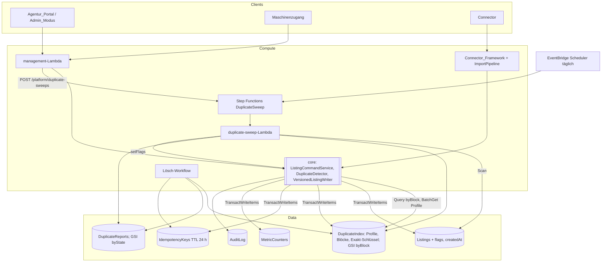
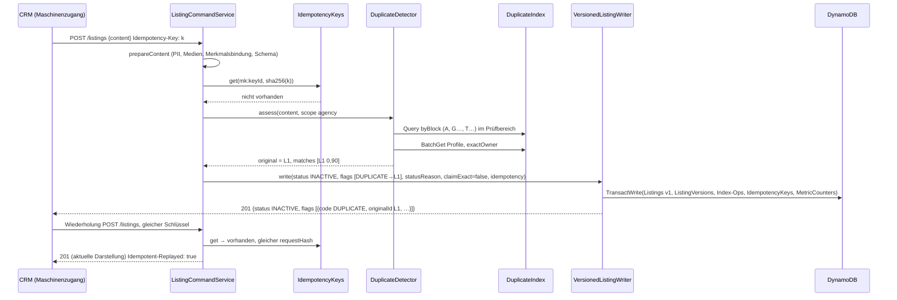
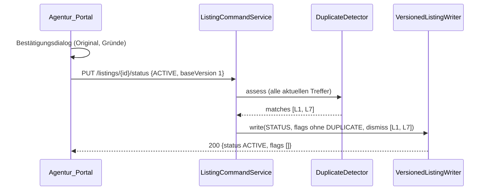
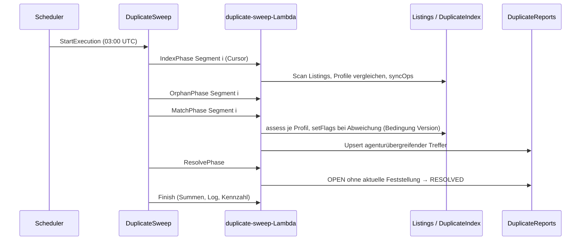

# Design Document

## Overview

Dieses Dokument beschreibt das technische Design der Duplikaterkennung als Erweiterung der Platform (Specs `real-estate-platform` und `listing-management`). Es ergänzt die bestehenden Schichten um:

1. **Objektmerkmale** — neun optionale Inhaltsfelder im bestehenden Listing-Schema (`shared`), je Immobiliengruppe über die Immobilien_Taxonomie freigegeben; nicht zulässige Merkmale verwirft `prepareContent` wie nicht erlaubte PII-Felder.
2. **Duplikat_Bewertung** — reine Funktionen in `shared/duplicates/`: Normalisierung, Merkmalsprofil, Blockschlüssel und `scoreMatch` mit Ausschlusskriterien, Ortsankern und gewichteter Summe aus der Duplikat_Konfiguration.
3. **Duplikat_Index** — eine DynamoDB-Tabelle `DuplicateIndex` (Merkmalsprofile, Blockschlüssel mit GSI `byBlock`, Exakt-Schlüssel, Verwerfungen), die der `VersionedListingWriter` im selben `TransactWriteItems` wie das Listing pflegt.
4. **Duplikat_Prüfung** — `DuplicateDetector` in `core` bestimmt Treffer und Original eines Listings; `ListingCommandService` und `ImportPipeline` rufen ihn vor jedem Schreiben auf, legen neue Duplikate mit `INACTIVE` und Duplikat_Markierung an und setzen bei Änderungen nur die Markierung.
5. **Markierungen und Freigabe** — `flags` als Verwaltungsdaten am `Listings`-Item (keine Version), Statusbegründung in Version 1, Freigabe über die bestehende Statusänderung oder ein eigenes Verwerfen mit gespeicherter Verwerfung.
6. **Idempotenzschlüssel** — Tabelle `IdempotencyKeys` (TTL 24 h), im Writer-Transaktionsschreiben mitgeschrieben.
7. **Duplikat_Abgleich** — Step-Functions-Workflow (täglich per EventBridge Scheduler): Index-Abgleich über den `Listings`-Bestand, Markierungsabgleich je Prüfbereich, agenturübergreifende Treffer in `DuplicateReports` nur für Plattform_Admins.
8. **Portal, Admin_Modus, API und Dokumentation** — Hinweise, Filter, Freigabe-Dialog, Trefferansicht, OpenAPI, Fehlercode, Berechtigung `duplicate:review`, zwei Kennzahlen.

Leitprinzipien aus den bestehenden Specs gelten weiter: **eine Schema-Quelle** (Zod in `shared`), **reine Funktionen für Entscheidungen** (Bewertung, Blockschlüssel, Markierungsentscheidung), **ein Schreibpfad** (`VersionedListingWriter`), **keine Teilzustände** (Index, Markierung, Zähler und Listing in einer Transaktion), **Existenz nicht verraten** (keine fremden Bezeichner an Agenturakteure), **YAGNI**.

### Getroffene Entscheidungen

| Thema | Entscheidung | Kurzbegründung |
| --- | --- | --- |
| Neues Duplikat bei Anlage | speichern, Listing_Status `INACTIVE`, Duplikat_Markierung; nur das Original bleibt online | Nutzerentscheidung: nichts geht verloren, ein Fehlalarm ist mit einer Freigabe behoben |
| Duplikat durch Änderung oder Import-Update | nur Markierung setzen/entfernen, Status bleibt | Ein veröffentlichtes Listing geht nicht ungefragt offline; Import darf den Status bestehender Listings ohnehin nicht ändern (Req 6.7 `listing-management`) |
| Duplikat_Abgleich | setzt nur Markierungen, ändert nie den Status | wie oben; der Abgleich läuft ohne Akteur und ohne Kontext |
| „Erstes Listing“ | Original = ältester Treffer nach Anlagezeitpunkt (neues Verwaltungsattribut `createdAt`), Gleichstand nach Bezeichner | deterministisch, unabhängig von der Reihenfolge der Prüfung; Listing ist Duplikat ⇔ es hat einen älteren Treffer |
| Prüfbereich | eigene Agentur; Listings ohne Agentur bilden einen gemeinsamen Bereich (`_none`, wie `NO_AGENCY_SCOPE_ID`) | Agentur-Isolation (Req 2.6 `listing-management`), keine Einflussnahme fremder Agenturen |
| Agenturübergreifend | nur im täglichen Abgleich, nur Meldung an Plattform_Admins, keine Wirkung auf Listings | Kosten sind unkritisch (siehe „Kostenabschätzung“); entscheidend sind Missbrauch (eine Agentur könnte fremde Listings „wegmarkieren“) und Isolation |
| Bewertungsverfahren | regelbasiert: Ausschlusskriterien, Ortsanker, gewichtete Summe, Gründe als Codes; Werte in `duplicate-detection.json` | erklärbar (Gründe im Portal), testbar als reine Funktion, ohne Trainingsdaten kalibrierbar |
| Markierungen | Liste `flags` am `Listings`-Item, höchstens eine je Code, keine Version; Statusbegründung in der Version | Markierungen sind Verwaltungsdaten wie Status-Metadaten; der Abgleich darf keine Versionsflut erzeugen; die automatische Deaktivierung bleibt in der Historie sichtbar |
| Objektmerkmale | feste, typisierte Felder im Schema; Bindung je Immobiliengruppe in `taxonomy.json` | eine Schema-Quelle für Validierung, OpenAPI, Portal und Bewertung; ein frei konfigurierbarer Merkmalskatalog hätte keine feste Semantik für die Bewertung |
| Nicht zulässiges Merkmal | verwerfen und benennen (`droppedFields`, Lauf-Protokoll), nicht abweisen | gleiches Muster wie nicht erlaubte PII-Felder; ein Crawler-Feed soll nicht wegen eines Zusatzfelds ein ganzes Listing verlieren |
| Kandidatensuche | eigener Index (`DuplicateIndex`, GSI `byBlock`) statt Suchindex | der Suchindex enthält nur `ACTIVE`-Listings, neue Listings sind standardmäßig `INACTIVE`, OpenSearch ist optional |
| Klarwerte | Straße, Hausnummer, Einheit, Flurstück, URLs als SHA-256; Titel/Beschreibung als SimHash | Req 12.1; Gleichheit genügt für diese Merkmale |
| Index nicht erreichbar | Management_API 503, Import „Duplikatprüfung nicht verfügbar“ | gleicher DynamoDB-Bestand wie das Listing; kein Schreiben ohne Prüfung |
| Seed-Daten | Import-Pipeline der Connectors (`createImportPipeline`, Quelle `seed`/`loadtest`, `REPLACE`) | Seed-Skript und Lasttest-Generator schreiben wie ein Import: Version, Feldherkunft, Zähler und Duplikat_Prüfung; ein roher Tabellen-Schreibvorgang wäre für Management_API und Abgleich unlesbar |
| Wiederholte Anlage | `Idempotency-Key` je Akteur, 24 h, im Writer-Transaktionsschreiben | häufigste Ursache echter Duplikate bei Maschinenzugängen (Retry nach 503/Timeout) |

### Zuordnung Design → Requirements

| Design-Baustein | Requirements |
| --- | --- |
| Listing-Schema-Erweiterung, Serialisierung | 1 |
| Taxonomie-Bindung, `prepareContent`-Schritt | 2 |
| Normalisierung, Merkmalsprofil, `scoreMatch`, Duplikat_Konfiguration | 3, 12.1 |
| Blockschlüssel, `DuplicateIndex`, `DuplicateDetector` | 3.4, 4, 5.1, 5.7, 5.8 |
| Writer-Erweiterung (Markierung, Index, Exakt-Schlüssel, Verwerfungen, Zähler) | 5.2, 5.4, 6.1, 7.1–7.3, 8.1–8.3, 9.1, 14.5 |
| `ListingCommandService`-Erweiterung | 5.1–5.3, 5.6, 6, 8, 9 |
| Import-Pipeline-Erweiterung | 5.1, 5.2, 5.5, 5.9, 6 |
| Idempotenzschlüssel | 9.2–9.6 |
| Duplikat_Abgleich (Step Functions) | 10, 12.4 |
| Agenturübergreifende Treffer | 4.5, 11 |
| Löschprozess-Erweiterung | 12.3 |
| Management_API, OpenAPI, Fehlerkatalog, Berechtigung | 7.5, 7.6, 8.2, 8.4, 9, 10.2, 11.3, 11.4, 14 |
| Audit und Kennzahlen | 7.7, 10.7, 10.8, 14.5 |
| Agentur_Portal und Admin_Modus | 1.7, 2.7, 8.5, 11.7, 13 |
| Erkennungsschalter (SSM-Parameter, Schalter im Admin_Modus, Bereitstellungswert) | 15 |

## Architecture

### Technologie-Rationale

| Entscheidung | Wahl | Begründung | Verworfene Alternative |
| --- | --- | --- | --- |
| Kandidatensuche | **DynamoDB-Tabelle `DuplicateIndex`** mit GSI `byBlock` (PK Blockschlüssel, SK `scope#createdAt#listingId`) | Prüfbereich in der Key-Condition (`begins_with`), agenturübergreifend dieselbe Abfrage ohne Präfix; Einträge im Writer-Transaktionsschreiben, also nie veraltet gegenüber dem Listing | OpenSearch `more_like_this` (optional, nur `ACTIVE`), Scan mit Filter (linear in der Bestandsgröße) |
| Textähnlichkeit | **SimHash 64 Bit** über Wort-Bigramme der normalisierten Originalsprache; „nahezu gleich“ = Hamming-Abstand ≤ h (Standard 3) | 16 Hex-Zeichen je Text, kein Klartext im Index (Req 12.1); Banding (h+1 Bänder) macht die Kandidatensuche für „nahezu gleich“ verlustfrei (Schubfachprinzip) | Trigramm-Jaccard (braucht den Text im Index), MinHash (größer, für kurze Titel ohne Vorteil) |
| Geo-Nähe | **festes Gradraster 0,001°** mit berechnetem Nachbarring | garantiert, dass jedes Paar mit ≤ 50 m Abstand einen gemeinsamen Abfrageschlüssel hat (siehe „Blockschlüssel“); Geohash-Zellen verlieren diese Garantie in hohen Breiten | Geohash 7 mit 8 Nachbarn (Zellbreite < 50 m ab ~60° Breite) |
| Hashing | **SHA-256** (bestehendes `sha256Hex`) mit Domänenpräfix | Zweck ist, keine Klarwerte zu vervielfältigen (Req 12.1); wer `DuplicateIndex` lesen darf, darf auch `Listings` lesen, ein geheimer HMAC-Schlüssel brächte keinen Schutz, aber Schlüsselverwaltung | HMAC mit Schlüssel in Secrets Manager |
| Abgleich | **Step Functions Standard** (Map über Scan-Segmente, Schleifen mit Cursor) + EventBridge Scheduler | 1.000.000 Listings in ≤ 4 h (Req 10.9) übersteigen eine Lambda-Laufzeit (15 min); gleiches Muster wie Connector- und Lösch-Workflows | Eine Lambda (Laufzeitgrenze), Glue/EMR (zusätzliche Dienste) |
| Verwerfungen | **Liste am Merkmalsprofil** des freigebenden Listings (`dismissed`), Prüfung in beide Richtungen beim Bewerten | eine Schreiboperation je Freigabe unabhängig von der Trefferzahl; beide Profile liegen beim Bewerten ohnehin vor | je Paar zwei Einträge (bis zu 2 × 200 Operationen, Transaktionsgrenze 100) |

### Architektur-Übersicht



### Paketstruktur

| Paket | Neu bzw. geändert |
| --- | --- |
| `shared` | `schema/listing.ts` (Objektmerkmale, `LISTING_BOUNDS`, Regel `floor ≤ totalFloors`, `serialize`), `content.ts` (`CONTENT_FIELDS` erweitert), `taxonomy.ts` (Merkmalsbindung, neue Verstöße, `allowedAttributes`), `duplicates/` (neu: `config.ts`, `normalize.ts`, `simhash.ts`, `profile.ts`, `score.ts`, `blocks.ts`, `reasons.ts`), `flags.ts` (neu: Markierungstypen), `schema/management.ts` (`flags`, `statusReason`, Filter, Treffer-Schemas), `errors.ts` (`IDEMPOTENCY_KEY_REUSED`), `permissions.ts` (`duplicate:review`), `config/duplicate-detection.json` (Standardwerte) |
| `core` | `content/prepare-content.ts` (Schritt Merkmalsbindung), `duplicates/` (neu: `DuplicateIndexStore`, `DuplicateDetector`, `DuplicateReportStore`, `IdempotencyStore`, `sweep/`), `management/versioned-listing-writer.ts` (Markierungen, Index, Exakt-Schlüssel, Verwerfungen, Idempotenz, Zähler, `setFlags`), `management/listing-command-service.ts`, `management/listing-query-service.ts`, `management/listing-store.ts` (`flags`, `createdAt`, Filter), `search/listings-table.ts` (`ListingManagement` erweitert), `management/metric-resolvers.ts` (zwei Kennzahlen) |
| `ingestion` | `pipeline/import-pipeline.ts` (Duplikat_Prüfung, Zähler `flagged`), `run-logger.ts`, `persistent-run-logger.ts` |
| `admin` | Lösch-Workflow entfernt Index-, Treffer- und Idempotenz-Einträge; Vollständigkeitsprüfung erweitert |
| `management` | Routen (Filter, Verwerfen, `Idempotency-Key`, Treffer, Abgleich starten), OpenAPI |
| `api`, `mcp` | keine Logikänderung; Objektmerkmale kommen über `serialize`; `/meta` liefert Merkmale je Immobiliengruppe |
| `infra` | `ManagementDataStack`: Tabellen `DuplicateIndex`, `DuplicateReports`, `IdempotencyKeys`; `ManagementStack`: Lambda `duplicate-sweep`, State Machine, Schedule, Alarm; Berechtigungen für management-, Connector-, Lösch- und Sweep-Lambda; Konfigurationsdatei `duplicate-detection.json` |
| `frontend` | Formular-Merkmale je Immobiliengruppe, Detailzeilen, Markierungs-Badge und Filter, Duplikat-Hinweis mit Freigabe/Verwerfen, Hinweis nach Anlage, Zeitleiste, Admin-Ansicht „Duplikate“, Übersetzungsschlüssel |
| `devserver` | In-Memory-Verdrahtung aller neuen Stores, manueller Abgleich |

### Request-Pfade

- **Anlage (Management_API):** Route → `ListingCommandService.create` → `prepareContent` (inkl. Merkmalsbindung) → Idempotenz-Vorprüfung → `DuplicateDetector.assess` → Status/Markierung bestimmen → `VersionedListingWriter.write` (Listing, Version, Index, Exakt-Schlüssel, Idempotenz, Zähler in einer Transaktion).
- **Änderung:** wie bisher, zusätzlich `assess` und Markierung im selben Schreibvorgang; Status unverändert.
- **Freigabe:** `PUT /listings/{id}/status` `ACTIVE` → `assess` (alle aktuellen Treffer) → Status-Version mit Markierung entfernt und Verwerfungen.
- **Import:** Pipeline-Schritt 5a nach der Validierung: `assess` → bei Neuanlage ggf. `INACTIVE` + Markierung → Writer.
- **Abgleich:** Scheduler → Step Functions → `duplicate-sweep`-Lambda (Phasen Index, Abgleich, Auflösen, Abschluss).

## Components and Interfaces

### Objektmerkmale im Listing-Schema (Req 1)

```typescript
// LISTING_BOUNDS (erweitert)
houseNumber: { min: 1, max: 20 }, unit: { min: 1, max: 50 },
floor: { min: -5, max: 200 }, totalFloors: { min: 1, max: 200 },
yearBuilt: { min: 1000, max: 2100 },
plotArea: { minMinor: 100, maxMinor: 1_000_000_000 },   // 1 – 10.000.000 m², Hundertstel
bedrooms: { min: 0, max: 99 }, bathrooms: { min: 0, max: 99 },
parcelId: { min: 1, max: 100 },

export const Address = z.object({
  city, postalCode, country, street: boundedString(B.street).optional(),
  houseNumber: boundedString(B.houseNumber).optional(),
  unit: boundedString(B.unit).optional(),
});
export const PlotArea = decimalSchema(/* wie Area */, B.plotArea.minMinor, B.plotArea.maxMinor);

ListingBase = z.object({ /* bisherige Felder */,
  floor: z.int().min(B.floor.min).max(B.floor.max).optional(),
  totalFloors: z.int().min(B.totalFloors.min).max(B.totalFloors.max).optional(),
  yearBuilt: z.int().min(B.yearBuilt.min).max(B.yearBuilt.max).optional(),
  plotArea: PlotArea.optional(),
  bedrooms: z.int().min(B.bedrooms.min).max(B.bedrooms.max).optional(),
  bathrooms: z.int().min(B.bathrooms.min).max(B.bathrooms.max).optional(),
  parcelId: boundedString(B.parcelId).optional(),
});
```

- `refineListing` erhält die Regel `floor ≤ totalFloors` (Issue auf `floor`, läuft wie `uniqueLocalesInclOriginal` auch nach Feldfehlern, damit alle Fehler auf einmal gemeldet werden; Req 1.2, 1.3).
- `CONTENT_FIELDS` wird um `floor`, `totalFloors`, `yearBuilt`, `plotArea`, `bedrooms`, `bathrooms`, `parcelId` ergänzt; `houseNumber` und `unit` sind Unterfelder von `address` und damit über `address.houseNumber`/`address.unit` eigene Inhaltsfelder (Req 1.4). Weil `contentHash` fehlende Felder weglässt, bleibt der Hash merkmalsloser Inhalte unverändert (Req 1.9).
- `serialize` übernimmt die Merkmale; `plotArea` wird wie `area` als Dezimal-String ausgeliefert, fehlende Merkmale werden weggelassen (Req 1.5). `LocalizedListing` leitet sich weiter aus `ListingBase` ab, JSON Schema/OpenAPI folgen automatisch (Req 1.6).
- `SearchDocument`, OpenSearch-Mapping und Search-Filter bleiben unverändert (Abgrenzung); die Compile-Zeit-Prüfung `sharedKeysAreKnown` bleibt gültig, weil keines der neuen Felder im Suchdokument vorkommt.
- `MERGE` führt `address.houseNumber`/`address.unit` feldweise zusammen (bestehende Regel für Objekte); alle übrigen Merkmale sind Skalare.
- Frontend-Detailansicht: neue Zeilen im Abschnitt „Objekt“ (`listing-detail-model.ts`), Übersetzungsschlüssel `listing.attributes.*` (Req 1.7).

### Taxonomie-Bindung (Req 2)

```typescript
export const BINDABLE_ATTRIBUTES =
  ['address.unit', 'floor', 'totalFloors', 'yearBuilt', 'plotArea', 'bedrooms', 'bathrooms', 'parcelId'] as const;
type BindableAttribute = (typeof BINDABLE_ATTRIBUTES)[number];

// NestedTaxonomyConfig.groups[] und FlatTaxonomyConfig.groups[]: zusätzlich
attributes?: string[]

interface Taxonomy {
  readonly groups: readonly { code: string; types: readonly string[]; attributes: readonly BindableAttribute[] }[];
}
function allowedAttributes(t: Taxonomy, listingType: string): ReadonlySet<BindableAttribute> | undefined;
```

- `validateTaxonomy` ergänzt die Verstöße `UNKNOWN_ATTRIBUTE` und `DUPLICATE_ATTRIBUTE` (je betroffener Gruppe und Code, Req 2.4); ohne `attributes` werden alle Bindbaren_Objektmerkmale eingetragen (Req 2.2). Die Standard-Taxonomie erhält die Listen aus Req 2.3.
- `prepareContent` bekommt nach dem PII-Filter den Schritt **Merkmalsbindung**: Ist `listingType` in der Taxonomie, werden nicht zulässige Bindbare_Objektmerkmale entfernt und als `attributeDrops` zurückgegeben; `droppedFieldNames` (Management_API) und das Lauf-Protokoll (Import) nennen sie wertfrei (Req 2.5). Ein unbekannter `listingType` scheitert ohnehin an der Schemaprüfung. Da Wiederherstellung und Import denselben Schritt durchlaufen, gilt die Bindung für alle Änderungskanäle.
- `GET /meta` und das API_Schema liefern `taxonomy.groups[].attributes` (Req 2.6); das Portal-Formular liest sie daraus (Req 2.7).

### Normalisierung und Merkmalsprofil (Req 3.1, 3.2, 12.1)

```typescript
function normalizeText(s: string): string;          // NFKC, ä→ae ö→oe ü→ue ß→ss, NFKD ohne Diakritika,
                                                     // toLocaleLowerCase('und'), Nicht-Alphanumerisches → ' ', Leerraum zusammengefasst
function normalizeStreet(street: string, aliases: StreetSuffixAliases): string;   // Zusätze vereinheitlicht, ohne Leerraum
function splitHouseNumber(street: string): { street: string; houseNumber?: string }; // führende oder abschließende Nummer inkl. Zusatz/Bereich
function normalizePostalCode(p: string): string;    // Großbuchstaben, ohne Leerraum und Bindestrich

interface MatchProfile {
  rules: string;                 // Hash der profilrelevanten Duplikat_Konfiguration (Normalisierungsregeln)
  country: string; postalCode: string; group: string; listingType: string;
  offers: { type: 'SALE' | 'RENT'; amountMinor: number; currency: string }[];
  areaMinor: number; rooms: number;
  addressHash?: string;          // nur mit Straße und Hausnummer: sha256('addr|' + country|postal|street|houseNumber)
  unitHash?: string; parcelHash?: string;
  floor?: number; totalFloors?: number; yearBuilt?: number; plotAreaMinor?: number;
  bedrooms?: number; bathrooms?: number;
  geo?: { lat: number; lon: number };
  sourceUrlHash?: string;        // nur nicht abgeleitete Quell-URL (Vergleich mit publicDetailUrl)
  mediaHashes: string[];         // sortiert, je 16 Hex-Zeichen (Präfix von sha256)
  titleSig: string; descriptionSig: string;   // SimHash 64 Bit, Originalsprache
  exactKey: string;              // sha256 über die kanonischen Vergleichsbestandteile
}
function buildProfile(content: ListingContent, ctx: { taxonomy: Taxonomy; config: DuplicateConfig;
  publicDetailUrl: string }): MatchProfile;
```

- Das Profil hängt ausschließlich vom Listing_Inhalt und der Konfiguration ab: Bezeichner, Status, Custom_Id, Agentur, Markierungen und Provenienz gehen nicht ein, die abgeleitete Öffentliche_Detail_URL wird erkannt und ausgelassen, Medien werden als sortierte Menge geführt, Sprachfassungen außer der Originalsprache gehen nicht ein (Req 3.1).
- Die Hausnummer kommt aus `address.houseNumber`, sonst aus `splitHouseNumber(street)`; beide Wege ergeben dasselbe `addressHash` (Req 3.2, 1.8).
- Straßenzusätze kommen aus `normalization.streetSuffixes` der Duplikat_Konfiguration (Standard: Deutsch und Englisch, z. B. `straße|strasse|str → str`, `street|st → st`, `avenue|ave → ave`); Füllwörter der Einheit aus `normalization.unitNoiseWords` (`whg`, `wohnung`, `apt`, `apartment`, `unit`, `nr`, `no`).
- SimHash: Merkmale = Wort-Bigramme (bei einem Wort das Wort selbst), 64-Bit-Hash je Merkmal = erste 8 Byte von `sha256Hex`, Gewicht 1.
- Klarwerte von Straße, Hausnummer, Einheit, Flurstück und URLs verlassen `buildProfile` nicht (Req 12.1); Personenbezogene_Felder (`contact.*`) werden nicht gelesen.

### Duplikat_Bewertung (Req 3)

```typescript
// Codes nennen das Signal, nicht den konfigurierten Grenzwert (die Toleranzen sind konfigurierbar).
type MatchReason = 'EXACT' | 'SAME_SOURCE_URL' | 'SAME_PARCEL' | 'SAME_ADDRESS' | 'GEO_NEAR'
  | 'GEO_ANCHOR' | 'SAME_UNIT' | 'AREA_CLOSE' | 'AREA_NEAR' | 'AREA_DIFFERS'
  | 'ROOMS_EQUAL' | 'ROOMS_DIFFER' | 'ATTRIBUTES_EQUAL' | 'ATTRIBUTES_DIFFER' | 'PRICE_CLOSE'
  | 'TITLE_NEAR' | 'DESCRIPTION_NEAR' | 'MEDIA_SHARED' | 'MEDIA_SHARED_2';

type Assessment =
  | { duplicate: false; excludedBy?: Exclusion; score: number; reasons: MatchReason[] }
  | { duplicate: true; score: number; reasons: MatchReason[] };
function scoreMatch(a: MatchProfile, b: MatchProfile, config: DuplicateConfig): Assessment;
```

Ablauf (rein, deterministisch, symmetrisch; Req 3.5, 3.7):

1. **Ausschluss** (Req 3.3): verschiedenes `country` oder `group`; keine gemeinsame Angebotsart; bei beiden vorhanden und verschieden: `addressHash`, `unitHash`, `floor`, `parcelHash` → `duplicate: false`.
2. **Exakt** (Req 3.6): gleiches `exactKey` → `score 1`, `['EXACT']`, `duplicate: true`.
3. **Ortsanker** (Req 3.4): gleiches `addressHash`; Haversine-Abstand ≤ 50 m; gleiches `parcelHash`; gleiches `sourceUrlHash`; gleiche `postalCode` und `hamming(titleSig) ≤ h` und `hamming(descriptionSig) ≤ h`. Ohne Anker → `duplicate: false`.
4. **Summe** der Gewichte aller zutreffenden Signale (negative Gewichte für Widersprüche), begrenzt auf [0, 1]; `duplicate = score ≥ threshold`. Gründe = zutreffende Signale, sortiert nach Katalogreihenfolge (Req 3.10).

Standardwerte (`shared/src/config/duplicate-detection.json`, Req 3.8; Kalibrierung in Task 13):

| Signal | Bedingung | Gewicht |
| --- | --- | --- |
| `SAME_SOURCE_URL` | gleiche nicht abgeleitete Quell-URL | 0,60 |
| `SAME_PARCEL` | gleiches Flurstück | 0,45 |
| `SAME_ADDRESS` | gleiche Straße mit Hausnummer | 0,35 |
| `GEO_NEAR` / `GEO_ANCHOR` | Abstand ≤ `geoNearMeters` (15 m) / ≤ 50 m | 0,30 / 0,15 |
| `SAME_UNIT` | gleiche Einheit | 0,10 |
| `AREA_CLOSE` / `AREA_NEAR` / `AREA_DIFFERS` | Abweichung ≤ 2 % / ≤ 5 % / > 10 % | 0,20 / 0,10 / −0,40 |
| `ROOMS_EQUAL` / `ROOMS_DIFFER` | gleich / Abweichung ≥ 1 | 0,10 / −0,30 |
| `ATTRIBUTES_EQUAL` | je gleichem, bei beiden vorhandenem Wert aus `totalFloors`, `yearBuilt`, `plotArea` (≤ 2 %), `bedrooms`, `bathrooms` | je 0,03 |
| `ATTRIBUTES_DIFFER` | mindestens ein bei beiden vorhandener Wert davon verschieden (`plotArea` > 5 %) | −0,25 |
| `PRICE_CLOSE` | gleiche Angebotsart und Währung, Abweichung ≤ 5 % | 0,05 |
| `TITLE_NEAR` / `DESCRIPTION_NEAR` | Hamming ≤ h | 0,10 / 0,15 |
| `MEDIA_SHARED` / `MEDIA_SHARED_2` | ≥ 1 / ≥ 2 gleiche Medien-URLs | 0,15 / 0,30 |
| Schwellenwert | | 0,70 |

Beispiele: erneut eingestellte Anzeige mit gleicher Adresse, Fläche, Zimmern und Text: 0,35 + 0,20 + 0,10 + 0,10 + 0,15 = 0,90 → Duplikat. Zwei baugleiche Wohnungen derselben Adresse mit unterschiedlichen Texten und gleichem Preis, ohne Einheit: 0,35 + 0,20 + 0,10 + 0,05 = 0,70 → Duplikat (Fehlalarm, durch Angabe der Einheit vermeidbar: verschiedene Einheiten schließen aus). Gleiche Adresse, Fläche 12 % größer: 0,35 − 0,40 + … → kein Duplikat.

### Blockschlüssel und Verlustfreiheit (Req 3.4, 4.2, 5.1)

```typescript
function blockKeys(p: MatchProfile): string[];     // gespeicherte Schlüssel eines Listings
function lookupKeys(p: MatchProfile): string[];    // abgefragte Schlüssel (Obermenge, inkl. Geo-Nachbarn)
```

| Anker | Gespeicherter Schlüssel | Abgefragte Schlüssel |
| --- | --- | --- |
| Adresse | `A\|{addressHash}` | derselbe |
| Geo ≤ 50 m | `G\|{⌊lat/0,001⌋}\|{⌊lon/0,001⌋}` | Zeilen `latCell ± 1`, Spalten `lonCell ± k` mit `k = ⌈50 m / (111.320 m · 0,001 · cos φmax)⌉`, φmax = größte Breite der drei Zeilen; Längenzellen modulo 360.000 (Datumsgrenze); ab |φ| > 85° wird k auf 60 begrenzt |
| Flurstück | `P\|{country}\|{parcelHash}` | derselbe |
| Quell-URL | `U\|{sourceUrlHash}` | derselbe |
| Text | `T\|{country}\|{postalCode}\|{i}\|{Band i von titleSig}` für i = 0 … h (h+1 Bänder à ⌊64/(h+1)⌋ Bit) | dieselben |

Jeder Anker aus Req 3.4 impliziert einen gemeinsamen Schlüssel: gleiche Hashes trivial; Geo: eine Zeile ist 111 m hoch und eine Spalte in den abgefragten Zeilen mindestens 50 m breit; Text: Hamming ≤ h bei h+1 Bändern lässt mindestens ein Band unverändert (Schubfachprinzip). Damit ist die Kandidatensuche für Paare mit Anker **verlustfrei**, solange die Kandidatenobergrenze nicht greift (Property 9). Exakt_Duplikate haben stets den Text-Anker. Die Konfiguration erlaubt h ∈ [0, 7].

**Kandidatenobergrenze** (`maxCandidates`, Standard 200, Req 5.7): Übersteigt die Vereinigung die Grenze, werden Kandidaten in der Reihenfolge der Schlüsselarten `U`, `P`, `A`, `G`, `T` aufgenommen (spezifische zuerst), innerhalb einer Art nach `createdAt`; der Abschnitt wird mit `truncated: true` protokolliert (Kennzahl in EMF), der Abgleich prüft mit derselben Regel.

### Duplikat_Index (Req 4, 5, 10, 12)

Eine Tabelle `DuplicateIndex` (PK `pk`, SK `sk`):

| Eintrag | `pk` | `sk` | Attribute |
| --- | --- | --- | --- |
| Profil | `L#{listingId}` | `P` | `scope`, `createdAt`, `listingVersion`, `profile`, `blockKeys[]`, `exactClaimed` (bool), `dismissed[]` (Listing-Bezeichner), `flags` (Spiegel), `status` (Spiegel), `sweepId?` |
| Block | `L#{listingId}` | `B#{blockKey}` | `gsiBlock = blockKey`, `gsiSk = {scope}#{createdAt}#{listingId}` |
| Exakt-Schlüssel | `X#{scope}#{exactKey}` | `X` | `listingId` (Eigentümer: ältestes Listing mit diesem Profil) |
| Treffer-Verweis | `L#{listingId}` | `R#{reportId}` | — (für die Löschung) |

GSI `byBlock` (PK `gsiBlock`, SK `gsiSk`, Projektion `KEYS_ONLY`). Kandidaten im Prüfbereich: `gsiBlock = :k AND begins_with(gsiSk, :scope#)`; agenturübergreifend ohne SK-Bedingung. `scope` = `agency#{agencyId}` bzw. `agency#_none`; Agentur-Bezeichner enthalten kein `#`.

```typescript
interface DuplicateIndexStore<Op> {
  getProfile(listingId: string): Promise<StoredProfile | null>;          // stark konsistent
  getProfiles(ids: readonly string[]): Promise<Map<string, StoredProfile>>; // BatchGet, eventual
  candidates(keys: readonly string[], scope?: string): Promise<CandidateRef[]>; // Query byBlock
  exactOwner(scope: string, exactKey: string): Promise<string | null>;    // stark konsistent
  /** Ops, die das gespeicherte Profil `before` in `after` überführen (Label `duplicateIndex.*`). */
  syncOps(listingId: string, before: StoredProfile | null, after: StoredProfile | null): Op[];
  claimExactOp(scope: string, exactKey: string, listingId: string): Op;   // attribute_not_exists OR listingId = :id
  releaseExactOp(scope: string, exactKey: string, listingId: string): Op; // listingId = :id
}
```

`syncOps` erzeugt: `Put` Profil; `Put` für hinzugekommene bzw. im `gsiSk` geänderte Blöcke (Agenturwechsel), `Delete` für entfallene. Höchstens 1 + 2 × 8 Block-Operationen + 2 Exakt-Operationen ≈ 19; zusammen mit den bisherigen Writer-Operationen (Listing, Version, Sperrlisten-Prüfungen, Custom_Id, Zähler ≈ 10) und Idempotenz (1) bleibt jede Transaktion unter 40 von 100 Operationen.

### DuplicateDetector (Req 4, 5.1, 6.1, 8.1)

```typescript
interface Assessment {
  profile: MatchProfile;
  /** Treffer im Prüfbereich (ohne sich selbst, ohne Verwerfungen), absteigend nach Wert. */
  matches: { listingId: string; createdAt: string; score: number; reasons: MatchReason[] }[];
  /** Ältester Treffer, der älter ist als das Listing; null = kein Duplikat. */
  original: string | null;
  exact: { owner: string | null };            // Eigentümer des Exakt-Schlüssels im Prüfbereich
  truncated: boolean;
}
interface DuplicateDetector {
  assess(input: { listingId: string; scope: string; createdAt: string; content: ListingContent;
    dismissed: readonly string[] }, signal: AbortSignal): Promise<Assessment>;
}
function duplicateFlag(a: Assessment, detectedBy: 'CREATE' | 'UPDATE' | 'SWEEP', at: string): DuplicateFlag | null;
```

1. `buildProfile` mit der geladenen Konfiguration und Taxonomie.
2. `candidates(lookupKeys(profile), scope)` parallel (höchstens 16 gleichzeitige Queries), Vereinigung ohne `listingId`, Obermenge begrenzt auf `maxCandidates`.
3. `getProfiles` der Kandidaten; `exactOwner(scope, exactKey)` stark konsistent (deckt die Verzögerung des GSI für Exakt_Duplikate ab).
4. Je Kandidat: verworfen, wenn `input.dismissed ∋ id` oder `candidate.dismissed ∋ listingId` (Req 8.3); sonst `scoreMatch`.
5. `original` = ältester Treffer mit `(createdAt, id) < (input.createdAt, listingId)` (Req 4.3, 4.4).

Der Detector liest nur; Entscheidungen über Status und Markierung treffen die Aufrufer mit der reinen Funktion `duplicateFlag` (Original + bis zu fünf Treffer, Req 7.2). Fehler des Index (Timeout, Drosselung) werden als `DuplicateIndexUnavailable` geworfen (Req 5.8, 5.9).

### Markierungen (Req 7)

```typescript
interface DuplicateFlag {
  code: 'DUPLICATE';
  updatedAt: string;                              // ISO mit Offset
  detectedBy: 'CREATE' | 'UPDATE' | 'SWEEP';
  originalId: string;
  matches: { listingId: string; score: number; reasons: MatchReason[] }[];   // 1–5, absteigend
}
type ListingFlag = DuplicateFlag;                 // diskriminierte Union über `code`, erweiterbar (Req 7.8)
type StatusReason = { code: 'DUPLICATE'; originalId: string };
```

- `ListingManagement` erhält `createdAt` (Zeitpunkt der Version 1, danach unverändert) und `flags?: ListingFlag[]` (nach `code` sortiert, höchstens eine je Code) sowie `flagCodes?` (String-Set für den Filter). Listings ohne `createdAt` (Seed-Daten) verwenden `lastImportedAt` als Anlagezeitpunkt.
- Markierungen gehen weder in `contentHash` noch in `VersionedState` ein (Req 7.3); `fromListingItem` entfernt sie für Search_API und MCP wie alle Verwaltungsdaten (Req 7.4).
- `ListingView` erhält `flags` (immer ein Array) und `createdAt`, `ListingSummary` `flagCodes`, `VersionEntry` `statusReason?`; `ListListingsQuery` den Filter `flag` (Req 7.5). Der DynamoDB-Store filtert mit `contains(flagCodes, :flag)` in der bestehenden Abfrage über `byAgency`.
- Agenturakteure erhalten in `flags` nur Bezeichner des eigenen Prüfbereichs (Req 7.6); das gilt per Konstruktion, weil der Detector nur im Prüfbereich sucht. Nach einer Agenturzuweisung durch einen Plattform_Admin wird die Markierung im selben Schreibvorgang im neuen Prüfbereich neu bestimmt.
- Audit: `listing.flag.set` / `listing.flag.update` / `listing.flag.remove` / `listing.flag.dismiss` mit Akteur, `target = listing/{id}` und dem neuen, strikt typisierten Feld `details = { flag, originalId?, reasons? }` (nur Codes und Bezeichner; das bestehende Audit-Schema lässt sonst keine Details zu, Req 7.7, 12.2). Der Abgleich schreibt als neuer `ActorRef`-Typ `{ kind: 'system', job: 'duplicate-sweep', runId }`.

### VersionedListingWriter-Erweiterung (Req 5.2, 5.4, 6.1, 8.1, 9.1, 9.2, 14.5)

```typescript
interface StateChange { /* bestehend */
  flags?: ListingFlag[];                  // undefined = unverändert übernehmen
  statusReason?: StatusReason;            // nur Version 1 eines Duplikats
  dismiss?: readonly string[];            // Verwerfungen, die das Listing speichert
  /** Ergebnis der Duplikat_Prüfung: Profil wird gespeichert, Exakt-Schlüssel beansprucht, wenn kein Eigentümer. */
  assessment?: Pick<DuplicateAssessment, 'profile' | 'exactOwner'>;
  idempotency?: { record: IdempotencyRecord; nowSeconds: number };
  /** Anlagezeitpunkt eines neuen Listings, mit dem die Duplikat_Prüfung entschieden hat (Req 4.3, 9.1). */
  createdAt?: string;
}
type WriteConflict = /* bestehend */
  | { code: 'EXACT_CLAIMED'; owner: string }          // paralleles Exakt_Duplikat (Req 9.1)
  | { code: 'IDEMPOTENCY_RACE' };                     // paralleler Auftrag mit demselben Schlüssel

/** Nur Markierung und Verwerfungen, keine Version (Verwerfen, Abgleich). */
setFlags(change: { listingId: string; expectedVersion: number; flags: ListingFlag[];
  dismiss?: readonly string[]; actor: ActorRef }): Promise<Result<ManagedListing, WriteConflict>>;
```

- `write` liest zusätzlich das gespeicherte Profil (`getProfile`) und ergänzt die Transaktion um `syncOps(before, after)`, Exakt-Schlüssel (Beanspruchen bei `claimExact`, Freigeben, wenn sich `exactKey` oder der Prüfbereich ändert), die Verwerfungen (`dismissed` im Profil erweitert), den Idempotenz-Eintrag und die Zähleränderung `listing.flags.DUPLICATE` (±1 je Agentur bei Setzen/Entfernen und Agenturwechsel).
- `createdAt` wird bei Version 1 gesetzt und danach übernommen; `statusReason` landet im `ListingVersionRecord`.
- Abbruchgründe: `duplicateIndex.exactClaim` → `EXACT_CLAIMED` mit aktuellem Eigentümer (nachgelesen); `idempotency.put` → `IDEMPOTENCY_RACE`.
- `unchanged` (gleicher Hash, Status, Custom_Id, Agentur) prüft keine Duplikate neu und schreibt keinen Index; der Abgleich erfasst spätere Veränderungen anderer Listings.
- `setFlags`: `Update Listings` mit Bedingung `version = :v` (Req 10.5), `Put` Profil (Spiegel `flags`, `dismissed`), Zähler; bei Bedingungsfehler `VERSION_CONFLICT`.
- Alle Listings, auch Neuanlagen über den Import, entstehen weiterhin nur über den Writer; damit sind Index und Markierungen für Management_API und Connector_Framework stets konsistent (Property 10).

### ListingCommandService-Erweiterung (Req 5, 6, 8, 9)

**`create`** (nach `prepareContent`, vor dem Schreiben):

1. Idempotenz (falls Header): `IdempotencyStore.get(actorKey, keyHash)`; vorhanden und nicht abgelaufen → gleicher `requestHash` ⇒ aktuelles Listing laden und als Wiederholung antworten (Req 9.2); sonst 409 `IDEMPOTENCY_KEY_REUSED` (Req 9.3).
2. `assess({listingId, scope, createdAt: now, content})`; `now` wird je Versuch neu genommen und nach dem Anlagezeitpunkt des Exakt-Schlüssel-Eigentümers gelegt (`creationTimeAfterCheck`), und genau dieser Wert wird als `createdAt` gespeichert. Sonst könnten zwei gleichzeitig angelegte Exakt_Duplikate einander als jünger ansehen und beide unmarkiert bleiben (gefunden mit Property 15).
3. `original ≠ null` ⇒ `next.status = 'INACTIVE'`, `flags = [duplicateFlag(…, 'CREATE')]`, `statusReason = {DUPLICATE, original}` (Req 5.2, 5.4); sonst angeforderter Status (Req 5.6).
4. `claimExact = exact.owner === null`.
5. `write`; bei `EXACT_CLAIMED` einmalig ab Schritt 2 wiederholen: der Eigentümer wird per `getProfiles` nachgeladen und ist nun Treffer mit `EXACT` (Req 9.1); bei `IDEMPOTENCY_RACE` Schritt 1 wiederholen.
6. Antwort 201 mit `status`, `flags` (Req 5.3).

**`replaceContent`, `restore`, `assignAgency`:** `assess` mit dem neuen Inhalt bzw. Prüfbereich und `createdAt` des Listings, `dismissed` aus dem Profil; `flags` = Markierung gemäß Ergebnis mit `detectedBy: 'UPDATE'` (bei unverändertem Original und gleichen Treffern bleibt `updatedAt` der bisherigen Markierung); Status unverändert (Req 6.1–6.3).

**`setStatus`:** Ziel `ACTIVE` und Listing markiert ⇒ `assess` (alle aktuellen Treffer), `flags` ohne `DUPLICATE`, `dismiss = matches.map(id)` in der Status-Version (Req 8.1). Andere Statusänderungen lassen `flags` unverändert (Req 6.4, 8.6).

**`dismissFlag(p, id, code)`** (neu, `listing:status`): nicht markiert ⇒ Erfolg ohne Änderung (Req 8.4); sonst `assess`, `setFlags(flags ohne code, dismiss = matches)` (Req 8.2).

Kanalabhängigkeit: keine — Portal, Maschinenzugang und Admin_Modus durchlaufen denselben Ablauf (Req 5.1, 14.1).

### Import-Pipeline-Erweiterung (Req 5.1, 5.2, 5.5, 5.9, 6)

Neuer Schritt **5a** in `ImportPipeline.process` nach der Validierung und vor dem Status (Schritt 6):

- Neuanlage: `assess` im Prüfbereich des Connectors (Agentur bzw. `_none`); Duplikat ⇒ Status `INACTIVE` statt `record.status ?? 'ACTIVE'`, Markierung `CREATE`, Statusbegründung; der Datensatz zählt als `imported` und zusätzlich `flagged` (Req 5.5).
- Bestehendes Listing: `assess`, Markierung `UPDATE`, Status unverändert.
- `EXACT_CLAIMED` und Versionskonflikte laufen über die bestehende Wiederholung (höchstens 3, ab Schritt 2).
- `DuplicateIndexUnavailable` ⇒ Abweisung „Duplikatprüfung nicht verfügbar“ (Req 5.9).
- `RunSummary`, `ConnectorRuns` und die Lauf-Ansicht erhalten `flagged`; `RunLogger.recordFlagged(listingId, originalId, reasons)` protokolliert ohne Werte. Die Pipeline meldet dafür das Ergebnis `flagged`, das das Framework als `imported` und zusätzlich als `flagged` zählt. Markierungsentscheidung und Anlagezeitpunkt kommen aus denselben reinen Funktionen wie in der Management_API (`flagsAfterCheck`, `creationTimeAfterCheck`). Die Summenregel `imported + updated + unchanged + rejected` bleibt unverändert; es gilt `flagged ≤ imported`.

### Idempotenzschlüssel (Req 9.2–9.6)

- Header `Idempotency-Key`: 1–128 Zeichen aus `[\x21-\x7E]`, sonst 400 `INVALID_PARAMETER` mit `field: 'Idempotency-Key'` (Req 9.5). Nur bei `POST /listings`.
- `actorKey` = `user:{userId}` bzw. `mk:{keyId}` (Req 9.4); `keyHash` = `sha256(key)`; `requestHash` = `sha256(canonicalJson(body))` des Rohkörpers.
- Tabelle `IdempotencyKeys`: PK `{actorKey}#{keyHash}`, Attribute `listingId`, `requestHash`, `createdAt`, `expiresAt` (TTL, 24 h); GSI `byListing` (PK `listingId`) für die Löschung. Der `Put` mit `attribute_not_exists` läuft im Writer-Transaktionsschreiben; abgelaufene, noch nicht entfernte Einträge gelten als nicht vorhanden (Prüfung `expiresAt`).
- Wiederholung: 201 mit der aktuellen Darstellung und Header `Idempotent-Replayed: true`, kein Audit-Eintrag `listing.create`, sondern `listing.create.replay`.

### Duplikat_Abgleich (Req 10, 11, 12.4)

State Machine `DuplicateSweep` (Standard, Timeout 4 h, Req 10.8):

```
Start ─▶ IndexPhase (Map über S Segmente von Listings) ─▶ OrphanPhase (Map über S Segmente von DuplicateIndex-Profilen)
      ─▶ MatchPhase (Map über S Segmente von DuplicateIndex-Profilen) ─▶ ResolvePhase ─▶ Finish
```

Jede Map-Iteration ruft die `duplicate-sweep`-Lambda in einer Schleife mit Scan-Cursor auf (je Aufruf höchstens 10 min Arbeit, danach Rückgabe des Cursors). `S` = `sweep.segments` (Standard 8). `sweepId` = Ausführungsname.

- **IndexPhase** (Req 10.4): Scan `Listings`; je Item Profil mit aktueller Konfiguration berechnen; weicht es vom gespeicherten ab (fehlt, `rules` geändert, Inhalt außerhalb des Writers geändert), `syncOps` in einer Transaktion mit `ConditionCheck` auf die Listing-Version (bei Konflikt überspringen: der Writer hat das Profil ohnehin aktualisiert); `sweepId` am Profil setzen.
- **OrphanPhase** (Req 12.4): Profile ohne aktuelles `sweepId` gehören zu nicht mehr vorhandenen Listings → Profil, Blöcke, Exakt-Schlüssel und Verweise entfernen. Aus `dismissed[]` aller Profile werden Bezeichner entfernt, deren Profil in dieser Phase entfernt wurde oder nicht existiert.
- **MatchPhase** (Req 10.3, 10.5, 11.1): je Profil `assess` im Prüfbereich (gleiche reine Logik wie beim Schreiben) → gewünschte Markierung; weicht sie vom Spiegel am Profil ab, `setFlags` mit `expectedVersion = listingVersion` und Akteur `system` (Konflikt → überspringen, nächster Lauf). Zusätzlich agenturübergreifend: `candidates(lookupKeys)` ohne Prüfbereich, nur Paare mit `a.listingId < b.listingId` und verschiedenem `scope`, `scoreMatch` → Treffer-Upsert (siehe unten). Exakt-Schlüssel ohne Eigentümer erhalten das älteste Listing als Eigentümer.
- **ResolvePhase** (Req 11.6): `DuplicateReports` über GSI `byState = OPEN` mit `lastSweepId ≠ sweepId` → `RESOLVED`. Läuft nur nach vollständiger MatchPhase.
- **Finish** (Req 10.7): Zähler aller Segmente summieren, strukturierte Log-Zeile `{"event":"duplicate.sweep", sweepId, status, startedAt, endedAt, checked, flagsSet, flagsUpdated, flagsRemoved, reportsNew, reportsResolved, truncated}`, EMF-Metriken, Zähler `duplicate.cross_agency_open` (Platform-Scope in `MetricCounters`) auf die Anzahl `OPEN` setzen.
- **Start per API** (Req 10.2): `POST /platform/duplicate-sweeps` → `ListExecutions(RUNNING)`; läuft eine, deren Name zurückgeben, sonst `StartExecution` (Name `manual-{timestamp}`).
- **Zeitplan** (Req 10.1): EventBridge Scheduler `cron(m h * * ? *)` aus `sweep.timeUtc` (Standard `03:00`), zur Synthesezeit aus der Konfigurationsdatei gelesen; eine Änderung der Uhrzeit wird mit dem nächsten Deployment wirksam (in der Developer_Documentation benannt).
- **Alarm** (Req 10.8): CloudWatch-Alarm auf `ExecutionsFailed` + `ExecutionsTimedOut` der State Machine, Aktion wie die bestehenden Alarme der Platform.

#### Umsetzungshinweise (Abweichungen vom ursprünglichen Entwurf)

- **Keine `sweepId` an den Profilen.** Die IndexPhase schreibt nur Profile, die fehlen oder abweichen; die OrphanPhase erkennt verwaiste Einträge über eine stark konsistente Existenzprüfung der Listings (`BatchGetItem` mit `ConsistentRead`, nur Schlüssel) statt über eine `sweepId`. Das spart je Lauf einen Schreibvorgang je Listing.
- **Revision statt Spiegel.** Profile und Treffer tragen einen Schreibzähler `revision`; jeder Schreibvorgang des Writers, der Verwerfung und des Abgleichs ist an die gelesene Revision gebunden. Listings werden zusätzlich an die gespeicherten Markierungen gebunden (`#flags = :expectedFlags`), weil Markierungen ohne Version geändert werden. So überschreibt kein Beteiligter eine nebenläufige Verwerfung oder Abgleich-Entscheidung, und `listing.flags.DUPLICATE` bleibt exakt.
- **Zähler `duplicate.cross_agency_open` transaktional.** Jede Zustandsänderung eines Treffers (neu/wieder `OPEN`, `RESOLVED`, `DISMISSED`, Löschung) ändert den Zähler in derselben Transaktion; Finish setzt ihn nicht neu.
- **Lambda-Aufgaben:** `prepare` (Konfiguration laden, Segmente), `step` (Phase, Segment, Cursor, aufsummierte Zähler), `finish`, `fail`. Ein `Parallel`-Zustand fängt Fehler nach den Wiederholungen ab, protokolliert den Lauf als `FAILED` und beendet die Ausführung mit `Fail` (Alarm).
- **Lesezeit-Isolation.** Antworten an Agenturakteure lassen Treffer-Bezeichner und Statusbegründungen weg, deren Listing inzwischen einer anderen Agentur gehört (Agenturzuweisung); die gespeicherte Markierung erneuert der nächste Schreibvorgang oder Abgleich.
- **Neustart der Management_API.** `POST /platform/reload` startet die Management_API selbst zuletzt neu (`AWS_LAMBDA_FUNCTION_NAME`, eigene Policy ohne Zyklus); der Stack-Output `ReloadFunctionNames` der ManagementStack nennt sie für `open-estate-admin reload`, die verwaltete Policy `ReloadPolicyArn` erlaubt Administratoren diesen Neustart (die `AdministratorPolicy` der AdminStack entsteht vor der Funktion).

### Agenturübergreifende Treffer (Req 4.5, 11)

Tabelle `DuplicateReports`: PK `reportId` = `sha256(a + '\u0000' + b)` mit `a < b`; Attribute `listingA`, `listingB`, `agencyA?`, `agencyB?`, `score`, `reasons`, `state` (`OPEN` | `DISMISSED` | `RESOLVED`), `firstSeenAt`, `lastSeenAt`, `lastSweepId`, `dismissedBy?`, `dismissedAt?`; GSI `byState` (PK `state`, SK `{1000 − ⌊score·1000⌋ auf 4 Stellen}#{reportId}`) für die absteigende Sortierung. Upsert im Abgleich: neu → `OPEN`; vorhanden und `DISMISSED` → nur `lastSeenAt`/`score` (Req 11.5); vorhanden und `RESOLVED` → wieder `OPEN`. Verweise `R#{reportId}` an beiden Listings im `DuplicateIndex`. Keine Operation dieses Bausteins berührt `Listings` (Req 11.2). Der Agenturfilter der Liste ist eine `FilterExpression` auf `agencyA`/`agencyB` (Trefferbestand ist klein gegenüber dem Listingbestand).

### Löschprozess-Erweiterung (Req 12.3)

`deleteListing` des Lösch-Workflows ergänzt nach dem Entfernen des Listings:

1. `Query pk = L#{id}` → Profil (Exakt-Schlüssel), Blöcke, Treffer-Verweise; `BatchWriteItem` Delete aller Einträge, Exakt-Schlüssel nur mit Bedingung `listingId = :id`.
2. `DuplicateReports` der Verweise löschen.
3. `IdempotencyKeys` über GSI `byListing` löschen.
4. Die Vollständigkeitsprüfung („keine Version und kein Objekt mehr“) prüft zusätzlich „kein Eintrag unter `L#{id}`, kein Treffer, kein Idempotenz-Eintrag“; erst dann zählt das Listing als entfernt. Alle Schritte sind idempotent.

Markierungen und Verwerfungen anderer Listings, die den Bezeichner nennen, bestimmt der nächste Abgleich neu (Req 12.4); der Bezeichner selbst ist kein Personenbezogenes_Feld und bleibt ohnehin dauerhaft in der Löschsperrliste (Req 18.6 `real-estate-platform`).

### Management_API

| Methode | Pfad | Berechtigung | Requirements |
| --- | --- | --- | --- |
| `POST` | `/listings` + optional `Idempotency-Key` | `listing:write` | 5, 9 |
| `GET` | `/listings?flag=DUPLICATE` | `listing:read` | 7.5 |
| `GET` | `/listings/{id}`, `/listings/by-custom-id/{customId}` (mit `flags`, `createdAt`) | `listing:read` | 7.5, 7.6 |
| `PUT` | `/listings/{id}/status` (Freigabe markierter Listings) | `listing:status` | 8.1 |
| `DELETE` | `/listings/{id}/flags/{code}` (`code` = `DUPLICATE`) → 200 `ListingView` | `listing:status` | 8.2, 8.4 |
| `GET` | `/listings/{id}/versions` (mit `statusReason`) | `listing:read` | 5.4, 13.4 |
| `GET` | `/platform/duplicate-reports?state=&agencyId=&pageSize=&pageToken=` | `duplicate:review` | 11.3, 11.4 |
| `POST` | `/platform/duplicate-reports/{reportId}/dismiss` | `duplicate:review` | 11.5 |
| `POST` | `/platform/duplicate-sweeps` → 202 `{ executionName, alreadyRunning }` | `platform:operate` | 10.2 |

`duplicate:review` wird in `shared/permissions.ts` ausschließlich `PLATFORM_ADMIN` zugeordnet und ist nicht in `GRANTABLE_MACHINE_PERMISSIONS` (Req 11.4); Agenturakteure erhalten für `/platform/duplicate-reports*` wie für alle plattformweiten Operationen 403 `FORBIDDEN`. Alle neuen Operationen erscheinen im OpenAPI-Dokument mit `x-required-permission` (Req 14.2).

### Agentur_Portal und Admin_Modus (Req 1.7, 2.7, 8.5, 11.7, 13)

| Ort | Änderung |
| --- | --- |
| `ListingFormComponent` / `listing-form-model.ts` | Abschnitt „Objektmerkmale“; sichtbare Felder = `allowedAttributes` der Gruppe des gewählten Typs aus `/meta`; beim Typwechsel werden nicht mehr zulässige Werte aus dem Request entfernt (Req 2.7) |
| Listing-Detail (`listing-detail-model.ts`) | Zeilen für vorhandene Merkmale (Req 1.7) |
| `ListingTableComponent` | Badge „Mögliches Duplikat“, Filter „Markierung“ (Req 13.1) |
| `ListingWorkspaceComponent` | `DuplicateNoticeComponent`: Original als Link, Wert, übersetzte Gründe; „Trotzdem aktivieren“ (Bestätigungsdialog mit Original und Gründen, Req 8.5) und „Markierung verwerfen“, je nach `can('listing:status')` (Req 13.2) |
| Nach `POST /listings` | Hinweis „Als mögliches Duplikat inaktiv gespeichert“, wenn `flags` `DUPLICATE` enthält (Req 13.3) |
| `VersionTimelineComponent` | Version mit `statusReason` als „automatisch deaktiviert (Duplikat von …)“ (Req 13.4) |
| Admin_Modus `/portal/admin/duplicates` | `AdminDuplicatesComponent`: Filter Zustand/Agentur, Verweise auf beide Listings (Admin_Modus sieht alle Agenturen), „Verwerfen“ (Req 11.7) |

Texte über Transloco-Schlüssel `portal.duplicates.*`, `listing.attributes.*`, `duplicate.reasons.*` (de, en); Gestaltung über die bestehenden Theme-Variablen (Req 13.5).

### Monitoring und Audit (Req 7.7, 10.7, 14.5)

| Code | Scope | Quelle |
| --- | --- | --- |
| `listing.duplicate_flags` | agency | `MetricCounters` `listing.flags.DUPLICATE#current`, im Writer-Transaktionsschreiben gepflegt |
| `duplicate.cross_agency_open` | platform | `MetricCounters` Platform-Scope, vom Abgleich gesetzt |

Audit-Aktionen: `listing.flag.set|update|remove|dismiss`, `listing.create.replay`, `duplicate-report.dismiss`, `duplicate-sweep.start`, `duplicate-detection.enable|disable`; alle ohne Inhaltswerte (Req 12.2).

### Ein- und Ausschalten (Req 15)

Der Erkennungsschalter ist der SSM-Parameter `/open-estate/<env>/duplicate-detection` (`enabled` | `disabled`, fehlend ⇒ `enabled`), angelegt von der DataStack mit dem CDK-Kontextwert `duplicateDetection` (Standard `enabled`; CloudFormation schreibt ihn nur, wenn sich der Vorlagenwert ändert, ein im Betrieb gesetzter Wert bleibt also erhalten). Gelesen über `SsmDuplicateDetectionSetting` (`core`) mit 60-s-Cache wie Zugriffsmodus und Ratenlimit (Req 15.9); ein fehlgeschlagener Lesevorgang nutzt den zuletzt gelesenen Wert, ohne einen solchen lehnen die Schreibwege ab wie bei nicht erreichbarem Duplikat_Index (503 bzw. Import-Ablehnung „Duplikatprüfung nicht verfügbar“, Req 15.10).

| Baustein | Ausgeschaltet |
| --- | --- |
| `ListingCommandService` | liest den Schalter je Befehl (auch ohne Prüfung, z. B. Statuswechsel); keine Duplikat_Prüfung, angeforderter Status, Markierungen unverändert; Freigabe (`RELEASE`) entfernt die Markierung und verwirft gegen die in ihr genannten Treffer |
| `VersionedListingWriter` | `StateChange.duplicateDetection = 'disabled'`: keine Index-Operationen (kein `getProfile`, keine Profile, Blöcke, Exakt-Schlüssel); nur Verwerfungen einer Freigabe werden am gespeicherten Profil ergänzt |
| Import-Pipeline | wie `ListingCommandService`; Ergebnis `imported` statt `flagged` |
| Duplikat_Abgleich | `prepare` liest den Schalter ungecacht; `enabled: false` ⇒ Log-Zeile `status: SKIPPED`, Choice `DetectionEnabled` endet mit `Succeed` (kein Alarm); ein laufender Abgleich läuft zu Ende |
| `POST /platform/duplicate-sweeps` | 409 `DUPLICATE_DETECTION_DISABLED` |
| `GET`/`PUT /platform/duplicate-detection` | `platform:operate`; Audit `duplicate-detection.enable|disable` (`UNCHANGED` ohne Änderung); Wechsel auf `enabled` startet einen Abgleich (`sweep` in der Antwort, fehlt bei fehlgeschlagenem Start) |
| Admin_Modus „Betrieb“ | Schalter (`role="switch"`) mit Zustand und Schaltfläche, Bestätigung vor dem Ausschalten; „Duplikate über Agenturen“ zeigt einen Hinweis und sperrt den manuellen Start |
| Seed-Skript, Lasttest-Generator, Dev-Server | folgen dem Parameter (`DUPLICATE_DETECTION_PARAMETER_NAME`) bzw. `DEV_DUPLICATE_DETECTION` |

Unverändert auch ausgeschaltet: Idempotenzschlüssel (kein Teil der Prüfung), Anzeige von Markierungen und Treffern, Verwerfen von Treffern, Löschprozess. Da ausgeschaltet geschriebene Listings kein aktuelles Profil haben, baut der beim Einschalten gestartete Abgleich den Index aus allen Listings neu auf (INDEX-Phase schreibt fehlende und veraltete Profile, ORPHAN-Phase gibt veraltete Exakt-Schlüssel frei) und bestimmt alle Markierungen neu (Req 15.8); bis zu seinem Ende prüfen Anlagen gegen den alten Indexstand.

### Sequenzdiagramme

**(a) Anlage eines Duplikats über einen Maschinenzugang**



**(b) Freigabe im Agentur_Portal**



**(c) Täglicher Abgleich**



## Data Models

### Listing-Schema (`shared`) – erweitert

```typescript
const CONTENT_FIELDS = ['originalLocale', 'title', 'description', 'translations', 'offers', 'listingType',
  'rooms', 'area', 'address', 'geo', 'sourceUrl', 'media', 'tours', 'contact',
  'floor', 'totalFloors', 'yearBuilt', 'plotArea', 'bedrooms', 'bathrooms', 'parcelId'] as const;
// address: { city, postalCode, country, street?, houseNumber?, unit? }
```

### Verwaltungsdaten und Versionen

```typescript
interface ListingManagement { /* bestehend */ createdAt: string; flags?: ListingFlag[]; flagCodes?: string[] }
interface ListingVersionRecord { /* bestehend */ statusReason?: StatusReason }
type ActorRef = /* bestehend */ | { kind: 'system'; job: 'duplicate-sweep'; runId: string };
```

Invarianten: `flagCodes` = Codes von `flags`; `flags` enthält höchstens eine Markierung je Code; eine Duplikat_Markierung nennt nur Listings desselben Prüfbereichs; `createdAt` ändert sich nach Version 1 nicht.

### DynamoDB-Tabellen (neu)

| Tabelle | Schlüssel | Wesentliche Attribute | Indizes / TTL |
| --- | --- | --- | --- |
| `DuplicateIndex` | PK `pk`, SK `sk` | siehe „Duplikat_Index“ | GSI `byBlock` (PK `gsiBlock`, SK `gsiSk`, KEYS_ONLY) |
| `DuplicateReports` | PK `reportId` | `listingA`, `listingB`, `agencyA?`, `agencyB?`, `score`, `reasons`, `state`, `firstSeenAt`, `lastSeenAt`, `lastSweepId`, `dismissedBy?`, `dismissedAt?` | GSI `byState` (PK `state`, SK `scoreKey#reportId`) |
| `IdempotencyKeys` | PK `{actorKey}#{keyHash}` | `listingId`, `requestHash`, `createdAt`, `expiresAt` | GSI `byListing` (PK `listingId`), TTL `expiresAt` |

Alle drei im `ManagementDataStack`, On-Demand, PITR, SSE wie die bestehenden Management-Tabellen. Berechtigungen: management- und Connector-Lambda lesen/schreiben `DuplicateIndex`, `IdempotencyKeys` (nur management); Sweep-Lambda liest `Listings`, liest/schreibt `DuplicateIndex`, `DuplicateReports`, `MetricCounters`, schreibt `AuditLog` (nur `PutItem`); Lösch-Lambda löscht in allen drei.

### Duplikat_Konfiguration (`duplicate-detection.json`, optional)

```typescript
const DuplicateConfig = z.strictObject({
  threshold: z.number().min(0.05).max(1).default(0.7),
  maxCandidates: z.int().min(10).max(1000).default(200),
  textNearHamming: z.int().min(0).max(7).default(3),
  geoNearMeters: z.number().min(1).max(50).default(15),
  tolerances: z.strictObject({ areaClosePercent, areaNearPercent, areaDiffersPercent,
    pricePercent, plotAreaClosePercent, plotAreaDiffersPercent }).default(/* 2, 5, 10, 5, 2, 5 */),
  weights: z.strictObject({ /* je MatchReason außer EXACT, −1 … 1 */ }).default(/* Tabelle oben */),
  normalization: z.strictObject({ streetSuffixes: z.record(z.string(), z.array(z.string())),
    unitNoiseWords: z.array(z.string()) }).default(/* de, en */),
  sweep: z.strictObject({ timeUtc: z.string().regex(/^([01]\d|2[0-3]):[0-5]\d$/),
    segments: z.int().min(1).max(64) }).default({ timeUtc: '03:00', segments: 8 }),
}).superRefine(/* areaClose ≤ areaNear ≤ areaDiffers; plotAreaClose ≤ plotAreaDiffers */);
```

Geladen wie `tour-providers.json` (optionale Datei über `ConfigProvider`/Config-Bucket, `open-estate-admin reload` lädt neu); ungültig ⇒ Init-Abbruch mit allen Feldfehlern (Req 3.9). Die Lambdas von Management_API, Connectors und Abgleich lesen dieselbe Datei; der Abgleich liest sie zu Beginn jedes Laufs (Req 10.6).

### Fehlerkatalog-Erweiterung (Req 14.3)

| Code | Status | Auslöser | Requirement |
| --- | --- | --- | --- |
| `IDEMPOTENCY_KEY_REUSED` | 409 | Idempotenzschlüssel desselben Akteurs für abweichenden Auftrag innerhalb von 24 h | 9.3 |
| `DUPLICATE_DETECTION_DISABLED` | 409 | Manueller Start des Duplikat_Abgleich bei ausgeschalteter Duplikaterkennung | 15.6 |

Ungültiger Header und ungültige Objektmerkmale nutzen `INVALID_PARAMETER`; Index nicht erreichbar `SERVICE_UNAVAILABLE` (bestehend).

## Kostenabschätzung

Annahmen: DynamoDB On-Demand (us-east-1, Stand der Planung: 0,125 USD je Mio. Read Request Units, 0,625 USD je Mio. Write Request Units; Transaktionen doppelt), Lambda 1 GB. Regionale Preise vor dem Betrieb prüfen.

| Posten | 100.000 Listings, 5.000 Schreibvorgänge/Tag | 1.000.000 Listings, 50.000/Tag |
| --- | --- | --- |
| Prüfung beim Schreiben: ≈ 20 Queries + BatchGet ≈ 15 RRU; Index-Ops ≈ 20 WRU (transaktional) | ≈ 0,08 USD/Tag | ≈ 0,80 USD/Tag |
| Abgleich: Scan `Listings` (≈ 1,3 RRU/Listing) + je Profil ≈ 20 Queries und BatchGet (≈ 15 RRU) | ≈ 0,20 USD/Lauf | ≈ 2 USD/Lauf |
| Abgleich: Lambda ≈ 30 ms/Listing | ≈ 0,05 USD/Lauf | ≈ 0,50 USD/Lauf |
| Speicher `DuplicateIndex` ≈ 4,5 KB/Listing | ≈ 0,11 USD/Monat | ≈ 1,10 USD/Monat |
| **Summe** | **≈ 10 USD/Monat** | **≈ 100 USD/Monat** |

Ausgeschaltet (Req 15) entfallen alle Posten bis auf die Speicherung des bestehenden Index und einen SSM-Lesezugriff je Funktion und Minute; der tägliche Lauf endet nach einem Lambda-Aufruf.

Der größte Posten ist der tägliche Vollabgleich, davon zum größten Teil die Geo-Nachbarabfragen (bis zu 15 Queries je Listing). Der agenturübergreifende Teil kostet nahezu nichts zusätzlich, weil er dieselben Abfragen ohne Prüfbereichs-Bedingung nutzt. Mögliche spätere Optimierung (nicht Teil dieser Spec): inkrementeller Abgleich nur für Listings, deren Profil oder Blocknachbarschaft sich seit dem letzten Lauf geändert hat, mit wöchentlichem Vollabgleich.

## Correctness Properties

*A property is a characteristic or behavior that should hold true across all valid executions of a system — essentially, a formal statement about what the system should do. Properties serve as the bridge between human-readable specifications and machine-verifiable correctness guarantees.*

Die Properties richten sich auf die reine Logik (Schema, Bindung, Normalisierung, Bewertung, Blockschlüssel, Markierungsentscheidung) und auf die Domänendienste über In-Memory-Fakes mit Transaktionssemantik. DynamoDB-GSI-Verzögerung, Step Functions und der Zeitplan werden durch Integrations- und CDK-Tests abgedeckt.

### Property 1: Validierung der Objektmerkmale

*For any* Listing_Inhalt mit beliebigen (gültigen und ungültigen) Objektmerkmalen akzeptieren Management_API-Schema und Import-Validierung genau die Inhalte, deren Merkmale in den Wertebereichen aus Req 1.1 liegen und `floor ≤ totalFloors` erfüllen, und nennen bei Ablehnung jedes ungültige Merkmal einzeln.

**Validates: Requirements 1.1, 1.2, 1.3**

### Property 2: Abwärtskompatibler Inhalts_Hash

*For any* Listing_Inhalt ohne Objektmerkmale ist `contentHash` gleich dem Hash einer Referenzimplementierung über die bisherigen Inhaltsfelder, und `changedContentPaths` meldet für ein hinzugefügtes Merkmal genau dessen Pfad.

**Validates: Requirements 1.4, 1.9**

### Property 3: Öffentliche Projektion mit Objektmerkmalen

*For any* gespeichertes Listing mit beliebiger Teilmenge an Objektmerkmalen und Markierungen enthält `serialize` genau die gespeicherten Merkmale (fehlende fehlen), wird von `LocalizedListing` akzeptiert und enthält weder Markierungen noch andere Verwaltungsdaten.

**Validates: Requirements 1.5, 1.6, 7.4**

### Property 4: Taxonomie-Bindung

*For any* Taxonomie-Konfiguration mit beliebigen Merkmalslisten gilt: ungültige Codes oder Wiederholungen brechen die Validierung mit je einem Verstoß pro Gruppe und Code ab; sonst entfernt `prepareContent` aus jedem Inhalt genau die für die Gruppe seines Typs nicht zulässigen Bindbaren_Objektmerkmale, nennt genau diese wertfrei, lässt alle übrigen Felder unverändert, und eine Gruppe ohne Liste lässt alle zu.

**Validates: Requirements 2.1, 2.2, 2.4, 2.5**

### Property 5: Normalisierungsinvarianz

*For any* Adresse und Texte und *for any* Umformung aus Req 3.2 (Groß-/Kleinschreibung, Unicode-Normalform, Leerraum, Satzzeichen, Diakritika, ß/ss, Straßenzusatz-Schreibweisen, Hausnummer im Straßenfeld statt in `houseNumber`) ist das Merkmalsprofil des umgeformten Inhalts gleich dem des ursprünglichen; `normalizeText` ist idempotent.

**Validates: Requirements 1.8, 3.2**

### Property 6: Eigenschaften der Bewertung

*For any* Paar von Listing_Inhalten ist `scoreMatch(a, b)` gleich `scoreMatch(b, a)`, wiederholt aufgerufen gleich, liefert einen Wert in [0, 1] mit Gründen aus dem Katalog, und bleibt unverändert, wenn Bezeichner, Status, Custom_Id, Agentur, Markierungen, Provenienz, die abgeleitete Quell-URL oder die Reihenfolge von Medien und Sprachfassungen verändert werden.

**Validates: Requirements 3.1, 3.7, 3.10**

### Property 7: Ausschluss, Anker und Schwellenwert

*For any* Paar von Merkmalsprofilen und Konfiguration ist `duplicate` genau dann wahr, wenn kein Ausschlusskriterium aus Req 3.3 zutrifft, ein Ortsanker aus Req 3.4 vorliegt und der Wert den Schwellenwert erreicht; insbesondere ist ein Paar mit verschiedenem Land, verschiedener Gruppe, ohne gemeinsame Angebotsart oder mit verschiedenen bei beiden vorhandenen Adressen, Einheiten, Etagen oder Flurstücken nie Duplikat.

**Validates: Requirements 3.3, 3.4, 3.5**

### Property 8: Exakt_Duplikat

*For any* Listing_Inhalt und *for any* Kopie, die sich nur in Bezeichner, Status, Custom_Id, Agentur, abgeleiteter Quell-URL, Reihenfolge der Medien und Sprachfassungen oder einer Umformung aus Req 3.2 unterscheidet, liefert `scoreMatch` den Wert 1 mit Grund `EXACT`.

**Validates: Requirements 3.6**

### Property 9: Verlustfreie Kandidatensuche

*For any* Paar von Merkmalsprofilen, für das ein Ortsanker aus Req 3.4 gilt, ist `lookupKeys(a) ∩ blockKeys(b)` nicht leer (einschließlich Geo-Paaren in beliebiger Breite bis 85° und über die Datumsgrenze sowie Textpaaren mit Hamming-Abstand ≤ h), und bei höchstens `maxCandidates` Kandidaten findet `assess` jeden Treffer des Prüfbereichs.

**Validates: Requirements 3.4, 4.2, 5.1**

### Property 10: Index-Konsistenz

*For any* Folge von Anlagen, Bearbeitungen, Wiederherstellungen, Agenturzuweisungen, Importen, Freigaben, Verwerfungen und Löschungen über den Writer entspricht der Duplikat_Index nach jedem Schritt der Neuberechnung aus dem Bestand: je Listing genau ein Profil mit `buildProfile(content)`, genau die Blockeinträge `blockKeys(profile)` mit aktuellem Prüfbereich, und jeder Exakt-Schlüssel gehört einem Listing mit diesem Schlüssel im Prüfbereich.

**Validates: Requirements 5.1, 6.1, 10.4**

### Property 11: Markierung nach Schreibvorgängen

*For any* Bestand mehrerer Prüfbereiche mit Verwerfungen und *for any* Anlage oder Inhalts-/Agenturänderung eines Listings L hat L danach genau dann eine Duplikat_Markierung, wenn L einen älteren Treffer in seinem Prüfbereich hat; das Original ist der älteste Treffer, die Markierung nennt höchstens fünf Treffer absteigend nach Wert, nur aus dem Prüfbereich, mit Erkennungsweg `CREATE` bzw. `UPDATE`.

**Validates: Requirements 4.1, 4.2, 4.3, 4.4, 6.1, 6.3, 7.1, 7.2, 7.6**

### Property 12: Anlage eines Duplikats

*For any* Bestand und Anlageauftrag (alle Kanäle, beliebiger angeforderter Status) gilt: ist das neue Listing ein Duplikat, hat es Status `INACTIVE`, eine Duplikat_Markierung und in Version 1 die Statusbegründung `DUPLICATE` mit dem Original, und die Antwort ist 201 mit diesem Zustand; sonst entspricht das Ergebnis dem Verhalten ohne Duplikaterkennung.

**Validates: Requirements 5.2, 5.3, 5.4, 5.6**

### Property 13: Änderungen und Status

*For any* Folge von Bearbeitungen, Wiederherstellungen, Agenturzuweisungen, Import-Updates und Abgleichen ist der Listing_Status jedes Listings danach gleich dem Status davor, und Änderungen nur an Status oder Custom_Id (außer der Freigabe) lassen die Markierungen unverändert.

**Validates: Requirements 6.2, 6.4, 10.3, 11.2**

### Property 14: Freigabe und Verwerfung

*For any* markiertes Listing und *for any* Freigabe (Status `ACTIVE`) oder Verwerfung gilt: danach hat es keine Duplikat_Markierung, für jeden Treffer zum Zeitpunkt der Freigabe besteht eine Verwerfung, und keine nachfolgende Anlage, Änderung oder kein Abgleich markiert es oder einen dieser Treffer wegen dieses Paars erneut; die Verwerfung erzeugt keine Version und ändert den Status nicht; Verwerfen ohne Markierung ändert nichts.

**Validates: Requirements 8.1, 8.2, 8.3, 8.4, 8.6**

### Property 15: Nebenläufige Exakt_Duplikate

*For any* Menge nebenläufiger Anlagen von Exakt_Duplikaten in einem Prüfbereich (beliebige Verschränkung der Schritte „prüfen“ und „schreiben“ über In-Memory-Fakes) ist danach höchstens eines der neuen Listings ohne Duplikat_Markierung, und jedes markierte nennt ein Listing desselben Exakt-Schlüssels als Original.

**Validates: Requirements 9.1**

### Property 16: Idempotenzschlüssel

*For any* Folge von Anlageaufträgen mehrerer Akteure mit beliebigen Schlüsseln, Körpern und simulierter Uhr gilt: je Akteur, Schlüssel und 24-h-Fenster entsteht höchstens ein Listing; jede Wiederholung mit gleichem Körper liefert 201 mit diesem Listing und `Idempotent-Replayed: true`; abweichende Körper liefern 409 `IDEMPOTENCY_KEY_REUSED` ohne Änderung; ungültige Schlüssel 400; Schlüssel verschiedener Akteure beeinflussen sich nicht.

**Validates: Requirements 9.2, 9.3, 9.4, 9.5, 9.6**

### Property 17: Konvergenz des Abgleichs

*For any* Bestand (auch mit fehlenden, veralteten oder verwaisten Index-Einträgen, außerhalb des Writers geschriebenen Listings, geänderter Konfiguration und verwaisten Verwerfungen) gilt nach einem vollständigen Abgleich ohne nebenläufige Änderungen: der Duplikat_Index entspricht der Neuberechnung aus dem Bestand, jede Duplikat_Markierung entspricht dem Referenzmodell aus Property 11 mit Erkennungsweg `SWEEP` (bzw. unverändert, wenn bereits korrekt), kein Status und keine Version hat sich geändert, und keine Verwerfung nennt ein nicht vorhandenes Listing; ein während des Laufs geändertes Listing behält den vom Writer gesetzten Zustand.

**Validates: Requirements 10.3, 10.4, 10.5, 10.6, 12.4**

### Property 18: Agenturübergreifende Treffer

*For any* Bestand mehrerer Prüfbereiche und Folge von Abgleichen und Verwerfungen ist die Menge der Treffer mit Zustand `OPEN` nach einem Abgleich genau die Menge der nicht verworfenen Paare verschiedener Prüfbereiche, die Duplikate sind; verworfene bleiben `DISMISSED`, nicht mehr zutreffende `OPEN`-Treffer werden `RESOLVED`, und kein Listing, keine Markierung und kein Status ändert sich dadurch.

**Validates: Requirements 4.5, 11.1, 11.2, 11.5, 11.6**

### Property 19: Isolation

*For any* Bestand mehrerer Agenturen und Akteur einer Agentur enthält keine Antwort der Management_API (Listing, Liste, Version, Markierung) einen Bezeichner eines Listings eines anderen Prüfbereichs, und jeder Aufruf von `/platform/duplicate-reports*` durch einen Akteur ohne `duplicate:review` (Agenturrollen, jeder Maschinenzugang) wird mit 403 abgelehnt, ohne Daten zurückzugeben oder zu verändern.

**Validates: Requirements 7.6, 11.4**

### Property 20: Löschung entfernt alle Duplikat-Daten

*For any* Bestand und Löschkriterium gibt es nach einer ausgeführten Löschanfrage für kein betroffenes Listing mehr einen Eintrag unter `L#{id}`, einen Exakt-Schlüssel mit seinem Bezeichner, einen agenturübergreifenden Treffer oder einen Idempotenz-Eintrag; die Anfrage wird erst danach `EXECUTED`, und Einträge nicht betroffener Listings sind unverändert.

**Validates: Requirements 12.3**

### Property 21: Keine Klarwerte

*For any* Listing mit Straße, Hausnummer, Einheit, Flurstück, URLs und Personenbezogenen_Feldern und *for any* Folge von Operationen enthält kein Eintrag von `DuplicateIndex`, `DuplicateReports`, `IdempotencyKeys`, kein Audit-Eintrag, keine Markierung und keine Protokollzeile des Abgleichs oder Imports einen dieser Werte oder einen Titel- oder Beschreibungsteil (auch nicht als Teilstring ab 3 Zeichen).

**Validates: Requirements 5.5, 7.7, 10.7, 12.1, 12.2**

### Property 22: Zähler der Markierungen

*For any* Folge von Anlagen, Änderungen, Agenturzuweisungen, Freigaben, Verwerfungen, Abgleichen und Löschungen ist `listing.duplicate_flags` je Agentur gleich der Anzahl ihrer Listings mit Duplikat_Markierung, und `duplicate.cross_agency_open` nach einem Abgleich gleich der Anzahl offener Treffer.

**Validates: Requirements 14.5**

### Property 23: Import und Duplikate

*For any* Folge von Import_Datensätzen eines Laufs gilt: `imported + updated + unchanged + rejected` = Anzahl verarbeiteter Datensätze, `flagged` = Anzahl der als Duplikat angelegten Listings ≤ `imported`, jedes davon hat Status `INACTIVE` unabhängig vom gelieferten Status, und bestehende Listings behalten ihren Status.

**Validates: Requirements 5.1, 5.2, 5.5, 6.2**

### Property 24: Portal-Formular und Bindung

*For any* Taxonomie und Folge von Typwechseln im Formular zeigt das Formular genau die für die Gruppe des aktuellen Typs zulässigen Objektmerkmale, und der gesendete Request enthält keine nicht zulässigen Merkmale.

**Validates: Requirements 2.7**

## Error Handling

### Management_API

| Situation | Verhalten | Requirement |
| --- | --- | --- |
| Objektmerkmal ungültig / `floor > totalFloors` | 400 `INVALID_PARAMETER` je Feld, nichts gespeichert | 1.2, 1.3 |
| Merkmal für Gruppe nicht zulässig | verworfen, `droppedFields` nennt es | 2.5 |
| Neues Listing ist Duplikat | 201, `status: INACTIVE`, `flags` | 5.2, 5.3 |
| Paralleles Exakt_Duplikat (Transaktion scheitert am Exakt-Schlüssel) | einmalige Wiederholung der Prüfung, dann als Duplikat gespeichert | 9.1 |
| `Idempotency-Key` ungültig | 400 `INVALID_PARAMETER`, `field: 'Idempotency-Key'` | 9.5 |
| Schlüssel wiederverwendet, anderer Körper | 409 `IDEMPOTENCY_KEY_REUSED` | 9.3 |
| Wiederholung, gleicher Körper | 201, `Idempotent-Replayed: true` | 9.2 |
| Duplikat_Index nicht erreichbar / Deadline | 503 `SERVICE_UNAVAILABLE`, nichts gespeichert | 5.8 |
| Verwerfen ohne Markierung | 200, unverändert | 8.4 |
| Treffer-Endpunkte ohne `duplicate:review` | 403 `FORBIDDEN` + Audit `access-denied` | 11.4 |
| Abgleich läuft bereits | 202 mit `alreadyRunning: true` | 10.2 |

### Import

| Situation | Verhalten | Requirement |
| --- | --- | --- |
| Neuanlage ist Duplikat | gespeichert `INACTIVE`, `imported` und `flagged` | 5.2, 5.5 |
| Update wird Duplikat | nur Markierung | 6.1, 6.2 |
| Index nicht erreichbar | Abweisung „Duplikatprüfung nicht verfügbar“ | 5.9 |
| Exakt-Schlüssel-Konflikt | bestehende Wiederholung (≤ 3), dann „Nebenläufige Änderung“ | 9.1 |
| Merkmal nicht zulässig | verworfen, Feldname im Lauf-Protokoll | 2.5 |

### Duplikat_Abgleich

| Situation | Verhalten | Requirement |
| --- | --- | --- |
| Listing während des Laufs geändert | Markierung/Index dieses Listings übersprungen, nächster Lauf | 10.5 |
| Lambda-Fehler in einem Segment | Step-Functions-Retry (3×, exponentiell), danach Lauf `FAILED`, Alarm; ResolvePhase entfällt | 10.8 |
| Laufzeit > 4 h | Timeout der State Machine, Alarm | 10.8 |
| Kandidatenobergrenze erreicht | Prüfung mit den spezifischsten Kandidaten, `truncated` gezählt | 5.7 |
| Konfiguration ungültig | Lauf bricht beim Start ab (`FAILED`), Alarm | 3.9 |

### Frontend

| Situation | Verhalten | Requirement |
| --- | --- | --- |
| Anlage liefert Markierung | Hinweis, Weiterleitung in den Arbeitsbereich des Listings | 13.3 |
| Aktivieren eines markierten Listings | Bestätigungsdialog mit Original und Gründen | 8.5 |
| Original nicht lesbar (gelöscht) | Hinweis ohne Link | 12.4 |

## Testing Strategy

Dualer Ansatz wie in den bestehenden Specs: Property-based Tests für reine Logik und Domänendienste über In-Memory-Fakes, Beispieltests für konkrete Abläufe, Integrations- und CDK-Tests für AWS-Anbindungen.

### Property-based Testing

- **Bibliothek:** `fast-check` (im Monorepo gepinnt); jede Property genau **ein** Test mit `fc.assert(prop, { numRuns: 100 })` und Kommentar-Tag **Feature: duplicate-detection, Property {number}: {property_text}**; Quick-Tier wie bisher auf 10 Läufe begrenzt.
- **Generatoren** (`shared/test/arbitraries`, erweitert): Listing_Inhalte mit beliebigen Teilmengen an Objektmerkmalen, Taxonomien mit Merkmalslisten, **Duplikat-Paare** (Kopie mit Umformungen aus Req 3.2, mit gezielten Abweichungen in genau einem Signal, mit Ausschlusskriterium), Geo-Paare in beliebiger Breite und über die Datumsgrenze, Text-Paare mit vorgegebenem Hamming-Abstand, Bestände mehrerer Prüfbereiche mit Verwerfungen, Operationsfolgen inklusive Abgleich und Löschung, Verschränkungen nebenläufiger Anlagen, simulierte Uhr.
- **Referenzmodelle:** Property 7 gegen eine direkte Implementierung der Regeln aus Req 3.3–3.5; Properties 11, 17 und 18 gegen eine Brute-Force-Paarbewertung über den gesamten Bestand; Property 10 gegen eine Neuberechnung des Index; Property 22 gegen eine Neuzählung.
- **Fakes:** In-Memory `DuplicateIndexStore` (mit simulierter GSI-Verzögerung, damit Property 15 die Exakt-Schlüssel-Absicherung prüft), `DuplicateReportStore`, `IdempotencyStore`; dieselben Interfaces wie die DynamoDB-Implementierungen.

### Unit- und Beispieltests

- Standard-Taxonomie enthält die Bindungen aus Req 2.3; `/meta` und API_Schema nennen sie (2.3, 2.6).
- Kalibrierungs-Beispiele (Task 13): fester Katalog von Paaren „gleich“/„verschieden“ (Neueinstellung mit neuem Text, baugleiche Wohnungen mit/ohne Einheit, Reihenhäuser mit Nachbar-Hausnummern, Umzug eines Listings in eine andere PLZ) mit erwartetem Ergebnis unter den Standardwerten.
- Route-Tests: `DELETE /listings/{id}/flags/DUPLICATE`, `Idempotency-Key`-Parsing, `Idempotent-Replayed`, `/platform/duplicate-reports`, `/platform/duplicate-sweeps` (14.1).
- OpenAPI enthält alle neuen Operationen, Felder und Fehlercodes (14.2); Berechtigungsmatrix enthält `duplicate:review` (14.6).
- Portal: Hinweis nach Anlage, Bestätigungsdialog, Zeitleiste mit Statusbegründung, Admin-Ansicht (8.5, 11.7, 13.1–13.4).
- Ungültige `duplicate-detection.json` bricht die Initialisierung mit allen Feldfehlern ab (3.9).

### Integrationstests (DynamoDB Local)

- `byBlock`-Abfragen mit Prüfbereichs-Präfix; Abbruchgründe `duplicateIndex.exactClaim` und `idempotency.put` werden korrekt zugeordnet.
- Lösch-Workflow entfernt alle Einträge der drei Tabellen.
- Abgleich über einen kleinen Bestand mit Step-Functions-Logik im Prozess (Segmente, Cursor, Auflösen).

### CDK-Assertions und Lasttest

- Tabellen mit GSIs, TTL, PITR; Schedule mit `cron` aus der Konfiguration; State Machine mit Timeout 4 h; Alarm auf fehlgeschlagene Läufe; IAM: keine Lambda mit `UpdateItem`/`DeleteItem` auf `AuditLog`, Sweep-Lambda ohne Schreibrechte auf `Listings` außer über `setFlags` (`UpdateItem` mit Bedingung).
- Lasttest (`packages/loadtest`): zusätzliche Latenz der Anlage p95 ≤ 300 ms bei 200 Kandidaten (5.7); Durchsatz des Abgleichs je Segment als Grundlage für 1.000.000 Listings in 4 h (10.9).
