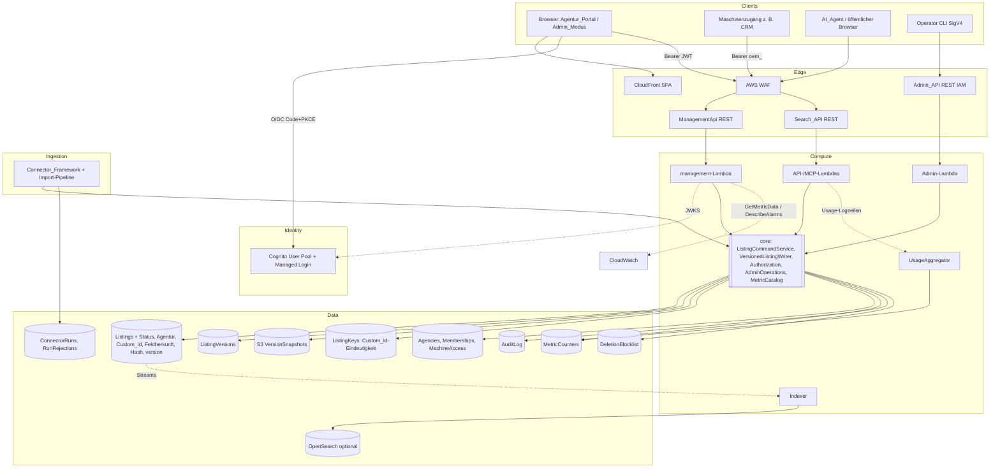
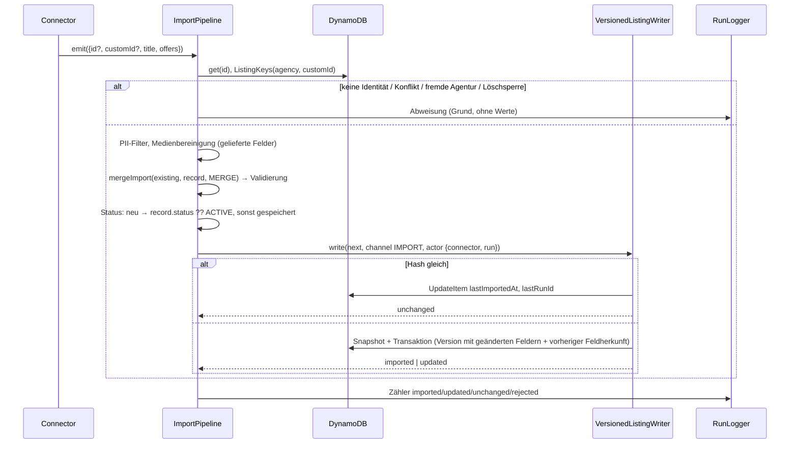

# Design Document

## Overview

Dieses Dokument beschreibt das technische Design der Listing-Verwaltung als Erweiterung der Platform (Spec `real-estate-platform`). Es ergänzt die bestehenden Schichten um:

1. **Identität & Berechtigung** — Amazon Cognito User Pool als Identity_Provider, Rollen und Agenturzugehörigkeit in DynamoDB, Maschinenzugänge mit gehashten Geheimnissen, eine reine `authorize`-Funktion als einziges Berechtigungsmodell.
2. **Management_API** — eigene API-Gateway-REST-API mit einer Lambda, die Agentur-, Listing-, Versions-, Monitoring- und Plattform_Admin-Operationen über **dieselbe Domänenlogik** anbietet wie Import und Admin_API.
3. **Versionierter Listing-Store** — Listing_Status, Custom_Id, Feldherkunft, Inhalts_Hash und optimistische Nebenläufigkeit im bestehenden `Listings`-Item; Versions-Metadaten in DynamoDB, vollständige Inhalts-Snapshots inhaltsadressiert in S3.
4. **Feldgenauer Import** — die Import-Pipeline bestimmt das Ziel-Listing (Bezeichner → Custom_Id), führt gelieferte Inhaltsfelder zusammen (`MERGE`, Default) oder ersetzt (`REPLACE`, Standard der mitgelieferten Vollfeed-Module) und erzeugt nur bei geändertem Inhalts_Hash eine Version.
5. **Agentur_Portal & Admin_Modus** — lazy geladener, angemeldeter Bereich der bestehenden Angular-SPA.
6. **Monitoring-Basis** — Kennzahlenkatalog mit einheitlichem Zeitreihen-Endpunkt über DynamoDB-Zählern und CloudWatch.

Leitprinzipien aus `real-estate-platform` gelten weiter: **eine Schema-Quelle** (Zod in `shared`), **reine Funktionen für Entscheidungen** (Berechtigung, Zusammenführung, Diff, Sichtbarkeit), **Default-deny**, **YAGNI**. Die Admin_API (IAM, CLI) bleibt in Verhalten und Schnittstelle unverändert; die Management_API ruft dieselben Use-Case-Funktionen auf.

### Getroffene Entscheidungen

| Thema | Entscheidung | Kurzbegründung |
| --- | --- | --- |
| Identity_Provider | Cognito User Pool, Managed Login, Authorization Code + PKCE, keine Selbstregistrierung | Requirements-Entscheidung; Cognito wurde in `real-estate-platform` nur für die wenigen IAM-Operatoren verworfen |
| Token-Prüfung | In der Lambda (`aws-jwt-verify`), kein API-Gateway-Authorizer | 401 müssen im Audit_Log landen (Req 2.8), Maschinenzugänge brauchen ohnehin einen zweiten Pfad, ein Fehlerformat |
| Rollen & Agentur | DynamoDB (`Memberships`), nicht Cognito-Gruppen | Änderungen ≤ 60 s wirksam (Gruppen erst nach Token-Erneuerung), transaktionale Invarianten „letzter Admin“ (Req 1.6, 1.7, 10.9) |
| Maschinenzugang | Plattform-eigene Geheimnisse, SHA-256-Hash in DynamoDB | wie bestehende API_Keys; kein Cognito-App-Client je Zugang (Quoten, M2M-Kosten), Widerruf ≤ 60 s über Cache-TTL |
| Admin_API vs. Management_API | getrennt; Management_API enthält zusätzlich Plattform_Admin-Funktionen | Nutzerentscheidung E3; gleiche Use-Cases, Admin_API unverändert |
| Versionsspeicher | Metadaten in DynamoDB, Snapshots in S3 (inhaltsadressiert je Listing) | DynamoDB-Itemgröße und WCU-Kosten großer Listings, ~10× günstigerer Speicher, Deduplizierung bei Status- und Restore-Versionen |
| Aufbewahrung | unbegrenzt; Kennzahlen `history.version_count`/`history.storage_bytes` | Nutzerentscheidung E5 |
| Import vs. manuell | keine Sperre; Zusammenführung je Inhaltsfeld, Feldherkunft, Inhalts_Hash | Nutzerentscheidung E2 |
| Importmodus | Default `MERGE`; Auflösung `config.importMode ?? module.defaultImportMode ?? 'MERGE'`; die drei mitgelieferten Module (Web-Crawler, relationale DB, externe API) setzen `defaultImportMode: 'REPLACE'` | Nutzerentscheidung E6. Die mitgelieferten Module liefern je Listing einen vollständigen Datensatz; nur `REPLACE` entfernt dort ein an der Quelle entfallenes optionales Feld (z. B. `geo`, `address.street`). Der Standard sitzt am Modul statt in jeder `connectors.json`-Zeile, damit er nicht vergessen werden kann; eine Konfiguration darf ihn überschreiben (z. B. CRM-Feed, der nur Preise liefert → `MERGE`). |
| Zusammenführungsgranularität | Objekte rekursiv feldweise, Listen als Ganzes, `null` entfernt optionale Felder auf jeder Ebene; Feldherkunft je Feldpfad in genau dieser Granularität | Nutzerentscheidung E7 (delegiert), Begründung unter „Zusammenführung“ |
| Öffentliche Pflichtfelder | API_Schema und internes `Listing`-Schema unverändert; für `MANUAL` werden `sourceUrl`, `source`, `lastImportedAt`, `lastRunId` beim Schreiben abgeleitet | Nutzerentscheidung E8 (ersetzt E4 „Quell-URL optional“), siehe „Provenienzfelder“ |
| Kompatibilität | keine Bestandsinstallation → keine Migration, kein „fehlender Status = ACTIVE“ | Nutzerangabe |

### Zuordnung Design → Requirements

| Design-Baustein | Requirements |
| --- | --- |
| Authenticator, Memberships, Agenturen | 1, 2.4, 10.9, 10.10 |
| Berechtigungsmodell (`authorize`) | 2.1–2.7, 3.3, 3.4, 10.1, 10.2 |
| Maschinenzugänge | 3 |
| ListingCommandService, VersionedListingWriter | 4, 6.2, 6.9, 7.1–7.4, 8, 10.5, 10.6 |
| Provenienzfelder, Öffentliche_Detail_URL | 4.5, 4.16–4.19 |
| Diff | 5.5, 7.6, 7.7, 8.6 |
| Öffentliche Sichtbarkeit (Search_API, MCP, Indexer) | 1.8, 1.9, 4.15, 6.3–6.5 |
| Import-Pipeline (Identität, Importmodus, Merge, Hash) | 6.7, 7.3, 12 |
| Löschprozess-Erweiterung | 6.8, 9 |
| Admin-Operationen in der Management_API | 10.7, 10.8 |
| Audit_Log | 2.8, 11 |
| Monitoring & Kennzahlenkatalog | 13, 14, 15 |
| Agentur_Portal / Admin_Modus | 5, 7.8, 8.6, 10.3, 10.4, 10.8, 12.15, 13.6, 14.6, 15.5 |
| OpenAPI & Dokumentation | 16 |

## Architecture

### Technologie-Rationale

| Entscheidung | Wahl | Begründung | Verworfene Alternative |
| --- | --- | --- | --- |
| Management-Zugang | **Eigene API Gateway REST API** (`ManagementApi`) mit WAF, eine Lambda `management` | Wie die Admin_API getrennt von der Search_API: eigene Gateway Responses, CORS mit `Authorization`, eigene Throttling- und Metrikgrenzen; keine Kollision mit den öffentlichen Pfaden. | Pfade unter der Search_API (gemeinsame Gateway Responses, 404-Abbildung für fehlende Auth). |
| Authentifizierung | **In-Lambda-`Authenticator`** mit `aws-jwt-verify` (AWS-gepflegt, JWKS-Cache, Version gepinnt) für Cognito-Access-Tokens; Präfix `oem_` für Maschinenzugänge | Ein Codepfad für beide Akteursarten, einheitliches `ApiError`, jede Ablehnung wird auditiert (Req 2.8). Ein Gateway-Authorizer würde 401 vor der Lambda erzeugen – ohne Audit. | Cognito-Authorizer am Gateway; Lambda-Authorizer (zusätzlicher Kaltstart, Caching verzögert Widerruf). |
| Rollen | **DynamoDB `Memberships`** (PK `userId` = Cognito `sub`), Cache 60 s | Rollenänderung/Entfernung ≤ 60 s (Req 1.6) unabhängig von Token-Laufzeit; Admin-Zähler im selben `TransactWriteItems` (Req 1.7, 10.9). Cognito hält nur Identität (sub, E-Mail). | Cognito-Gruppen (wirken erst nach Token-Refresh, keine transaktionale Invariante). |
| Maschinengeheimnis | **32 Byte Zufall, base64url, SHA-256-Hash**, Vergleich per `timingSafeEqual` | Hochentropische Geheimnisse brauchen kein langsames Passwort-Hashing; gleiche Lösung wie `ApiKeys` (Req 3.2). | bcrypt/argon2 (unnötige Latenz je Aufruf), Cognito Client Credentials (App-Client-Quote je Pool, M2M-Tokenkosten, Widerruf nur über Token-Ablauf). |
| Versions-Snapshots | **S3-Bucket `VersionSnapshots`**, Schlüssel `listings/{listingId}/{contentHash}.json`, SSE-KMS, Block Public Access, **ohne** Bucket-Versionierung | Ein Listing kann mit 20 Sprachfassungen à 5.300 Zeichen und 60 URLs à 2.048 Zeichen > 200 KB groß sein; als DynamoDB-Item je Version kostet das ~200 WCU je Schreibvorgang und $0,25/GB-Monat statt $0,023. Inhaltsadressierung speichert gleiche Inhalte (Status-Version, Wiederherstellung) nur einmal. Ohne Bucket-Versionierung ist `DeleteObject` endgültig (DSGVO, Req 9.2). | Nur DynamoDB (Itemgröße, Kosten), S3 mit Versionierung (gelöschte Inhalte blieben als Noncurrent Versions). |
| Versions-Metadaten | **DynamoDB `ListingVersions`** (PK `listingId`, SK `version`) | Paginierte Historie ohne S3-Zugriff; atomar im selben Transaktionsschreiben wie das Listing (Req 7.1). | — |
| Nutzungszahlen | **Strukturierte Log-Zeile je Anfrage → CloudWatch-Logs-Subscription → `UsageAggregator`-Lambda → `MetricCounters`** | Eine Suchseite blendet bis zu 50 Listings ein; ein Schreibvorgang je Einblendung wäre bei 50 req/s zu teuer. Der Aggregator fasst einen Batch zusammen (ein `ADD` je Listing und Tag). Verzögerung Sekunden, ≤ 15 min gefordert (Req 13.7). Keine IP-Adressen in der Zeile (Req 13.4). | EMF-Metrik mit Listing-Dimension (Kardinalitätskosten), Kinesis/Firehose/Athena (zusätzliche Dienste). |
| Plattform-Kennzahlen | **CloudWatch `GetMetricData`/`DescribeAlarms`** | Latenz-p95 existiert bereits (`RequestLatency`); ergänzt wird `RequestCount` mit Dimension `statusClass` in allen drei Lambdas. | Eigene Speicherung. |
| Portal-Login | **`angular-auth-oidc-client`** (OIDC-zertifiziert, Code + PKCE, Refresh-Token-Rotation, Version gepinnt) | Spricht nur OIDC gegen die Cognito-Domain; kein AWS-SDK im Browser. | AWS Amplify (großer Bundle-Umfang, Cognito-spezifisch). |
| Portal-Routing | **`@angular/router`** mit lazy geladener Route `portal` | Die öffentliche SPA hat bisher keinen Router; der Portal-Code wird nur nach Anmeldung geladen. | Eigene SPA (zweites Deployment, doppelte Theme/i18n-Logik). |

### Architektur-Übersicht



### Paketstruktur

| Paket | Neu bzw. geändert |
| --- | --- |
| `shared` | `permissions.ts` (Rollen → Berechtigungen, `authorize`), `content.ts` (Inhaltsfelder, `contentPaths`, `changedContentPaths`, `contentHash`), `merge.ts` (`mergeImport`, `resolveImportMode`), `diff.ts` (`diffState`, `applyDiff`), `visibility.ts` (`isPublic`), `provenance.ts` (`publicDetailUrl`, `deriveProvenance`), Management-Schemas (Requests/Responses, `ManualContentInput`), neue Fehlercodes; `canonicalJson` aus `cursor.ts` wird exportiert. Das `Listing`-Schema und `LocalizedListing` bleiben unverändert. Nur reine Funktionen, vom Frontend nutzbar. |
| `core` | `management/`: `Authenticator`, `MembershipService`, `AgencyService`, `MachineAccessService`, `ListingCommandService`, `VersionedListingWriter`, `VersionService`, `AuditService`, `MonitoringService`, `MetricCatalog`; `AdminOperations` (aus `admin` extrahierte Use-Cases: Löschanfragen, Löschsperre, API_Keys, Rate_Limit, Zugangsmodus, Reload); `ListingService`/`SearchService` um Sichtbarkeit erweitert. |
| `management` (neu) | Dünner Lambda-Adapter: Router, Request-Parsing, OpenAPI (`/openapi.json`). |
| `admin` | Handler nutzen `AdminOperations` aus `core`; Akteur-Typ um `user` erweitert; Schnittstelle unverändert. |
| `ingestion` | Import-Pipeline: Identitätsauflösung, Importmodus, Zusammenführung, Hash-Vergleich, Schreiben über `VersionedListingWriter`; `RunLogger` persistiert Läufe und Abweisungen; Connector-Konfiguration `agencyId?`, `importMode?`; `ConnectorModule.defaultImportMode?` (mitgelieferte Module: `REPLACE`). |
| `api`, `mcp` | Nutzungs-Logzeile, `RequestCount`-Metrik. |
| `infra` | `IdentityStack` (User Pool, Domain, App-Client, Bootstrap-Trigger), `ManagementStack` (REST API, Lambda, WAF, Tabellen, Snapshot-Bucket, UsageAggregator; liest den bestehenden SSM-Parameter `/open-estate/{env}/frontend-origin`), CSP-Erweiterung. |
| `frontend` | Router mit öffentlicher Route `/listings/:id` (Öffentliche_Detail_URL), Feature `portal` (lazy), `ManagementApiClient`, OIDC-Konfiguration. |

### Request-Pfade

- **Management (Benutzer):** Browser → WAF → ManagementApi → management-Lambda → `AccessGuard` (IP-Limit für nicht authentifizierte Aufrufe) → `Authenticator` (JWT → `Principal` aus `Memberships`/`Agencies`, Cache 60 s) → `AccessGuard` (Limit je Akteur) → Request-Schema (Zod) → Use-Case → `authorize` → Ausführung → Audit.
- **Management (Maschine):** wie oben; `Authorization: Bearer oem_<keyId>_<secret>` → `MachineAccess` per `keyId`, Hash-Vergleich, Ablauf/Widerruf, Agenturzustand.
- **Import:** Scheduler → Step Functions → Connector → Import-Pipeline → `VersionedListingWriter` → Streams → Indexer.
- **Öffentlich:** unverändert, zusätzlich Sichtbarkeitsfilter (Status über Indexinhalt, Agentursperre zur Abfragezeit) und Nutzungs-Logzeile.
- **Admin_API:** unverändert; intern dieselben `AdminOperations`.

## Components and Interfaces

### Authenticator und Principal (Req 1.3, 1.6, 1.8, 2.4, 3.4–3.6)

```typescript
type Principal =
  | { kind: 'user'; userId: string; displayName: string; role: 'AGENCY_MEMBER' | 'AGENCY_ADMIN'; agencyId: string }
  | { kind: 'user'; userId: string; displayName: string; role: 'PLATFORM_ADMIN' }
  | { kind: 'machine'; keyId: string; label: string; agencyId: string; permissions: Permission[] };

interface Authenticator {
  // Fehler: AUTH_MISSING | AUTH_INVALID | MACHINE_ACCESS_EXPIRED (401), AGENCY_SUSPENDED (403)
  authenticate(authorization: string | undefined): Promise<Result<Principal, ApiError>>;
}
```

- **JWT:** `CognitoJwtVerifier` (`tokenUse: 'access'`, `clientId` = Portal-App-Client); Signatur, `exp`, Issuer. `sub` → `Memberships`-Eintrag; fehlt er → 401 `AUTH_INVALID` (Konto ohne Platform-Zugang).
- **Maschine:** Format `oem_<keyId>_<secret>`; `GetItem(MachineAccess, keyId)`, `timingSafeEqual(sha256(secret), keyHash)`; widerrufen oder unbekannt → `AUTH_INVALID`, `expiresAt ≤ now` → `MACHINE_ACCESS_EXPIRED`. `lastUsedAt` wird höchstens einmal pro Minute per bedingtem `UpdateItem` geschrieben.
- **Agentur gesperrt:** `Agencies.state = SUSPENDED` → 403 `AGENCY_SUSPENDED` (Req 1.8).
- **Caches:** Membership, Agenturzustand und Maschinenzugang je 60 s (TTL-Cache aus `core/access/ttl-cache.ts`) → Rollenänderung, Sperre und Widerruf sind spätestens nach 60 s wirksam (Req 1.6, 1.8, 3.5).
- **Bootstrap (Req 10.10):** CDK-Kontext `initialPlatformAdminEmail`; ein CDK-Trigger nach dem Deploy legt den Cognito-Benutzer (`AdminCreateUser`, Einladung) und die Membership `PLATFORM_ADMIN` an, sofern `PlatformCounters.platformAdmins = 0`.

### Berechtigungsmodell (Req 2, 3.3, 10.1, 10.2)

Eine Tabelle in `shared/permissions.ts` ist die einzige Quelle; die Developer_Documentation und das OpenAPI-Dokument (`x-required-permission` je Operation) werden daraus generiert (Req 2.1, 16.2).

| Berechtigung | Agentur_Mitglied | Agentur_Admin | Maschinenzugang (gewährbar) | Plattform_Admin |
| --- | --- | --- | --- | --- |
| `listing:read`, `listing:write`, `listing:status`, `version:restore`, `monitoring:read` | ✓ | ✓ | ✓ | ✓ alle Agenturen |
| `audit:read` (eigene Agentur) | – | ✓ | ✓ | ✓ plattformweit |
| `member:manage`, `machine-access:manage` | – | ✓ | – | ✓ |
| `agency:manage`, `platform:operate` (Admin_API-Funktionen), `monitoring:platform`, `listing:assign` | – | – | – | ✓ |

```typescript
type Decision = 'ALLOW' | 'FORBIDDEN' | 'NOT_FOUND';
// resourceAgencyId: Agentur der Zielressource; null = Ressource ohne Agentur; undefined = plattformweite Operation
function authorize(p: Principal, perm: Permission, resourceAgencyId: string | null | undefined): Decision;
```

Regeln, in dieser Reihenfolge: (1) Plattform_Admin → `ALLOW`. (2) Ressource gehört nicht zur Agentur des Akteurs (andere Agentur, ohne Agentur oder plattformweit) → bei agenturgebundenen Ressourcen `NOT_FOUND`, bei plattformweiten Operationen `FORBIDDEN` (Req 2.6). Die Prüfung erfolgt **vor** der Berechtigungsprüfung, damit 403 nie die Existenz fremder Ressourcen verrät. (3) Berechtigung fehlt → `FORBIDDEN` (Req 2.5). (4) sonst `ALLOW`. Listen-Operationen erzwingen den Agenturfilter in der Datenabfrage (Key-Condition auf `agencyId`), nicht nachträglich (Req 2.7).

Maschinenzugang-Anlage prüft `requested ⊆ GRANTABLE_MACHINE_PERMISSIONS` und meldet jede unzulässige Berechtigung (Req 3.3).

### Management_API

Basis `https://<management-api>/v1`. Alle Antworten im bestehenden `ErrorResponse`-Format (Req 16.3). Plattform_Admins geben bei agenturgebundenen Sammel-Operationen `agencyId` als Parameter an; für Agenturakteure ist die Agentur immer die eigene.

| Methode | Pfad | Berechtigung | Requirements |
| --- | --- | --- | --- |
| `GET` | `/me` | authentifiziert | Rolle, Agentur, Berechtigungen fürs Portal (5.6) |
| `GET`/`POST` | `/agencies` | `agency:manage` | 1.1, 1.4, 10.3 |
| `GET`/`PATCH` | `/agencies/{agencyId}` | `agency:manage` (Lesen auch eigene Agentur) | 1.8, 1.9 |
| `GET`/`POST` | `/agencies/{agencyId}/members` | `member:manage` | 1.5 |
| `PATCH`/`DELETE` | `/agencies/{agencyId}/members/{userId}` | `member:manage` | 1.6, 1.7 |
| `GET`/`POST`/`DELETE` | `/platform-admins[/{userId}]` | `agency:manage` | 1.2, 10.9 |
| `GET`/`POST` | `/agencies/{agencyId}/machine-access` | `machine-access:manage` | 3.1, 3.3, 3.7 |
| `DELETE` | `/agencies/{agencyId}/machine-access/{keyId}` | `machine-access:manage` | 3.5 |
| `GET`/`POST` | `/listings` | `listing:read` / `listing:write` | 4.1, 4.2, 4.14, 10.4 |
| `GET` | `/listings/{id}`, `/listings/by-custom-id/{customId}` | `listing:read` | 4.13 |
| `PUT` | `/listings/{id}` `{content, customId?, baseVersion}` | `listing:write` | 4.6–4.12 |
| `PUT` | `/listings/{id}/status` `{status, baseVersion?}` | `listing:status` | 6.2, 6.9 |
| `PUT` | `/listings/{id}/agency` `{agencyId, baseVersion}` | `listing:assign` | 10.6 |
| `GET` | `/listings/{id}/versions`, `/listings/{id}/versions/{n}` | `listing:read` | 7.5 |
| `GET` | `/listings/{id}/diff?from=&to=` | `listing:read` | 7.6 |
| `POST` | `/listings/{id}/restore` `{version, baseVersion}` | `version:restore` | 8 |
| `GET` | `/audit-log` | `audit:read` | 11.4, 11.5 |
| `GET` | `/monitoring/overview`, `/monitoring/connector-runs`, `/monitoring/connector-runs/{runId}/rejections`, `/monitoring/usage` | `monitoring:read` | 13.1–13.5, 14.3 |
| `GET` | `/monitoring/platform`, `/monitoring/alarms`, `/monitoring/agency-activity`, `/monitoring/history-size` | `monitoring:platform` | 14.1, 14.2, 14.4, 14.5 |
| `GET` | `/metrics`, `/metrics/{code}` | `monitoring:read` bzw. je Kennzahl | 15 |
| `POST`/`GET` | `/platform/deletions[/{requestId}]` | `platform:operate` | 10.7 |
| `DELETE` | `/platform/deletion-blocklist/{listingId}` | `platform:operate` | 10.7 |
| `GET`/`POST`/`DELETE`/`PUT` | `/platform/api-keys[/{keyId}[/rate-limit]]`, `/platform/rate-limit`, `/platform/access-mode` | `platform:operate` | 10.7 |
| `POST` | `/platform/reload` | `platform:operate` | 10.7 |
| `GET` | `/openapi.json` | öffentlich | 16.2 |

`/platform/*` ruft dieselben `AdminOperations` wie `/admin/*` auf (gleiche Zod-Schemas, Fehlercodes, Audit-Einträge); nur der Akteur ist ein Benutzer statt einer IAM-Identität. Reload benötigt `lambda:UpdateFunctionConfiguration` ausschließlich auf den API-, MCP- und Connector-Funktionen. Benachrichtigungen bei überfälligen Löschanfragen (Req 9.5) erhalten zusätzlich das Message-Attribut `requesterId`; Benutzer abonnieren per Filter-Policy darauf.

**Rate_Limit (Req 2.9):** derselbe `AccessGuard`-Zählermechanismus mit Client-Identitäten `user:{userId}` bzw. `mk:{keyId}` und eigenem SSM-Parameter `/open-estate/{env}/management-rate-limit` (gleiche Wertebereiche). Nicht authentifizierte Aufrufe werden vor der Token-Prüfung je IP begrenzt.

**Destruktive Bestätigung (Req 10.8):** `DELETE`-/Sperr-Operationen akzeptieren `?dryRun=true` und liefern dann die Anzahl betroffener Listings bzw. Benutzer ohne Änderung; der Admin_Modus zeigt sie im Bestätigungsdialog.

### ListingCommandService und VersionedListingWriter (Req 4, 6, 7, 8, 10.5, 10.6)

```typescript
interface ListingCommandService {
  create(p: Principal, req: CreateListing): Promise<Result<ListingView, ApiError[]>>;
  replaceContent(p: Principal, id: string, req: ReplaceContent): Promise<Result<ListingView, ApiError[]>>;
  setStatus(p: Principal, id: string, req: SetStatus): Promise<Result<ListingView, ApiError[]>>;
  assignAgency(p: Principal, id: string, req: AssignAgency): Promise<Result<ListingView, ApiError[]>>;
  restore(p: Principal, id: string, req: Restore): Promise<Result<ListingView, ApiError[]>>;
}

// Gemeinsamer Schreibpfad für Management_API, Admin-Zuweisung und Import.
interface VersionedListingWriter {
  write(change: StateChange): Promise<WriteResult>; // 'created' | 'updated' | 'unchanged' | Konflikt/Sperre
}
interface StateChange {
  listingId: string;
  expectedVersion: number | null;      // null = Neuanlage
  next: VersionedState;                // {content, status, customId?, agencyId?}
  changeType: 'CREATE' | 'UPDATE' | 'STATUS' | 'RESTORE' | 'IMPORT';
  channel: 'PORTAL' | 'API' | 'IMPORT' | 'ADMIN';
  actor: ActorRef;
  restoredFrom?: number;
  provenance?: { lastImportedAt: string; lastRunId: string }; // nur Import
}
```

Ablauf `replaceContent` (analog die anderen Befehle):

1. Listing laden (`GetItem`, stark konsistent); fehlt es → 404. `authorize(p, 'listing:write', listing.agencyId)`.
2. Request-Schema (`ManualContentInput` = Listing_Inhalt mit optionalem `sourceUrl` bei Herkunft `MANUAL`); fehlt `sourceUrl`, setzt der Service `publicDetailUrl(frontendOrigin, id)` (Req 4.5). Danach durchläuft der Inhalt denselben PII-Filter, dieselbe Medien-/Tour-Bereinigung und dasselbe Listing-Schema wie die Import-Pipeline (eine gemeinsame Funktion `prepareContent` in `ingestion` → nach `core` verschoben). Verworfene PII-Felder und Medien werden in der Antwort benannt (Req 4.3, 4.4, 4.10).
3. `baseVersion ≠ listing.version` → 409 `VERSION_CONFLICT` mit `details.currentVersion` (Req 4.8).
4. Löschsperre für Bezeichner bzw. Custom_Id → 409 `DELETION_BLOCKED` (Req 4.9).
5. Kanal: Plattform_Admin → `ADMIN`, Maschine → `API`, sonst `PORTAL` (Req 10.5).
6. `VersionedListingWriter.write`.

`VersionedListingWriter.write`:

1. `hash = contentHash(next.content)`. Sind Hash, Status, Custom_Id und Agentur gleich dem aktuellen Stand → `unchanged`, kein Schreibvorgang außer ggf. Import-Provenienz (Req 4.7, 6.9, 7.3).
2. `changedPaths = changedContentPaths(current.content, next.content)` (Inhaltsfelder in Zusammenführungsgranularität, siehe Data Models); neue Feldherkunft = alte Feldherkunft ohne entfernte Pfade, für jeden geänderten bzw. hinzugefügten Pfad `{channel, actor, version: v+1}`; die Version speichert je geändertem Pfad die vorherige Feldherkunft (Req 7.2, 12.11). Provenienzfelder setzt `deriveProvenance` (siehe „Provenienzfelder“, Req 4.16, 4.17).
3. Snapshot `PutObject(listings/{id}/{hash}.json, If-None-Match: *)`; `412 PreconditionFailed` heißt „existiert bereits“ (Deduplizierung, `newSnapshot = false`).
4. Ein `TransactWriteItems`:
   - `Put Listings` mit `version = v+1`, Bedingung `version = :v` bzw. `attribute_not_exists(id)`;
   - `Put ListingVersions` mit `attribute_not_exists(version)`;
   - `ConditionCheck DeletionBlocklist(id)` und – bei Custom_Id – `ConditionCheck DeletionBlocklist(custom#{agencyId}#{customId})`;
   - bei geänderter Custom_Id `Put ListingKeys(agencyId#customId → id)` mit `attribute_not_exists` bzw. `attribute(listingId) = :id`, `Delete` des alten Schlüssels;
   - `Update MetricCounters` für die betroffene(n) Agentur(en): `listings.status.{ACTIVE|INACTIVE}` (±1 bei Neuanlage, Statuswechsel, Agenturwechsel), `history.version_count +1`, `history.storage_bytes +size` (nur bei `newSnapshot`), `listing.changes.{channel}#{day} +1`.
5. Abbruchgründe werden über `CancellationReasons` je Index zugeordnet: Versionsbedingung → `VERSION_CONFLICT`, Löschsperre → `DELETION_BLOCKED`, Custom_Id → `CUSTOM_ID_TAKEN` (Req 4.8, 4.9, 4.12).

Zähler im selben Transaktionsschreiben sind exakt (kein At-least-once-Stream-Problem); es gibt keinen plattformweiten Hot-Key – plattformweite Werte sind die Summe über Agenturen (Agenturen ohne Zuordnung unter `agency#_none`). Ein nach Schritt 3 gescheiterter Transaktionsschreibvorgang hinterlässt höchstens einen nicht referenzierten Snapshot unter dem Präfix des Listings; er wird nicht gezählt und mit dem Listing gelöscht.

**Wiederherstellung (Req 8):** Snapshot der Version V laden, gegen die **aktuellen** Regeln (`prepareContent` + Schema) prüfen (Req 8.4); `next = {content: V.content, status, customId, agencyId: aktuell}` (Req 8.2), `changeType RESTORE`, `restoredFrom = V`. Ist der Inhalt gleich dem aktuellen, entsteht dennoch keine Version (Req 4.7 gilt sinngemäß; das Portal zeigt „keine Änderung“).

**Kein Bestand:** Es gibt keine bestehende Installation; jedes Listing entsteht über den `VersionedListingWriter` und hat damit ab Version 1 `version`, `status` und Feldherkunft. Eine Migration entfällt.

### Provenienzfelder und Öffentliche_Detail_URL (Req 4.5, 4.16–4.19)

Das öffentliche API_Schema (`LocalizedListing`) verlangt `sourceUrl`, `source`, `lastImportedAt` und `lastRunId`. Beide Schemas (`Listing`, `LocalizedListing`) bleiben unverändert; stattdessen schreibt der `VersionedListingWriter` diese Felder für **jede** Herkunft, sodass jedes gespeicherte Listing das interne Schema erfüllt und Search_API, MCP_Server, Indexer und OpenSearch-Dokument ohne Änderung bleiben.

| Feld | `IMPORT` | `MANUAL` |
| --- | --- | --- |
| `sourceUrl` (Inhaltsfeld) | vom Connector geliefert, Pflicht | vom Akteur geliefert; sonst `publicDetailUrl(frontendOrigin, id)` = `<frontend-origin>/listings/{id}` |
| `source` | Connector-Bezeichner (wie bisher) | `agency:{agencyId}` der aktuellen Eigentümer-Agentur (bei Agenturzuweisung neu gesetzt) |
| `lastImportedAt` | Zeitpunkt jeder Version und jedes Import-Durchlaufs ohne Änderung | Zeitpunkt jeder Version |
| `lastRunId` | `runId` des Connector_Lauf | `{channel}#{version}`, z. B. `PORTAL#7` (≤ 128 Zeichen) |

```typescript
const publicDetailUrl = (origin: string, id: string) => `${origin}/listings/${encodeURIComponent(id)}`;
function deriveProvenance(l: { origin: Origin; source: string; agencyId?: string },
  w: { channel: Channel; version: number; at: string; runId?: string }): Pick<Listing, 'source' | 'lastImportedAt' | 'lastRunId'>;
```

- `lastImportedAt` wird öffentlich als Aktualitätszeitpunkt („Stand der Daten“) gelesen: Bei Import-Listings ist das wie bisher der letzte Import, nach einer manuellen Bearbeitung der Zeitpunkt dieser Bearbeitung. Provenienzfelder gehören nicht zum Listing_Inhalt und fließen nicht in den Inhalts_Hash ein; ein bloßer Provenienz-Update erzeugt keine Version.
- Der Frontend-Origin kommt aus dem bestehenden SSM-Parameter `/open-estate/{env}/frontend-origin` (FrontendStack). Der `ManagementStack` hängt vom FrontendStack ab; fehlt der Parameter bei Lambda-Init, startet die management-Lambda nicht (Fehler bei Bereitstellung statt eines Listings ohne Quell-URL).
- Die abgeleitete URL wird gespeichert, nicht zur Abfragezeit berechnet: sie ist damit Teil von Version, Diff und Hash und bleibt bei einem späteren Origin-Wechsel unverändert (bekannte Einschränkung; ein Origin-Wechsel erfordert eine Bearbeitung der betroffenen Listings). Ob die URL abgeleitet ist, berechnet `GET /listings/{id}` als `sourceUrlDerived` (Vergleich mit `publicDetailUrl`); im Portal-Formular bleibt das Feld dann leer.
- Eine Bearbeitung eines `MANUAL`-Listings ohne `sourceUrl` setzt wieder die abgeleitete URL (vollständiges Ersetzen, Req 4.6). Für Listings mit Herkunft `IMPORT` bleibt `sourceUrl` auch über die Management_API Pflicht.
- Das Frontend erhält die Route `/listings/:id`, die die bestehende Detailansicht öffnet (Req 4.19); nicht öffentliche oder unbekannte Listings zeigen dieselbe „nicht gefunden“-Ansicht.

### Diff (Req 5.5, 7.6, 7.7, 8.6)

```typescript
type DiffEntry =
  | { op: 'add'; path: (string | number)[]; value: unknown }
  | { op: 'remove'; path: (string | number)[]; oldValue: unknown }
  | { op: 'change'; path: (string | number)[]; oldValue: unknown; value: unknown };

function diffState(a: VersionedState, b: VersionedState): DiffEntry[];
function applyDiff(a: VersionedState, d: DiffEntry[]): VersionedState;
```

Rekursiv über Objekte (Schlüssel sortiert), Arrays positionsweise (Medien und Angebote haben eine fachliche Reihenfolge); Pfade sind deterministisch. Beträge erscheinen in der API-Darstellung (Dezimal-String). Diffs werden nie gespeichert, sondern aus zwei Snapshots berechnet – mit dem Entfernen der Snapshots sind auch alle Diffs entfernt (Req 9.2). Ein Diff zweier beliebiger (nicht nur benachbarter) Versionen ist erlaubt.

### Öffentliche Sichtbarkeit (Req 1.8, 1.9, 4.15, 6.3–6.5)

```typescript
function isPublic(l: { status: ListingStatus; agencyId?: string }, suspended: ReadonlySet<string>): boolean {
  return l.status === 'ACTIVE' && !(l.agencyId !== undefined && suspended.has(l.agencyId));
}
```

- **Status über den Indexinhalt:** `toListingItem` setzt das GSI-Attribut `gsiPk = 'L'` nur für Listings mit Status `ACTIVE` (sparse GSI `byId`). Der DynamoDB-Provider findet inaktive Listings damit gar nicht; der Indexer behandelt ein `MODIFY` ohne `gsiPk` wie `REMOVE` und löscht das OpenSearch-Dokument. Reaktivierung erzeugt wieder `gsiPk` → Upsert. Latenz = Stream-Verzögerung (Sekunden, ≤ 60 s).
- **Agentursperre zur Abfragezeit:** wie `hasTour` – `SearchService` lädt die Menge gesperrter Agenturen (`Agencies` GSI `byState`, Cache 60 s) und ergänzt die `ResolvedQuery` um `excludeAgencies` (OpenSearch `must_not terms agencyId`, DynamoDB `NOT agencyId IN (…)`). Kein Reindex bei Sperre/Entsperrung; wirksam ≤ 60 s. Das Suchdokument erhält dafür `agencyId`.
- **Detail:** `ListingService.get` liest das Item und liefert `NOT_FOUND` mit identischem Fehler wie für unbekannte Bezeichner, wenn `!isPublic` (Req 6.4); der MCP-Server nutzt dieselbe Funktion.
- Der Indexer überspringt `MODIFY`-Ereignisse, deren Suchdokument sich nicht geändert hat (z. B. nur `lastImportedAt`).

### Import-Pipeline (Req 6.7, 7.3, 12)

Konfiguration je Connector (`connectors.json`, kompatibel erweitert):

```typescript
{ id, type, module, enabled, schedule, timeoutSeconds, settings, secretRef?,
  agencyId?: string,                       // Req 12.1
  importMode?: 'REPLACE' | 'MERGE' }       // Req 12.16: Vorrang vor dem Modul-Standard

interface ConnectorModule { /* bestehend */ defaultImportMode?: ImportMode }   // Req 12.17
const resolveImportMode = (c: ConnectorConfig, m: ConnectorModule): ImportMode =>
  c.importMode ?? m.defaultImportMode ?? 'MERGE';
```

Die mitgelieferten Module `web-crawler` (JSON-LD), `relational-db` und `external-api` setzen `defaultImportMode: 'REPLACE'`: Sie erzeugen je Quell-Datensatz einen vollständigen Import_Datensatz (Mapping bzw. JSON-LD-Extraktion), in dem ein an der Quelle entfallenes Feld schlicht fehlt. Unter `MERGE` bliebe es stehen; `REPLACE` entfernt es (Req 12.17). Wer über `relational-db`/`external-api` nur einen Teil der Felder liefert (z. B. Preise aus einem CRM), setzt in `connectors.json` `importMode: 'MERGE'`. Neue Module ohne Angabe arbeiten mit `MERGE`.

Der Import_Datensatz entspricht dem bisherigen Eingabeformat; zusätzlich optional `customId`, `status` und `null` als „Feld entfernen“ (nur `MERGE`; unter `REPLACE` gilt `null` wie ein fehlendes Feld). `id` wird optional, sofern `customId` geliefert wird.

Neue Reihenfolge in `ImportPipeline.process`:

1. **Mapping** (wie bisher, plus `customId`, `status`).
2. **Identität** (`resolveImportTarget`, rein über ein Lese-Interface):
   - weder `id` noch `customId` → abweisen „Identität fehlt“ (Req 12.4);
   - `byId = get(id)`; `byCustom = customId ? keys.get(agency, customId) : null`;
   - `byId` und `byCustom` vorhanden und verschieden → „Identitätskonflikt“ (Req 12.3, 12.14);
   - Ziel = `byId ?? byCustom`; ohne Ziel → Neuanlage mit `id ?? randomUUID()` (Req 12.5);
   - Löschsperre für `id` oder `custom#{agency}#{customId}` → „Löschsperre“ (Req 12.14);
   - Ziel gehört anderer Agentur bzw. Connector ohne Agentur trifft Listing mit Agentur → „Fremde Agentur“ (Req 12.12); Ziel ohne Agentur mit `source = connectorId` und Connector mit Agentur → Agentur übernehmen (Req 12.13).
   Für die mitgelieferten Connectors (immer `id`, keine `customId`) ist Schritt 2 die quellbasierte Identität: Der Connector leitet `id` deterministisch aus der Quelle ab, ein unbekannter Bezeichner legt ein Listing mit genau diesem Bezeichner an.
3. **PII-Filter** und **Medien-/Tour-Bereinigung** auf die gelieferten Felder (wie bisher, wertfrei protokolliert).
4. **Zusammenführung** `mergeImport(existing?.content, record, resolveImportMode(config, module))`:
   - Neuanlage: gelieferte Felder; nicht gelieferte optionale Felder erhalten den Schema-Default bzw. bleiben leer (Req 12.8);
   - `MERGE` (Req 12.6), rekursiv über den Listing_Inhalt:
     - **Objekt** (`address`, `geo`, `contact`): gelieferte Schlüssel werden einzeln zusammengeführt, nicht gelieferte bleiben;
     - **Liste** (`offers`, `translations`, `media`, `tours`): der gelieferte Wert ersetzt die gespeicherte Liste vollständig;
     - **Skalar**: der gelieferte Wert ersetzt den gespeicherten;
     - **`null`** auf beliebiger Ebene entfernt das (optionale) Feld bzw. Objekt, z. B. `address.street: null`, `geo: null`; `null` auf einem Pflichtfeld führt in Schritt 5 zur Abweisung;
   - `REPLACE`: Ergebnis = gelieferter Inhalt (Req 12.7).
   Danach wird der PII-Filter auf das Ergebnis angewendet, damit auch gespeicherte, inzwischen nicht mehr erlaubte PII-Felder verschwinden.

   **Begründung der Granularität:** Objekte sind Gruppen unabhängiger Werte; ein Import, der nur `address.city` liefert, soll eine manuell gepflegte `address.street` nicht löschen. Listen dagegen haben fachliche Identität und Reihenfolge (Medienreihenfolge, genau ein Angebot je Angebotsart, eine Sprachfassung je Locale), aber keinen stabilen Elementschlüssel im Schema; ein positions- oder schlüsselweises Zusammenführen würde Reihenfolge und Eindeutigkeitsregeln stillschweigend verletzen. `translations` ist eine Liste (kein Objekt je Locale) und wird daher als Ganzes ersetzt. Die Feldherkunft wird in genau derselben Granularität geführt (Inhaltsfeld = Pfad bis zu einem Skalar oder einer Liste), damit sie immer eindeutig angibt, wer den aktuell sichtbaren Wert geschrieben hat: liefert ein Import nur `address.city`, ist genau `address.city` als „durch Listenimport überschrieben“ gekennzeichnet. `geo.lat`/`geo.lon` werden ebenfalls einzeln zusammengeführt; ein halbes Koordinatenpaar wird durch die bestehende Schema-Regel abgewiesen, sofern kein Gegenwert gespeichert ist.
5. **Validierung** des zusammengeführten Inhalts (Req 12.9) mit allen Feldfehlern.
6. **Status:** Neuanlage → `record.status ?? 'ACTIVE'`; bestehend → gespeicherter Status, gelieferter Wert verworfen (Req 6.7, 12.10).
7. **Schreiben** über `VersionedListingWriter` mit `expectedVersion` aus Schritt 2, Kanal `IMPORT`, Akteur `{connectorId, runId}`. `unchanged` → nur `lastImportedAt`/`lastRunId` per `UpdateItem` (Req 4.16, 7.3). Versionskonflikt (paralleler Portal-Edit) → bis zu 3 Wiederholungen ab Schritt 2, danach abweisen „Nebenläufige Änderung“.

Lauf-Zähler: `imported` (neu), `updated` (Version erzeugt), `unchanged`, `rejected`; `RunSummary` und Run-Log werden um `unchanged` erweitert (Req 13.2). Der `RunLogger` erhält einen persistierenden Decorator: Laufzusammenfassung nach `ConnectorRuns`, jede Abweisung (Bezeichner bzw. Custom_Id, Feldnamen, Grund – nie Werte) nach `RunRejections`; TTL 100 Tage (Req 13.2, 13.3).

### Löschprozess-Erweiterung (Req 6.8, 9)

Der bestehende Lösch-Workflow erweitert den Schritt je Listing:

1. Löschsperre für `id` **und** `custom#{agencyId}#{customId}` (Transaktion).
2. `Delete Listings`, `Delete ListingKeys`, Zähler dekrementieren (Status, Versionen, Bytes – Summe aus `ListingVersions.snapshotBytes`).
3. `ListingVersions` per `Query` + `BatchWriteItem` löschen; S3-Präfix `listings/{id}/` per `ListObjectsV2` + `DeleteObjects` löschen.
4. Nach Prüfung „keine Version und kein Objekt mehr vorhanden“ zählt das Listing als entfernt; erst wenn alle betroffenen Listings entfernt sind, wird die Anfrage `EXECUTED`. Sonst bleibt sie `OPEN` und die bestehende Überfälligkeitsprüfung benachrichtigt nach 24 h (Req 9.5).

Audit-Einträge, Run-Abweisungen und Kennzahlen enthalten nur Bezeichner, Feldnamen, Codes und Zähler (Req 9.4); Nutzungszähler des Listings bleiben bis zu ihrer TTL bestehen.

### Audit_Log (Req 2.8, 11)

Bestehende Tabelle `AuditLog`, neue Kategorien `management` und `access-denied`; Einträge `{timestamp, id, actor, channel, action, target, agencyId?, result}`. Neuer GSI `byAgency` (PK `agencyId`, SK `timestamp#id`) für Req 11.5; Plattform-Abfragen über die Kategorien mit Zeitraum in der Key-Condition und Filter auf Akteur/Aktion (Req 11.4). Schreibzugriff haben nur `AuditService.append` (IAM: kein `UpdateItem`/`DeleteItem` auf `AuditLog` für alle Lambdas, Req 11.3).

### Monitoring und Kennzahlenkatalog (Req 13–15)

```typescript
interface MetricDefinition {
  code: string;                     // stabil, z. B. 'listing.detail_views'
  description: string; unit: 'count' | 'bytes' | 'milliseconds';
  scope: 'agency' | 'platform';
  intervals: ('hour' | 'day')[];
  dimensions: ('agency' | 'listing' | 'connector' | 'endpoint' | 'status' | 'channel' | 'statusClass')[];
  resolve(q: MetricQuery, signal: AbortSignal): Promise<TimeSeries>;
}
interface TimeSeries { code: string; unit: string; interval: string; points: { t: string; value: number; dims?: Record<string, string> }[] }
```

Erstbefüllung des Katalogs:

| Code | Scope | Quelle |
| --- | --- | --- |
| `listing.count` (dim `status`) | agency | `MetricCounters` (aktuell) |
| `listing.changes` (dim `channel`) | agency | `MetricCounters` je Tag |
| `listing.detail_views`, `listing.search_impressions` (dim `listing`) | agency | `MetricCounters` je Tag (UsageAggregator) |
| `connector.runs` (dim `connector`, `status`) | agency | `ConnectorRuns` |
| `api.latency_p95`, `api.requests`, `api.responses` (dim `endpoint`, `statusClass`) | platform | CloudWatch |
| `history.version_count`, `history.storage_bytes` (dim `agency`) | platform | `MetricCounters` (aktuell) |

Eine neue Kennzahl ist ein neuer Katalogeintrag mit `resolve`; Antwortformat und bestehende Codes bleiben unverändert (Req 15.3). Die fachlichen Endpunkte (`/monitoring/*`) setzen sich aus denselben `resolve`-Aufrufen zusammen. Jeder Quellaufruf hat eine Deadline von 10 s; abgelaufene Quellen erscheinen als `{code, available: false}` statt eines Fehlers (Req 14.7). Unbekannter Code → 400 `UNKNOWN_METRIC`, Plattform-Kennzahl für Agenturakteur → 403 `METRIC_NOT_ALLOWED` (Req 15.4).

**UsageAggregator (Req 13.4, 13.5):** API- und MCP-Lambda schreiben je erfolgreicher Antwort eine Zeile `{"usage":{"kind":"detail"|"impression","items":[{"id","agencyId"}]}}` (keine IP, kein Key). Eine Subscription-Filter-Regel leitet nur diese Zeilen weiter; der Aggregator zählt je `(listingId, Tag)` und `(agencyId, Tag)` und schreibt pro Batch ein `ADD` je Schlüssel (TTL 100 Tage).

**Plattform-Kennzahlen (Req 14.1, 14.2):** `RequestCount` (EMF, Dimensionen `interface`, `endpoint`, `statusClass` ∈ {`2xx`, `4xx`, `429`, `5xx`}) wird von API-, MCP- und management-Lambda emittiert; `429` wird zusätzlich zu `4xx` gezählt, damit beide Werte direkt abfragbar sind. Alarme über `DescribeAlarms` mit dem Namenspräfix der Platform.

### Agentur_Portal und Admin_Modus (Angular)

Routing (`@angular/router`); `/` bleibt die öffentliche Suche. `portal` wird lazy geladen und durch `authGuard` (OIDC, Req 5.1) geschützt; `permissionGuard` liest Berechtigungen aus `GET /me`.

| Route | Komponente | Requirements |
| --- | --- | --- |
| `/portal/listings` | `ListingTableComponent` (Filter, Paginierung, Herkunft, Custom_Id) | 5.2 |
| `/portal/listings/new`, `/portal/listings/:id/edit` | `ListingFormComponent` (reaktives Formular, Validierung über `shared`-Schema) | 5.3, 5.4, 5.5, 5.9 |
| `/portal/listings/:id` | `ListingWorkspaceComponent` mit Tabs Vorschau (`ListingDetailComponent` wiederverwendet), Feldherkunft (`FieldProvenanceComponent`), Historie (`VersionTimelineComponent`, `DiffViewComponent`) | 5.8, 7.8, 8.6, 12.15 |
| `/portal/monitoring` | `AgencyMonitoringComponent`, `MetricChartComponent` (generische SVG-Zeitreihe, keine Chart-Bibliothek) | 13.6, 15.5 |
| `/portal/team`, `/portal/machine-access`, `/portal/audit` | Mitglieder-, Maschinenzugangs- und Audit-Ansicht | 1.5–1.7, 3, 11.5 |
| `/portal/admin/agencies[/:id]`, `/portal/admin/listings`, `/portal/admin/monitoring`, `/portal/admin/operations`, `/portal/admin/audit` | Admin_Modus (nur `PLATFORM_ADMIN`) | 10.1, 10.3, 10.4, 10.7, 10.8, 14.6 |

- `ManagementApiClient`: Bearer-Interceptor, 10-s-Timeout, Fehlerabbildung auf übersetzte Meldungen, Formularwerte bleiben erhalten (Req 5.9).
- `can(permission)` aus `/me` steuert die Anzeige von Bedienelementen (Req 5.6); die Prüfung im Backend bleibt maßgeblich.
- 409 `VERSION_CONFLICT`: Formular bleibt befüllt, `DiffViewComponent` zeigt `diff(baseVersion, current)` (Req 5.5).
- Vorschau: `toPublicDetailModel(listing, activeLocale)` – dieselbe reine Funktion wie die öffentliche Detailansicht (Req 5.8).
- Texte über Transloco-Schlüssel `portal.*`, Styling über die bestehenden Theme-Variablen (Req 5.7).
- CSP: `connect-src` um Management_API-Origin und Cognito-Domain erweitert; Tokens nur im Speicher und `sessionStorage` (kein `localStorage`).

### Sequenzdiagramme

**(a) Bearbeitung im Agentur_Portal**

```mermaid
sequenceDiagram
    participant P as Agentur_Portal
    participant M as management-Lambda
    participant AU as Authenticator
    participant LC as ListingCommandService
    participant W as VersionedListingWriter
    participant S3 as VersionSnapshots
    participant DB as DynamoDB

    P->>P: Validierung mit shared-Schema
    P->>M: PUT /v1/listings/{id} {content, customId, baseVersion} + Bearer JWT
    M->>AU: authenticate
    alt Token fehlt/ungültig
        AU-->>P: 401 + Audit access-denied
    end
    M->>LC: replaceContent(principal, …)
    LC->>DB: GetItem Listings
    LC->>LC: authorize → NOT_FOUND | FORBIDDEN | ALLOW
    LC->>LC: prepareContent (PII, Medien, Schema)
    alt baseVersion ≠ version
        LC-->>P: 409 VERSION_CONFLICT {currentVersion}
    end
    LC->>W: write(next, channel PORTAL)
    W->>W: contentHash; unverändert → unchanged
    W->>S3: PutObject listings/{id}/{hash}.json If-None-Match:*
    W->>DB: TransactWrite(Listings v+1, ListingVersions, Blocklist-Checks, ListingKeys, MetricCounters)
    W-->>P: 200 {version v+1, fieldSources}
```

**(b) Import eines Datensatzes im Modus MERGE**



## Data Models

### Listing-Schema (`shared`) – unverändert

- `Listing` und `LocalizedListing` bleiben unverändert; alle öffentlich verpflichtenden Felder (`sourceUrl`, `source`, `lastImportedAt`, `lastRunId`) bleiben verpflichtend und werden für `MANUAL` abgeleitet (siehe „Provenienzfelder“).
- Neu ist nur das Eingabeschema der Management_API `ManualContentInput` = Listing_Inhalt mit optionalem `sourceUrl` (Herkunft `MANUAL`); nach der Ableitung entspricht jedes gespeicherte Listing dem unveränderten `Listing`-Schema.
- Status, Agentur, Custom_Id und Feldherkunft sind Verwaltungsdaten und werden von Search_API und MCP nicht ausgeliefert.

```typescript
// Inhaltsfelder der obersten Ebene: ohne id, Provenienz und Verwaltungsdaten
const CONTENT_FIELDS = ['originalLocale', 'title', 'description', 'translations', 'offers', 'listingType',
  'rooms', 'area', 'address', 'geo', 'sourceUrl', 'media', 'tours', 'contact'] as const;
type ListingContent = Pick<Listing, (typeof CONTENT_FIELDS)[number]>;

// Inhaltsfeld = Pfad bis zu einem Skalar oder einer Liste; Objekte werden rekursiv aufgelöst.
// z. B. 'title', 'offers', 'address.city', 'geo.lat', 'contact.email'
type ContentPath = string;
function contentPaths(c: ListingContent): ContentPath[];                         // vorhandene Pfade, sortiert
function changedContentPaths(a: ListingContent | undefined, b: ListingContent): ContentPath[]; // hinzugefügt, entfernt, geändert

const contentHash = (c: ListingContent) => sha256Hex(utf8(canonicalJson(c)));    // interne Darstellung (Minor Units)

type ListingStatus = 'ACTIVE' | 'INACTIVE';
type Channel = 'PORTAL' | 'API' | 'IMPORT' | 'ADMIN';
type ImportMode = 'MERGE' | 'REPLACE';
type ActorRef =
  | { kind: 'user'; userId: string; displayName: string }
  | { kind: 'machine'; keyId: string; label: string }
  | { kind: 'connector'; connectorId: string; runId: string }
  | { kind: 'iam'; userArn: string };
interface FieldSource { channel: Channel; actor: ActorRef; version: number }
type FieldSources = Record<ContentPath, FieldSource>;   // Schlüssel = contentPaths(content)
interface VersionedState { content: ListingContent; status: ListingStatus; customId?: string; agencyId?: string }

// Tiefe Teilmenge des Listing_Inhalt; null = Feld entfernen (nur MERGE)
type DeepPartialNullable<T> = { [K in keyof T]?: (T[K] extends readonly unknown[] ? T[K]
  : T[K] extends object ? DeepPartialNullable<T[K]> : T[K]) | null };
type ImportRecord = DeepPartialNullable<ListingContent> & { id?: string; customId?: string; status?: ListingStatus };
```

Invariante: `Object.keys(fieldSources)` = `contentPaths(content)` nach jedem Schreibvorgang.

### DynamoDB-Tabellen

| Tabelle | Schlüssel | Wesentliche Attribute | Indizes / TTL |
| --- | --- | --- | --- |
| `Listings` (erweitert) | PK `id` | bisherige Felder + `status`, `agencyId?`, `origin`, `customId?`, `version`, `contentHash`, `fieldSources`, `updatedAt`; `gsiPk` nur wenn öffentlich (Status) | GSI `byId` (sparse); GSI `bySource`; **neu** GSI `byAgency` (PK `agencyId`, SK `updatedAt#id`) für Portal-Listen; Streams |
| `ListingVersions` | PK `listingId`, SK `version` (Number) | `changeType`, `channel`, `actor`, `createdAt` (ISO mit Offset), `status`, `customId?`, `agencyId?`, `contentHash`, `snapshotBytes`, `newSnapshot`, `changedPaths: {path, previous?: FieldSource, overwrittenByImport: boolean}[]`, `restoredFrom?` | — |
| `ListingKeys` | PK `agencyId#customId` | `listingId` | — |
| `Agencies` | PK `agencyId` | `displayName`, `state`, `createdAt`, `agencyAdmins` (Zähler) | GSI `byState` |
| `Memberships` | PK `userId` (Cognito `sub`) | `email`, `displayName`, `role`, `agencyId?`, `createdAt` | GSI `byAgency` (PK `agencyId`, SK `userId`) |
| `PlatformCounters` | PK `counter` | `platformAdmins` | — |
| `MachineAccess` | PK `keyId` | `agencyId`, `label`, `keyHash`, `permissions`, `createdBy`, `createdAt`, `expiresAt?`, `revokedAt?`, `lastUsedAt?` | GSI `byAgency` |
| `MetricCounters` | PK `scope` (`agency#{id}`, `listing#{id}`), SK `code#{day}` bzw. `code#current` | `value` bzw. Map je Dimension | TTL 100 Tage für Tageswerte |
| `ConnectorRuns` | PK `connectorId`, SK `startedAt#runId` | `agencyId?`, `endedAt`, `status`, `imported`, `updated`, `unchanged`, `rejected` | GSI `byAgency` (PK `agencyId`, SK `startedAt#runId`), TTL 100 Tage |
| `RunRejections` | PK `runId`, SK `seq` | `listingId?`, `customId?`, `fields[]`, `reason` | TTL 100 Tage |
| `AuditLog` (erweitert) | wie bisher | `actor`, `channel`, `action`, `target`, `agencyId?`, `result` | **neu** GSI `byAgency` |
| `DeletionBlocklist` (erweitert) | PK wie bisher | zusätzlich Schlüssel `custom#{agencyId}#{customId}` | — |

Invarianten „letzter Agentur_Admin“ und „letzter Plattform_Admin“: Rollenänderungen schreiben `Memberships` und den Zähler (`Agencies.agencyAdmins` bzw. `PlatformCounters.platformAdmins`) in einem `TransactWriteItems`; Herabstufung/Entfernung mit Bedingung `Zähler > 1` (Req 1.7, 10.9). Ein Benutzer mit Membership in einer Agentur oder als Plattform_Admin kann keiner weiteren Agentur hinzugefügt werden (`attribute_not_exists(userId)`, Req 1.2).

### Fehlerkatalog-Erweiterung (Req 16.3)

| Code | Status | Auslöser | Requirement |
| --- | --- | --- | --- |
| `AUTH_MISSING` | 401 | kein `Authorization`-Header | 2.4 |
| `AUTH_INVALID` | 401 | Token ungültig/abgelaufen, Maschinenzugang unbekannt/widerrufen, Konto ohne Membership | 2.4, 3.5 |
| `MACHINE_ACCESS_EXPIRED` | 401 | Ablaufzeitpunkt erreicht | 3.6 |
| `FORBIDDEN` | 403 | Berechtigung fehlt (bestehender Code) | 2.5 |
| `AGENCY_SUSPENDED` | 403 | Agentur gesperrt | 1.8 |
| `METRIC_NOT_ALLOWED` | 403 | Kennzahl außerhalb des Geltungsbereichs | 15.4 |
| `NOT_FOUND` | 404 | unbekannt **oder** fremde Agentur (bestehender Code) | 2.6, 9.3 |
| `VERSION_CONFLICT` | 409 | `baseVersion` veraltet, `details.currentVersion` | 4.8, 8.5 |
| `CUSTOM_ID_TAKEN` | 409 | Custom_Id in Agentur vergeben | 4.12 |
| `DELETION_BLOCKED` | 409 | Bezeichner/Custom_Id auf Löschsperrliste, Grund „Löschsperre“ | 4.9 |
| `LAST_AGENCY_ADMIN` / `LAST_PLATFORM_ADMIN` | 409 | Invariante verletzt | 1.7, 10.9 |
| `USER_ALREADY_ASSIGNED` | 409 | Benutzer gehört bereits einer Agentur an bzw. ist Plattform_Admin | 1.2 |
| `INVALID_PERMISSION` | 400 | nicht gewährbare Berechtigung (je Berechtigung ein Eintrag) | 3.3 |
| `UNKNOWN_METRIC` | 400 | unbekannter Kennzahl-Code | 15.4 |

Validierungsfehler von Listing-Inhalten nutzen die bestehenden Codes (`INVALID_PARAMETER` je Feld), auch bei Wiederherstellung (Req 8.4).

## Correctness Properties

*A property is a characteristic or behavior that should hold true across all valid executions of a system — essentially, a formal statement about what the system should do. Properties serve as the bridge between human-readable specifications and machine-verifiable correctness guarantees.*

Die Properties richten sich auf die reine Logik (`authorize`, Zusammenführung, Identitätsauflösung, Hash, Diff, Sichtbarkeit, Kennzahlen) und auf die Domänendienste über In-Memory-Fakes. Infrastruktur (Cognito, API Gateway, Streams, S3-Löschung, CloudWatch) wird durch Integrationstests abgedeckt.

### Property 1: Berechtigungsentscheidung entspricht dem Referenzmodell

*For any* Principal (Rolle bzw. Maschinenzugang mit Berechtigungsmenge), Berechtigung und Agentur der Zielressource liefert `authorize` genau dann `ALLOW`, wenn der Akteur Plattform_Admin ist oder die Ressource seiner Agentur gehört und die Berechtigung in seiner Menge liegt; gehört eine agenturgebundene Ressource nicht zur Agentur des Akteurs, ist das Ergebnis `NOT_FOUND` unabhängig von der Berechtigung, sonst bei fehlender Berechtigung `FORBIDDEN`.

**Validates: Requirements 2.2, 2.5, 2.6, 3.4, 10.1, 10.2**

### Property 2: Abgelehnte Operationen ändern nichts und werden auditiert

*For any* Ausgangszustand (Listings, Versionen, Agenturen, Memberships, Maschinenzugänge) und *for any* schreibende Operation eines Akteurs ohne erforderliche Berechtigung, mit fremder Ressource oder ohne gültige Authentifizierung ist der Zustand danach identisch mit dem Zustand davor, die Antwort enthält keine Daten der Zielressource, und bei 401/403 existiert genau ein neuer Audit-Eintrag mit Operation, Zielressource und Zeitpunkt.

**Validates: Requirements 2.4, 2.5, 2.6, 2.8, 16.5**

### Property 3: Agentur-Isolation von Listen

*For any* Bestand mehrerer Agenturen und *for any* Akteur einer Agentur enthalten die Listen von Listings, Versionen, Connector_Läufen, Audit-Einträgen, Kennzahlenkatalog und Kennzahlwerten ausschließlich Einträge seiner Agentur bzw. Kennzahlen mit Geltungsbereich Agentur, und keine Filterkombination ändert das.

**Validates: Requirements 2.7, 11.5, 15.1**

### Property 4: Authentifizierungsergebnis

*For any* Menge von Maschinenzugängen (aktiv, widerrufen, abgelaufen), Memberships, Agenturzuständen, simulierter Uhr und `Authorization`-Wert liefert der Authenticator genau dann einen Principal, wenn ein gültiges Token eines Benutzers mit Membership bzw. ein Geheimnis eines aktiven, nicht abgelaufenen Maschinenzugangs vorliegt und die Agentur nicht gesperrt ist; sonst `AUTH_MISSING` (kein Wert), `MACHINE_ACCESS_EXPIRED` (abgelaufen), `AGENCY_SUSPENDED` (gesperrt) bzw. `AUTH_INVALID` (alles übrige) — und nach einer Änderung an Membership, Widerruf oder Sperre gilt das neue Ergebnis spätestens 60 s später.

**Validates: Requirements 1.6, 1.8, 2.4, 3.5, 3.6**

### Property 5: Maschinenzugänge – Berechtigungsprüfung und Geheimnis

*For any* angeforderte Berechtigungsmenge wird ein Maschinenzugang genau dann angelegt, wenn die Menge Teilmenge der gewährbaren Berechtigungen ist, sonst nennt die Ablehnung jede unzulässige Berechtigung; *for any* angelegten Zugang authentifiziert das einmal zurückgegebene Geheimnis, der gespeicherte Datensatz und jede spätere Darstellung enthalten das Geheimnis nicht.

**Validates: Requirements 3.1, 3.2, 3.3, 3.7**

### Property 6: Admin-Invarianten

*For any* Folge von Rollenänderungen, Hinzufügungen und Entfernungen hat danach jede Agentur mit mindestens einem Benutzer mindestens einen Agentur_Admin, die Platform mindestens einen Plattform_Admin, und jeder Benutzer hat genau eine Agentur mit Agenturrolle oder die Rolle Plattform_Admin ohne Agentur; jede Operation, die das verletzen würde, wird mit 409 abgelehnt und lässt den Zustand unverändert.

**Validates: Requirements 1.2, 1.7, 10.9**

### Property 7: Öffentliche Sichtbarkeit

*For any* Bestand mit Listing_Status und *for any* Menge gesperrter Agenturen liefern Suche (alle Seiten) und Detailabruf von Search_API und MCP_Server genau die Listings, für die `isPublic` gilt; der Detailabruf eines nicht öffentlichen Listings liefert dieselbe Antwort wie für einen unbekannten Bezeichner, und eine Sperre oder Entsperrung ändert keinen gespeicherten Listing_Status.

**Validates: Requirements 1.8, 1.9, 6.3, 6.4, 6.5**

### Property 8: Manuelle Anlage

*For any* gültigen Listing_Inhalt (für `MANUAL` mit oder ohne Quell-URL) und optionalen Status legt `create` genau ein Listing mit neuem, eindeutigem Bezeichner, der Agentur des Akteurs, Herkunft `MANUAL`, Version 1, dem angegebenen Status bzw. `INACTIVE` und der gelieferten Quell-URL bzw. `publicDetailUrl(frontendOrigin, id)` an; *for any* Inhalt akzeptiert die Management_API genau die Inhalte, die die Import-Validierung akzeptiert, und bei Ablehnung ist der Bestand unverändert und jedes ungültige Feld benannt.

**Validates: Requirements 4.1, 4.2, 4.3, 4.4, 4.5, 4.10**

### Property 9: Optimistische Nebenläufigkeit

*For any* Listing mit aktueller Version v und *for any* Bearbeitung, Statusänderung mit Bezugsversion, Agenturzuweisung oder Wiederherstellung mit Bezugsversion b gilt: b = v ⇒ die neue aktuelle Version ist v + 1 (bei inhaltlicher Änderung); b ≠ v ⇒ 409 mit `currentVersion = v` und unverändertem Listing; von zwei nebenläufigen Schreibvorgängen mit derselben Bezugsversion gelingt höchstens einer.

**Validates: Requirements 4.6, 4.8, 8.5**

### Property 10: Keine Version ohne Änderung

*For any* Listing und *for any* Bearbeitung, Statusänderung oder Import, deren resultierender Zustand (Inhalts_Hash, Listing_Status, Custom_Id, Agentur) dem aktuellen gleicht, ist die Antwort erfolgreich und die Versionshistorie unverändert; jede Änderung mindestens eines dieser Werte erzeugt genau eine Version.

**Validates: Requirements 4.7, 6.9, 7.1, 7.3**

### Property 11: Inhalts_Hash

*For any* zwei Listing_Inhalte a, b gilt `contentHash(a) = contentHash(b)`, wenn a und b nach Normalisierung gleich sind, unabhängig von Schlüsselreihenfolge und Darstellung der Beträge (Dezimal-String oder Minor Units); *for any* Änderung eines Inhaltsfelds ändert sich der Hash; Listing_Status, Custom_Id und Provenienzfelder fließen nicht ein.

**Validates: Requirements 4.7, 7.3**

### Property 12: Custom_Id-Eindeutigkeit und Abruf

*For any* Folge von Anlagen, Bearbeitungen und Importen mit Custom_Ids ist jede Custom_Id je Agentur höchstens einem Listing zugeordnet; eine Zuordnung zu einem zweiten Listing wird mit `CUSTOM_ID_TAKEN` bzw. „Identitätskonflikt“ abgelehnt; *for any* gespeicherte Zuordnung liefert der Abruf über die Custom_Id dasselbe Listing wie der Abruf über den Bezeichner, und dieselbe Custom_Id darf in verschiedenen Agenturen unterschiedliche Listings bezeichnen.

**Validates: Requirements 4.11, 4.12, 4.13, 12.14**

### Property 13: Statusänderung erhält Inhalt und Historie

*For any* Listing und Statuswechsel bleiben Listing_Inhalt, Custom_Id, Agentur und alle bisherigen Versionen unverändert, die neue Version hat Änderungsart `STATUS` und den neuen Status; das Listing bleibt über die Management_API in jedem Status vollständig les- und bearbeitbar.

**Validates: Requirements 6.2, 6.6**

### Property 14: Versionshistorie ist lückenlos und unveränderlich

*For any* Folge von Änderungen über beliebige Kanäle ist die Versionshistorie eines Listings die Folge 1..n ohne Lücken, jede Version enthält den Zustand unmittelbar nach ihrer Änderung samt Akteur, Kanal, Änderungsart und Zeitpunkt mit Offset, der Zustand der Version n gleicht dem aktuellen Listing, und jede vor einer Operation vorhandene Version ist danach bytegleich vorhanden; die paginierte Abfrage liefert alle Versionen genau einmal absteigend.

**Validates: Requirements 7.1, 7.4, 7.5, 7.9, 9.1, 10.5**

### Property 15: Feldherkunft

*For any* Folge von Änderungen gilt nach jeder Version: die Schlüssel der Feldherkunft sind genau die Inhaltsfelder (`contentPaths`) des aktuellen Listing_Inhalt, und die Feldherkunft jedes Inhaltsfelds verweist auf die letzte Version, die dieses Feld geändert hat, mit deren Kanal und Akteur; jede Version listet genau die gegenüber der Vorversion hinzugefügten, entfernten oder geänderten Inhaltsfelder mit ihrer vorherigen Feldherkunft; ein Import, der ein zuletzt nicht durch `IMPORT` geändertes Inhaltsfeld überschreibt, ist in der Version für genau dieses Inhaltsfeld (z. B. nur `address.city`, nicht `address.street`) als „durch Listenimport überschrieben“ gekennzeichnet.

**Validates: Requirements 7.2, 12.11, 12.15**

### Property 16: Diff-Round-Trip

*For any* zwei versionierte Zustände a, b gilt `applyDiff(a, diffState(a, b)) = b`, `diffState(a, a) = []`, und jeder Eintrag des Diff enthält Pfad sowie alten und/oder neuen Wert entsprechend seiner Art.

**Validates: Requirements 7.6, 7.7**

### Property 17: Wiederherstellung

*For any* Listing mit Versionen und *for any* Version V, deren Inhalt nach aktuellen Regeln gültig ist, gilt nach der Wiederherstellung von V: Inhalt der neuen aktuellen Version = Inhalt von V, Status, Custom_Id und Agentur gleich dem Stand vor der Wiederherstellung, Änderungsart `RESTORE` mit Verweis auf V, und alle vorherigen Versionen unverändert; ist der Inhalt von V nach aktuellen Regeln ungültig, wird mit 400 je Feld abgelehnt und das Listing bleibt unverändert.

**Validates: Requirements 8.1, 8.2, 8.3, 8.4**

### Property 18: Identitätsauflösung beim Import

*For any* Bestand (Listings mit Agentur, Herkunftsquelle und Custom_Id, Löschsperrliste) und *for any* Import_Datensatz eines Connectors mit oder ohne Agentur entspricht das Ergebnis von `resolveImportTarget` einem Referenzmodell: ohne Bezeichner und Custom_Id „Identität fehlt“; Bezeichner und Custom_Id auf verschiedene Listings „Identitätskonflikt“; Ziel = Listing des Bezeichners, sonst der Custom_Id in der Connector-Agentur, sonst Neuanlage mit gelieferter bzw. neu vergebener Kennung; gesperrte Kennungen „Löschsperre“; Ziel einer fremden Agentur bzw. Connector ohne Agentur auf Listing mit Agentur „Fremde Agentur“; Ziel ohne Agentur aus derselben Quelle wird der Connector-Agentur zugeordnet; jede Abweisung lässt den Bestand unverändert.

**Validates: Requirements 12.1, 12.2, 12.3, 12.4, 12.5, 12.12, 12.13, 12.14**

### Property 19: Zusammenführung beim Import

*For any* bestehenden Listing_Inhalt und Import_Datensatz (tiefe Teilmenge mit `null` an beliebigen Stellen) gilt im Modus `MERGE` für jeden Pfad: ist er bis zu einem Skalar oder einer Liste geliefert, hat er danach den gelieferten Wert (Listen elementgleich und in gelieferter Reihenfolge); ist er oder ein übergeordnetes Objekt mit `null` geliefert, fehlt er; ist er nicht geliefert, ist er unverändert; im Modus `REPLACE` gleicht der Inhalt genau dem gelieferten; bei Neuanlage enthalten nicht gelieferte optionale Felder ihren Schema-Default bzw. fehlen; ist das Ergebnis ungültig, wird der Datensatz mit allen Feldfehlern abgewiesen und das Listing bleibt unverändert.

**Validates: Requirements 12.6, 12.7, 12.8, 12.9**

### Property 20: Import und Listing_Status

*For any* Import_Datensatz mit oder ohne Status gilt: legt er ein Listing an, ist dessen Status der gelieferte bzw. `ACTIVE`; betrifft er ein bestehendes Listing, ist dessen Status danach gleich dem Status davor.

**Validates: Requirements 6.7, 12.5, 12.10**

### Property 21: Lauf-Zähler

*For any* Folge von Import_Datensätzen eines Laufs gilt `imported + updated + unchanged + rejected` = Anzahl verarbeiteter Datensätze, `updated` = Anzahl erzeugter Versionen für bestehende Listings, `unchanged` = Anzahl bestehender Listings ohne neue Version, und je Abweisung existiert ein Eintrag mit Bezeichner bzw. Custom_Id, Feldnamen und Grund.

**Validates: Requirements 13.2, 13.3**

### Property 22: Löschung entfernt Listing, Historie und Schlüssel vollständig

*For any* Bestand und Löschkriterium entfernt eine ausgeführte Löschanfrage für jedes betroffene Listing das Listing, alle Versionen, alle Snapshots und die Custom_Id-Zuordnung; danach liefern Abrufe über Bezeichner und Custom_Id von Listing, Historie und Diff 404, Importe und Anlagen mit diesen Kennungen werden mit „Löschsperre“ abgelehnt, und alle nicht betroffenen Listings samt Historie sind unverändert; die Anfrage ist erst `EXECUTED`, wenn für jedes betroffene Listing keine Version mehr existiert.

**Validates: Requirements 4.9, 6.8, 9.2, 9.3, 9.5**

### Property 23: Keine personenbezogenen Werte in Audit, Kennzahlen und Lauf-Fehlern

*For any* Listing mit Personenbezogenen_Feldern und *for any* Folge von Verwaltungs-, Import- und Löschoperationen enthält kein Audit-Eintrag, kein Kennzahlwert, keine Nutzungs-Logzeile und keine Lauf-Abweisung einen Wert eines Personenbezogenen_Felds (auch nicht als Teilstring ab 3 Zeichen), eine IP-Adresse oder einen API-Key.

**Validates: Requirements 9.4, 13.3, 13.4**

### Property 24: Nutzungsaggregation

*For any* Folge von Nutzungs-Logzeilen (beliebig auf Batches verteilt) gleicht der Zähler je Listing und UTC-Tag der Anzahl der Detailaufrufe bzw. Sucheinblendungen dieses Listings an diesem Tag, und der Agenturwert je Tag ist die Summe der Werte ihrer Listings; die Abfrage für 1–90 Tage liefert genau diese Werte je Tag gesamt und je Listing.

**Validates: Requirements 13.4, 13.5, 14.4**

### Property 25: Bestands- und Historienzähler entsprechen dem Bestand

*For any* Folge von Anlagen, Status-, Agentur- und Inhaltsänderungen, Wiederherstellungen, Importen und Löschungen gleichen die Zähler `listing.count` je Agentur und Status, `listing.changes` je Agentur, Kanal und Tag, `history.version_count` und `history.storage_bytes` je Agentur den aus dem Bestand neu berechneten Werten (Bytes über eindeutige Snapshots), und die plattformweiten Werte sind die Summe über alle Agenturen.

**Validates: Requirements 10.3, 13.1, 14.4, 14.5**

### Property 26: Kennzahlen-API

*For any* Kennzahlenkatalog, Akteur und Abruf gilt: unbekannter Code → 400 mit Code, Plattform-Kennzahl für Agenturakteur → 403 mit Code, sonst eine Zeitreihe im einheitlichen Format mit genau den angeforderten Dimensionen und Intervallen; das Hinzufügen einer weiteren Kennzahl zum Katalog ändert die Antworten bestehender Codes nicht.

**Validates: Requirements 15.2, 15.3, 15.4**

### Property 27: Teilergebnisse bei langsamen Quellen

*For any* Menge von Monitoring-Quellen mit beliebigen simulierten Antwortzeiten liefert ein Abruf die Werte aller Quellen, die innerhalb von 10 s antworten, und kennzeichnet jede übrige Kennzahl als nicht verfügbar, ohne einen Fehlerstatus zurückzugeben.

**Validates: Requirements 14.7**

### Property 28: Rate_Limit je Akteur

*For any* Folge von Aufrufen beliebiger Akteure (simulierte Uhr) und Limit (N, W) werden je Akteur und Fenster höchstens N Aufrufe ausgeführt; jeder weitere erhält 429 mit `retryAfterSeconds` ≥ 1 bis Fensterende und verändert keinen Datenbestand.

**Validates: Requirements 2.9**

### Property 29: Audit-Abfrage

*For any* Menge von Audit-Einträgen und Filterkombination (Akteur, Agentur, Aktion, Zeitraum) liefert die Abfrage genau die passenden Einträge absteigend nach Zeitpunkt, jeden genau einmal über alle Seiten; jede protokollpflichtige Verwaltungsaktion erzeugt genau einen Eintrag mit Akteur, Kanal, Aktion, Ziel, Agentur, Ergebnis und Zeitpunkt.

**Validates: Requirements 11.1, 11.2, 11.4**

### Property 30: Portal-Validierung und Bedienelemente

*For any* Formularzustand lehnt der Portal-Validator genau die Eingaben ab, die das Request-Schema der Management_API ablehnt, ohne API-Aufruf und mit unveränderten Eingaben; *for any* Berechtigungsmenge aus `/me` zeigt das Portal ein Bedienelement genau dann, wenn die zugehörige Berechtigung enthalten ist.

**Validates: Requirements 5.4, 5.6, 5.9**

### Property 31: Vorschau entspricht der öffentlichen Detailansicht

*For any* Listing (unabhängig vom Listing_Status) und aktive Locale ist das Darstellungsmodell der Portal-Vorschau gleich dem Modell, das die öffentliche Detailansicht für dasselbe Listing mit Status `ACTIVE` erzeugt.

**Validates: Requirements 5.8**

### Property 32: Öffentliche Projektion erfüllt das unveränderte API_Schema

*For any* Folge von Operationen über alle Kanäle (manuelle Anlage mit und ohne Quell-URL, Bearbeitung, Import in beiden Importmodi, Statuswechsel, Agenturzuweisung, Wiederherstellung) erfüllt jedes gespeicherte Listing das unveränderte `Listing`-Schema, und `serialize(listing, …)` für jede Locale-Auswahl wird von `LocalizedListing` ohne Fehler akzeptiert; insbesondere sind `sourceUrl`, `source`, `lastImportedAt` und `lastRunId` immer vorhanden und gültig.

**Validates: Requirements 4.5, 4.18**

### Property 33: Ableitung der Provenienzfelder

*For any* Folge von Schreibvorgängen und Import-Durchläufen ohne Änderung (simulierte Uhr) gilt nach jedem Vorgang: `lastImportedAt` ist der Zeitpunkt des letzten Vorgangs, der eine Version erzeugt hat oder ein Import-Durchlauf war; `lastRunId` ist dessen `runId` bzw. `{channel}#{version}`; `source` ist bei Herkunft `IMPORT` der Connector-Bezeichner und bei `MANUAL` `agency:{agencyId}` der aktuellen Eigentümer-Agentur; kein Inhalts_Hash-Bestandteil ist eines dieser Felder.

**Validates: Requirements 4.16, 4.17**

## Error Handling

### Prinzipien

- **Keine Teilzustände:** Listing, Version, Custom_Id-Schlüssel, Löschsperren-Prüfung und Zähler sind ein Transaktionsschreiben; ein nicht referenzierter Snapshot ist der einzige mögliche Rest und bleibt unter dem Listing-Präfix.
- **Existenz nicht verraten:** fremde Ressourcen → 404 vor jeder Berechtigungsprüfung; 403 nur für eigene Ressourcen.
- **Alle Fehler auf einmal:** Inhaltsvalidierung sammelt alle Feldfehler (wie bisher).
- **Ein Fehlerkatalog** für Search_API, MCP, Admin_API und Management_API.
- **Backend entscheidet:** Portal-Prüfungen sind Komfort; jede Regel wird in der Management_API erzwungen.

### Management_API

| Situation | Verhalten | Requirement |
| --- | --- | --- |
| Kein/ungültiges/abgelaufenes Token | 401, Audit `access-denied` | 2.4, 2.8, 3.6 |
| Agentur gesperrt | 403 `AGENCY_SUSPENDED` | 1.8 |
| Berechtigung fehlt | 403 `FORBIDDEN`, keine Ressourcendaten, Audit | 2.5, 2.8 |
| Fremde Agentur | 404 `NOT_FOUND` | 2.6 |
| Veraltete Bezugsversion | 409 `VERSION_CONFLICT` + `currentVersion` | 4.8, 8.5 |
| Custom_Id vergeben | 409 `CUSTOM_ID_TAKEN` | 4.12 |
| Löschsperre | 409 `DELETION_BLOCKED` | 4.9 |
| Letzter Admin | 409 `LAST_AGENCY_ADMIN` / `LAST_PLATFORM_ADMIN` | 1.7, 10.9 |
| Ungültiger Inhalt / Wiederherstellung ungültig | 400 je Feld | 4.4, 8.4 |
| Rate_Limit | 429 + `Retry-After` | 2.9 |
| Cognito/DynamoDB/S3 nicht erreichbar oder Deadline 4,5 s | 503 `SERVICE_UNAVAILABLE`, nichts geschrieben | — |
| Frontend-Origin-Parameter fehlt oder ungültig | management-Lambda bricht bei Init ab (Bereitstellungsfehler), kein Listing ohne Quell-URL | 4.5 |
| Monitoring-Quelle > 10 s | Teilergebnis mit `available: false` | 14.7 |

### Import

| Situation | Verhalten | Requirement |
| --- | --- | --- |
| Keine Identität | abweisen „Identität fehlt“ | 12.4 |
| Bezeichner und Custom_Id widersprechen sich / Custom_Id vergeben | abweisen „Identitätskonflikt“ | 12.3, 12.14 |
| Fremde Agentur | abweisen „Fremde Agentur“ | 12.12 |
| Löschsperre (Bezeichner oder Custom_Id) | abweisen „Löschsperre“ | 12.14 |
| Zusammengeführter Inhalt ungültig | abweisen, alle Felder | 12.9 |
| Versionskonflikt mit parallelem Edit | bis zu 3 Wiederholungen, dann „Nebenläufige Änderung“ | — |
| Unveränderter Hash | `unchanged`, nur Provenienz aktualisiert | 4.16, 7.3 |
| `null` auf Pflichtfeld (MERGE) | abweisen wie ungültiger Inhalt | 12.9 |

### Frontend

| Situation | Verhalten | Requirement |
| --- | --- | --- |
| Nicht angemeldet / Token abgelaufen | Weiterleitung zum Login, Rückkehr zur angeforderten Route | 5.1 |
| 409 Versionskonflikt | Eingaben erhalten, Diff anzeigen | 5.5 |
| Fehler oder > 10 s | übersetzte Fehlermeldung, Eingaben erhalten | 5.9 |
| 403/404 | Hinweis „nicht verfügbar“, keine Ressourcendaten | 2.5, 2.6 |

## Testing Strategy

Dualer Ansatz wie in `real-estate-platform`: Property-based Tests für reine Logik und Domänendienste über In-Memory-Fakes, Beispieltests für konkrete Abläufe, Integrations- und Smoke-Tests für AWS-Anbindungen.

### Property-based Testing

- **Bibliothek:** `fast-check` (Version wie im Monorepo gepinnt), keine Eigenimplementierung.
- **Konfiguration:** jede Property genau **ein** Test mit `fc.assert(prop, { numRuns: 100 })`; Kommentar-Tag **Feature: listing-management, Property {number}: {property_text}**.
- **Generatoren** (`shared/test/arbitraries`, erweitert): Principals aller Rollen und Maschinenzugänge mit zufälligen Berechtigungsmengen, Agenturbestände, Listings mit Status/Agentur/Custom_Id/Feldherkunft, Import_Datensätze mit zufälliger Teilmenge an Inhaltsfeldern, `null`-Werten, Kennungskombinationen (nur `id`, nur `customId`, beide, keine, widersprüchlich), Operationsfolgen (Bearbeitung, Status, Wiederherstellung, Import, Löschung) und eine simulierte Uhr.
- **Fakes:** In-Memory-Implementierungen von Listing-Store (mit Transaktionssemantik: alle Bedingungen oder nichts), Versions-Store, Snapshot-Store (inhaltsadressiert), ListingKeys, Memberships, MachineAccess, MetricCounters, AuditLog; dieselben Interfaces wie die DynamoDB/S3-Implementierungen.
- **Referenzmodelle:** Property 1 gegen eine Tabelle aus der Berechtigungsmatrix; Property 18 gegen eine direkte Spezifikations-Implementierung der Auflösungsregeln; Property 25 gegen eine Neuberechnung aus dem Fake-Bestand.

### Unit- und Beispieltests

- Bootstrap des ersten Plattform_Admin (10.10); Einladung eines unbekannten Benutzers (1.5); Agentur anlegen (1.4).
- Wiederherstellungsdialog mit Diff und Bestätigung (8.6); Bestätigungsdialoge mit `dryRun`-Anzahlen (10.8).
- Zeitleiste kennzeichnet Import-Versionen mit Connector und Lauf (7.8); Feldherkunft-Hervorhebung (12.15).
- Generische Zeitreihen-Darstellung für eine Kennzahl ohne eigene Ansicht (15.5); Alarm-Hervorhebung (14.6).
- `resolveImportMode`: alle Kombinationen aus Konfiguration (`MERGE`/`REPLACE`/keine) und Modul-Standard (`MERGE`/`REPLACE`/keiner) (12.16); die Module `web-crawler`, `relational-db`, `external-api` melden `REPLACE`, und ein an der Quelle entfallenes `geo` bzw. `address.street` fehlt nach dem nächsten Lauf (12.17).
- Route `/listings/:id` öffnet die Detailansicht; unbekannte/inaktive Listings zeigen „nicht gefunden“ (4.19).
- `GET /listings/{id}` meldet `sourceUrlDerived` für abgeleitete Quell-URLs; das Portal-Formular zeigt das Feld dann leer (4.5).
- OpenAPI der Management_API ist valide und nennt für jede Operation Berechtigung, Parameter, Antworten und die Fehlercodes 401/403/404/409/429 (16.2); Berechtigungsmatrix in der Developer_Documentation stimmt mit `shared/permissions.ts` überein (2.1); jede Portal-Operation hat einen Endpunkt (16.1).
- `/platform/*` und `/admin/*` liefern für dieselben Eingaben dieselben Ergebnisse und Fehlercodes (10.7).

### Integrationstests (Testumgebung, 1–3 Beispiele)

- Cognito-Login (Code + PKCE) und JWT-Prüfung; abgelaufenes/fremdes Token → 401 mit Audit-Eintrag.
- Rollenänderung, Agentursperre und Widerruf sind nach ≤ 60 s wirksam (1.6, 1.8, 3.5).
- Deaktivierung entfernt das Listing aus DynamoDB- und OpenSearch-Suche ≤ 60 s, Reaktivierung stellt es wieder her; Änderungen aktiver Listings ≤ 60 s sichtbar (4.15, 6.3, 6.5).
- Transaktionsschreiben gegen DynamoDB Local: Abbruchgründe werden korrekt auf `VERSION_CONFLICT`, `CUSTOM_ID_TAKEN`, `DELETION_BLOCKED` abgebildet.
- Löschanfrage entfernt Versionen und S3-Snapshots vollständig; Bucket ohne Versionierung (9.2).
- Nutzungszeilen erscheinen ≤ 15 min in den Zählern (13.7); `RequestCount` und Alarmzustände sind abrufbar (14.1, 14.2).

### Smoke-Tests und Artefaktprüfungen

- CDK-Assertions: ManagementApi mit WAF, Cognito ohne Selbstregistrierung, Snapshot-Bucket mit Block Public Access, SSE-KMS und ohne Versionierung, keine Lambda-Rolle mit `UpdateItem`/`DeleteItem` auf `AuditLog`, TTL auf `MetricCounters`/`ConnectorRuns`/`RunRejections`, CSP enthält Management- und Cognito-Origin, management-Lambda erhält den SSM-Parameter `frontend-origin` und der ManagementStack hängt vom FrontendStack ab.
- Developer_Documentation enthält das vollständige Maschinenzugangs-Beispiel (16.4).
- Bestehende Tests von `real-estate-platform` laufen unverändert; angepasst werden nur Lauf-Zähler (zusätzlich `unchanged`) und der Listing-Writer (Versionierung).
