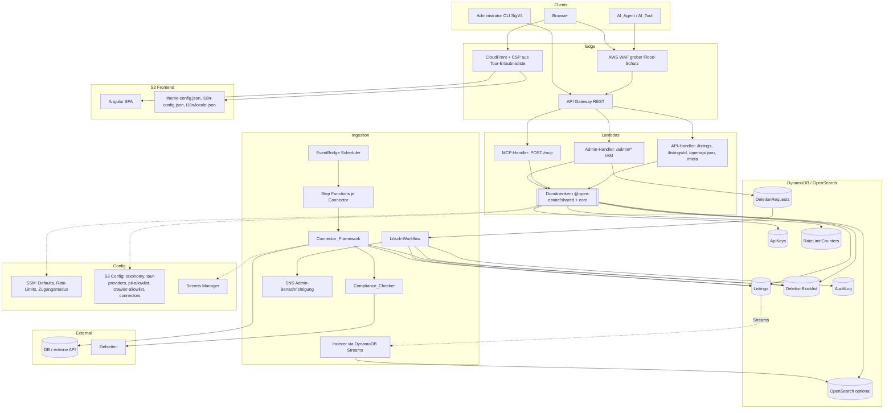
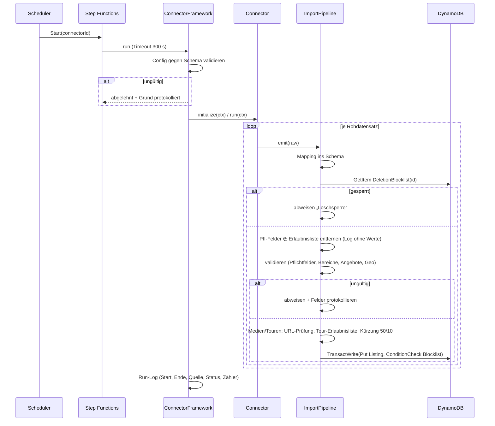
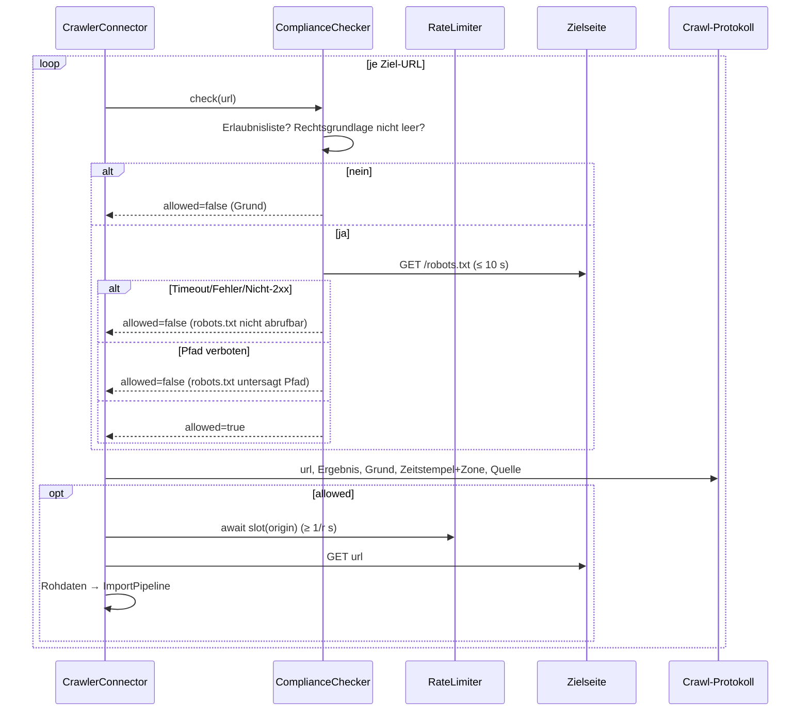

# Design Document

## Overview

Dieses Dokument beschreibt das technische Design der quelloffenen Immobilien-Plattform. Sie besteht aus vier Schichten:

1. **Agent-first Zugang** — eine über AWS API Gateway bereitgestellte, maschinenlesbar beschriebene `Search_API` und ein `MCP_Server` (Model Context Protocol), beide als dünne Adapter über **derselben** Domänenlogik.
2. **Datenbeschaffung** — ein modulares `Connector_Framework` (relationale DB, externe API, rechtskonformer Webcrawler), dessen Import-Pipeline Löschsperre, PII-Filter, Normalisierung, Validierung sowie Medien-/Tour-Prüfung erzwingt.
3. **White-Label- und mehrsprachiges Frontend** — eine Angular-SPA, die Branding, Übersetzungen, Taxonomie und Tour-Anbieter zur Laufzeit aus Konfiguration bezieht (kein Rebuild).
4. **Betrieb & Governance** — Infrastructure-as-Code (AWS CDK), externe Konfiguration, Rate-Limiting/API-Keys, DSGVO-Löschprozess mit Löschsperrliste und Audit-Log, Latenz-Metriken.

Leitprinzipien: **Agent-first**, **eine Schema-Quelle für alles** (Req 4.7), **Konfiguration statt Code** (White-Labeling, Taxonomie, Locales, Tour-Anbieter), **Default-deny** (Crawling, PII, Tour-Embeds), **YAGNI**.

Ein Listing kann zum Kauf, zur Miete oder gleichzeitig zum Kauf und zur Miete angeboten werden: `offers[]` enthält 1–2 Angebote, höchstens eines je Angebotsart (`SALE`, `RENT`) (Req 12.1, 12.14).

### Zuordnung Design → Requirements

| Design-Baustein | Requirements |
| --- | --- |
| Shared Schema (Zod) & Money | 3.2, 3.3, 3.8, 4, 12, 19.2 |
| Search_API (Suche, Detail, Discovery) | 1, 2, 3, 9.1, 9.5, 9.6, 12.6–12.9, 12.12, 14, 15.5–15.11, 16.9 |
| SearchProvider & Indexierung | 1, 12.7, 12.9, 15.5, 15.6, 16.9, 11.3 |
| LocaleResolver (API) | 14 |
| Taxonomy | 3.7, 15, 19.5 |
| Connector_Framework & Import-Pipeline | 4.8–4.12, 5, 12.4, 12.5, 12.11, 12.14, 16.1–16.5, 16.11, 18.1–18.3, 18.7 |
| Crawler_Connector & Compliance_Checker | 6, 11.6, 11.7 |
| AccessGuard (Rate-Limit, API-Keys) | 17 |
| Admin-API & Löschprozess | 17.8, 17.9, 18.4–18.11 |
| MCP_Server | 19, 17.3, 17.7 |
| Frontend (Suche, Detail, Medien, Touren) | 7, 12.10, 12.13, 16.6, 16.7, 16.10, 16.12 |
| Frontend (Theming, i18n) | 8, 13 |
| IaC, Konfiguration, Observability | 9, 10, 11.1–11.5 |
| Dokumentation & Open Source | 3.6, 8.6, 10 |

## Architecture

### Technologie-Rationale

| Entscheidung | Wahl | Begründung | Verworfene Alternative |
| --- | --- | --- | --- |
| Compute | **AWS Lambda (Node.js/TypeScript)** | Serverless, skaliert auf null, reproduzierbar in jedem Konto (Req 9.2). Ein Sprachraum für API, MCP, Connectors, Frontend und IaC. | ECS/Fargate (Dauerkosten, Betriebslast). |
| API-Zugang | **API Gateway REST API** | Vorgabe Req 9.1. REST statt HTTP-API wegen **nativer AWS-WAF-Anbindung**, **IAM-Autorisierung pro Methode** (Admin-Pfad) und **Gateway Responses** (einheitliches `ApiError` auch für Gateway-Fehler). Validierung erfolgt **nicht** am Gateway, sondern ausschließlich in Lambda aus dem gemeinsamen Schema — sonst gäbe es zwei Schema-Quellen und ein abweichendes Fehlerformat (Req 3.4, 4.7); dynamische Enums (Taxonomie, Locales) wären am Gateway ohnehin nicht abbildbar. | HTTP-API (kein direktes WAF). |
| Gemeinsames Schema | **Zod (v4) im Paket `@open-estate/shared`** | Eine TypeScript-Quelle liefert Laufzeit-Validierung, statische Typen, JSON-Schema/OpenAPI (`z.toJSONSchema` bzw. `zod-openapi`), MCP-Tool-Schemas (das MCP-TypeScript-SDK akzeptiert Zod direkt) und Frontend-Grenzen (Angular importiert dieselben Konstanten/Schemas). Schemas werden zur Startzeit über eine Factory aus Taxonomie und Locales gebaut, damit dynamische Enums enthalten sind (Req 3.7, 15.3). | JSON Schema + Ajv (zweite Typquelle nötig), io-ts/TypeBox (kleineres Ökosystem, kein direkter MCP-SDK-Support). |
| Geldbeträge | **Integer in Hundertsteln (`amountMinor`)**, API als Dezimal-String `"1250.00"` | Req 4.3/12 fixieren höchstens zwei Nachkommastellen; Ganzzahlen sind exakt (kein IEEE-754-Rundungsfehler bei Vergleichen/Filtern), Maximum 99.999.999.999 < 2^53. Parsing erfolgt string-basiert, nie über `parseFloat * 100`. Fester Skalierungsfaktor 100 (nicht der ISO-4217-Exponent), weil die Requirements die Skala für alle Währungen festlegen. Dezimal-String in der API bewahrt Exaktheit auch für Agents. | JSON-Number (Float-Rundung), Decimal-Bibliothek (Overhead ohne Nutzen bei fester Skala). |
| Listing-Store | **DynamoDB** | Schlüsselabruf, Upsert per `PutItem`, Transaktionen (atomare Löschsperren-Prüfung), Streams für Index-Sync, Serverless-Kosten. | RDS/Aurora (Betriebslast). |
| Suchindex | **OpenSearch Serverless** (Produktions-Empfehlung) hinter `SearchProvider`; **DynamoDB-Provider** als schlanker Default | Siehe „Indexierungs-Strategie“. | — |
| Frontend | **Angular** mit `APP_INITIALIZER` | Opinionated (Router, reaktive Formulare, DI) → wenige Architekturentscheidungen für Contributor; `APP_INITIALIZER` lädt Theme-, i18n- und Meta-Konfiguration vor App-Start. | React (mehr Zusatzentscheidungen; in Doku als Alternative genannt). |
| i18n-Bibliothek | **Transloco** (Laufzeit-Übersetzung) | Übersetzungsdateien werden zur Laufzeit per HTTP geladen → neue Locale ohne Rebuild (Req 13.3); eingebaute Fallback-Sprache und `missingHandler` (Req 13.7/13.8); Sprachwechsel ohne Reload (Req 13.5); aktiv gepflegt. | Angular-Build-time-i18n (`@angular/localize`, ein Build je Locale — verletzt 13.3/13.5); ngx-translate (tragfähig, aber Fallback-Kette/Missing-Handling weniger integriert). |
| Hosting | **S3 + CloudFront** | Statische SPA; `theme-config.json`, `i18n-config.json`, `i18n/{locale}.json` mit `no-cache`; CSP per CloudFront Response-Headers-Policy. | Amplify Hosting (weniger transparent). |
| Connector-Orchestrierung | **EventBridge Scheduler → Step Functions → Lambda** | Zeitpläne aus Konfiguration (Req 11.1); Step Functions kapselt Zeitlimit und Isolation je Connector (Req 5.7). | Cron auf EC2. |
| Konfiguration | **SSM Parameter Store** (Skalare), **privater S3-Config-Bucket** (strukturierte JSON-Dateien), **Secrets Manager** (Zugangsdaten) | Externe, benannte Werte (Req 9.3, 11.1); SSM-Advanced-Parameter sind für Taxonomie/Erlaubnislisten zu klein bzw. unhandlich. | `.env` im Artefakt. |
| Rate-Limiting | **Eigener `AccessGuard` mit atomaren DynamoDB-Fensterzählern**; AWS WAF nur als grober Flood-Schutz | Usage Plans gelten nur pro API-Key und kennen nur Token-Bucket + Tages/Wochen/Monats-Quoten, keine Fenster von 1–3.600 s; WAF-Rate-Rules sind pro IP, erlauben nur feste Fenster (60–600 s) und liefern keine exakte Wartezeit. Keines von beiden deckt „IP **oder** Key, konfigurierbares Fenster, gemeinsam für API und MCP, `Retry-After`, Änderung ≤ 60 s“ (Req 17.1–17.3, 17.9) ab. Ein bedingtes `UpdateItem` garantiert ≤ N zugelassene Anfragen pro Fenster. | Usage Plans, WAF allein, ElastiCache (zusätzlicher Dauerdienst). |
| MCP-Transport | **Streamable HTTP, stateless, JSON-Antworten** unter `POST /mcp` am selben API Gateway (Lambda) | Die drei Tools sind kurze Request/Response-Aufrufe ohne Server-Push; Streamable HTTP erlaubt einen zustandslosen Modus mit `enableJsonResponse`, der ohne SSE-Streaming und ohne Sitzungsspeicher in Lambda läuft. Gleiche Domäne, gleicher AccessGuard, gleiche Metriken. Optional: ein `stdio`-Paket als reiner Proxy auf `/mcp` für Clients ohne HTTP-Transport (keine eigene Logik). | Eigener MCP-Container (Dauerbetrieb), SSE-Transport (veraltet). |
| Admin-Authentifizierung | **IAM-autorisierte Admin-Endpunkte** (`/admin/*`, `AWS_IAM`) + kleine CLI mit SigV4 | Administrator-Rolle = IAM-Policy `execute-api:Invoke` auf `/admin/*`; keine Nutzerdatenbank, Identität (`userArn`) für Audit frei Haus (Req 18.8, 18.11). | Cognito (Over-Engineering für wenige Betreiber), statischer Admin-Token (Secret-Rotation, keine Identität). |
| Observability | **Powertools for AWS Lambda (TypeScript)**: Logger mit Redaction, Metrics (EMF) | Latenz je Endpunkt/Tool als CloudWatch-Metrik mit p95 über beliebige Zeitfenster (Req 11.4); strukturierte, wertfreie Logs (Req 18.2). | Eigenes Logging-Framework. |
| IaC | **AWS CDK (TypeScript)** | Ein Sprachraum, `cdk deploy` als „ein Befehl“ (Req 9.2), generiert CSP aus der Tour-Erlaubnisliste, validiert Konfiguration bei `synth`. | Terraform (zweiter Tooling-Raum; in Doku als Alternative). |

### Architektur-Übersicht



### Paketstruktur (Monorepo)

| Paket | Inhalt | Abhängigkeiten |
| --- | --- | --- |
| `shared` | Zod-Schemas, Money, Taxonomie-Logik, Locale-Matching, Fehlercodes, Cursor — **nur reine Funktionen** | keine AWS-Abhängigkeit (vom Frontend nutzbar) |
| `core` | `SearchService`, `ListingService`, `AccessGuard`, `SearchProvider`-Implementierungen, `ConfigProvider` | `shared`, AWS SDK |
| `api`, `mcp`, `admin` | Dünne Lambda-Adapter (Request → Domänenaufruf → Antwort) | `core` |
| `ingestion` | `ConnectorFramework`, Connectors, `ImportPipeline`, `ComplianceChecker` | `core` |
| `frontend` | Angular-App | `shared` |
| `infra` | CDK-Stacks, Konfigurations-Validierung bei `synth` | `shared` |

### Request-Pfade

- **Suche/Detail (API):** Client → WAF → API Gateway → API-Lambda → `AccessGuard` (Key, Rate-Limit) → `parseSearchQuery` (Zod) → `SearchService` → `SearchProvider` → `LocaleResolver` je Listing → Serialisierung.
- **MCP:** Client → WAF → API Gateway → MCP-Lambda → `AccessGuard` (gleiche Zähler) → Tool-Dispatch → **dieselben** Domänenfunktionen.
- **Discovery:** `GET /openapi.json` (aus Zod generiert, inkl. aktueller Taxonomie, Angebotsarten, Locales) und `GET /meta` (Taxonomie, aktivierte Locales, Standardwährung, Tour-Anbieter-Hostnamen, Feldgrenzen) — beide beim Lambda-Init einmal berechnet.
- **Import:** Scheduler → Step Functions (pro Connector, Zeitlimit) → Connector → `ImportPipeline` → transaktionaler Upsert → Streams → Indexer → OpenSearch.
- **Admin:** CLI (SigV4) → `/admin/*` (IAM) → Admin-Lambda → Löschanfragen, API-Keys, Rate-Limits, Zugangsmodus, Löschsperrliste.

„Neustart“ (Req 15.3, 16.8) bedeutet: Lambda-Konfiguration wird beim Init geladen; Änderungen an Taxonomie, Tour- oder Crawler-Erlaubnisliste werden per `cdk deploy` (bzw. `open-estate-admin reload`, das eine `CONFIG_VERSION`-Umgebungsvariable erhöht und damit Kaltstarts erzwingt) wirksam. Rate-Limits und Zugangsmodus werden dagegen mit 60-s-Cache **ohne** Neustart übernommen (Req 17.9).

## Components and Interfaces

### Search_API

| Methode | Pfad | Zweck | Requirements |
| --- | --- | --- | --- |
| `GET` | `/listings` | Suche | 1, 12, 14, 15, 16.9 |
| `GET` | `/listings/{id}` | Detail | 2, 14 |
| `GET` | `/openapi.json` | API_Schema | 3.1, 3.2, 3.7 |
| `GET` | `/meta` | Taxonomie, Locales, Währung, Tour-Hosts, Grenzen | 3.7, 15.9, 16.6 |
| `POST` | `/mcp` | MCP_Server (Streamable HTTP) | 19 |

**`GET /listings` Query-Parameter** (alle optional, UND-verknüpft; Grenzen stammen aus dem Listing-Schema):

| Parameter | Typ | Regel | Requirement |
| --- | --- | --- | --- |
| `offerType` | `SALE`\|`RENT` | Listing hat ein Angebot dieser Art | 12.6, 12.12 |
| `priceMin`, `priceMax` | Dezimal-String (≤ 2 NK) | inklusiv, auf Angebot der `offerType`; ohne `offerType` → 400 `OFFER_TYPE_REQUIRED` | 1.2, 12.7, 12.8 |
| `currency` | ISO 4217 | nur mit Preisfilter wirksam; Default Standardwährung | 12.9 |
| `roomsMin`, `roomsMax` | Dezimal, Schritt 0,5, 0–99,5 | inklusiv | 1.2, 4.4 |
| `areaMin`, `areaMax` | Dezimal (≤ 2 NK), 1–100.000 | inklusiv | 1.2, 4.5 |
| `city` | String 1–200 | exakt, case-insensitive | 1.3 |
| `postalCode` | String 1–10 | exakt | 1.4 |
| `group` | genau 1 Code | XOR mit `types` → sonst 400 `CONFLICTING_FILTERS` | 15.5, 15.7, 15.10 |
| `types` | 1–50 Codes (wiederholter Parameter) | ODER untereinander | 15.6, 15.10 |
| `hasTour` | boolean | ≥ 1 Tour mit aktuell erlaubtem Host | 16.9 |
| `lang` | BCP 47, ≤ 35 Zeichen | übersteuert `Accept-Language` | 14.3, 14.8, 14.9 |
| `pageSize` | 1–50, Default 20 | | 1.5, 1.6, 1.11 |
| `pageToken` | opak | Cursor der Vorseite | 1.7, 1.8 |

Min > Max bei Preis, Zimmer oder Fläche → 400 `INVALID_RANGE` mit Feld (Req 1.10).

**CORS (SPA auf eigener CloudFront-Origin):** Die Listings-Lambda setzt auf jeder Antwort (200, 4xx, 429, 503, auch bei fehlgeschlagener Init) `Vary: Origin`; nur wenn `Origin` exakt (Schema/Host case-insensitive, Standardport normalisiert, ohne Pfad/Slash) in der Erlaubnisliste steht, zusätzlich `Access-Control-Allow-Origin: <Origin>` und `Access-Control-Expose-Headers: Retry-After`. Nie `*`, keine Credentials. Erlaubnisliste = Frontend-Origin aus SSM `/open-estate/<env>/frontend-origin` (von der FrontendStack geschrieben und besessen, von der Lambda bei der Init per Name gelesen: kein Stack-Zyklus, denn die FrontendStack braucht die API-URL) + optional CDK-Kontext `corsAllowedOrigins` (kommagetrennt, z. B. Custom Domain, `http://localhost:4200`). Fehlt der Parameter (API vor Frontend deployt), gibt es nur die Kontext-Origins; eine geänderte Origin wirkt nach Neustart (Kaltstart/Admin-Reload) wie die übrige Init-Konfiguration. Ungültige Werte → `CONFIG_INVALID` im Log, Antworten ohne ACAO (fail closed). Die SPA sendet nur einfache GETs (`Accept`); `OPTIONS` auf den Listings-Routen beantwortet die Lambda für erlaubte Origins (204, `Allow-Methods: GET`, `Allow-Headers: Authorization, Accept-Language`, `Max-Age: 3600`) für einen künftigen API-Key-Modus im Browser. Gateway-Responses (Throttling, WAF, unbekannte Route) und die WAF-429 sind statisch: ACAO nur, wenn genau eine Origin per Kontext bekannt ist (Literal, kein Echo von `Origin`); sonst sieht die SPA bei diesen Fehlern einen Netzwerkfehler und zeigt die generische Fehlermeldung. `/mcp` hat kein CORS (Agenten, kein Browser).

### Domänenkern

```typescript
// @open-estate/shared — reine Funktionen
function buildSchemas(taxonomy: Taxonomy, locales: LocaleConfig): Schemas; // Listing, SearchQuery, MCP-Inputs, OpenAPI
function parseSearchQuery(raw: Record<string, unknown>, s: Schemas): Result<SearchQuery, ApiError[]>;
function selectLocalizedVersion(l: Listing, prefs: LocalePreference[]): { title: string; description: string; deliveredLocale: string };
function parseAcceptLanguage(header: string | undefined): LocalePreference[];
function encodeCursor(c: Cursor): string;  function decodeCursor(t: string): Result<Cursor, ApiError>;

// @open-estate/core
interface SearchService {
  search(q: SearchQuery, prefs: LocalePreference[]): Promise<Page<LocalizedListing>>;
}
interface ListingService {
  get(id: string, prefs: LocalePreference[]): Promise<LocalizedListing>; // wirft NOT_FOUND
}
interface SearchProvider {
  search(q: ResolvedQuery): Promise<{ items: Listing[]; next?: Cursor }>;
  getById(id: string): Promise<Listing | null>;
}
```

`SearchService` übersetzt vor dem Provider-Aufruf: `group` → Menge ihrer Typ-Codes (aus der geladenen Taxonomie), `hasTour` → aktuelle Menge erlaubter Hostnamen, `priceMin/Max` → `amountMinor`, `currency` → Default. Der Provider sieht nur eine `ResolvedQuery` mit primitiven Bedingungen. API- und MCP-Adapter rufen exakt diese Funktionen auf; Fehler werden von einer gemeinsamen Funktion `toApiErrors(zodIssues)` erzeugt (Req 19.6, 19.7). Die API übergibt Query-Strings, MCP typisierte JSON-Werte — das Schema akzeptiert beides (String-Coercion), sodass identische Werte identische Ergebnisse und Fehlercodes liefern.

### Indexierungs-Strategie und Ordnung

Beide Provider indexieren dasselbe **flache Suchdokument** (abgeleitet aus dem Listing beim Schreiben):

| Feld | Ableitung | Zweck |
| --- | --- | --- |
| `cityNorm` | `city` → Unicode-NFC → `toLocaleLowerCase('und')` | case-insensitive Exakt-Match (Req 1.3) |
| `postalCode`, `country`, `listingType` | direkt | Exakt-Match |
| `saleAmountMinor`, `saleCurrency`, `rentAmountMinor`, `rentCurrency` | aus `offers[]` (RENT: `coldRent`) | Angebotsart-/Preis-/Währungsfilter ohne Listen-Iteration |
| `roomsHalf` (= Zimmer × 2), `areaMinor` (= Fläche × 100) | Ganzzahlen | exakte Range-Filter |
| `tourHosts` | Menge der Tour-Hostnamen (lowercase) | `hasTour` zur Abfragezeit |

- **Ordnung:** global `id ASC` (Bytes-Ordnung der UTF-8-Kodierung; UTF-8-Byte-Ordnung = Code-Point-Ordnung, nicht die UTF-16-Ordnung von JS-`<`). Total, stabil, providerunabhängig; der Cursor kodiert `{v:1, lastId, queryHash}` (base64url-JSON). `queryHash` (SHA-256 der normalisierten Filter + `pageSize`) verhindert die Wiederverwendung eines Cursors mit anderen Parametern → 400 `INVALID_PAGE_TOKEN`. Eine Sortierung nach Preis ist nicht gefordert (YAGNI) und kann später als zusätzlicher Sortschlüssel ergänzt werden.
- **Gruppe nicht vorberechnen:** Die Gruppe wird **zur Abfragezeit** in `listingType IN types(group)` übersetzt statt beim Indexieren gespeichert. Damit gilt „Gruppe ≡ Vereinigung ihrer Typen“ immer gegen die aktuell geladene Taxonomie, und eine Taxonomie-Änderung erfordert keinen Reindex.
- **`hasTour` zur Abfragezeit:** Bedingung „`tourHosts` ∩ aktuelle erlaubte Hosts ≠ ∅“. Verworfen: vorberechnetes Flag + Neuberechnung bei Listenänderung — das erfordert einen Backfill-Job und erzeugt ein Inkonsistenzfenster, während Req 16.9 ausdrücklich „zum Zeitpunkt der Suchanfrage“ verlangt. Die Erlaubnisliste ist klein (wenige Hosts), daher ist der Laufzeitfilter günstig (OpenSearch `terms`, DynamoDB `contains(...) OR ...`).
- **DynamoDB-Provider (Default):** GSI `byId` (konstanter PK `L`, SK `id`) + `FilterExpression` über die flachen Felder; liest seitenweise weiter, bis `pageSize + 1` Treffer vorliegen (Lookahead für `nextPageToken`). Linearer Aufwand — geeignet für Entwicklung und kleine Bestände (≲ 10.000 Listings).
- **OpenSearch-Provider (Produktion):** `bool.filter` mit `term`/`range`/`terms`, `sort: [{id: asc}]`, `search_after`. Erforderlich, um die Referenzlast (100.000 Listings, 50 req/s, p95 ≤ 2 s; Req 11.3) zu erfüllen. Synchronisation über DynamoDB Streams → Indexer-Lambda (Upserts **und** Löschungen propagieren automatisch).

### LocaleResolver (Req 14)

1. **Präferenzen bestimmen:** `lang` gesetzt → validieren (nicht leer, ≤ 35 Zeichen, `Intl.getCanonicalLocales` wirft nicht; sonst 400 `INVALID_LOCALE`, Feld `lang`) → einzige Präferenz; der Header wird ignoriert (14.8). Sonst `parseAcceptLanguage`: Komma-getrennte Einträge `tag[;q=x]`; syntaktisch ungültige Einträge, `*` und `q=0` werden verworfen; stabile Sortierung nach `q` absteigend (Gleichstand: Auftrittsreihenfolge); nie ein Fehler (14.6).
2. **Je Listing auswählen:** Für jede Präferenz in Reihenfolge: (a) Sprachfassung mit exakt gleicher Locale (case-insensitive) → Treffer; (b) sonst Sprachfassung mit gleichem primärem Subtag — bei mehreren: Originalsprache bevorzugt, danach lexikografisch kleinste Locale (deterministisch). Kein Treffer über alle Präferenzen → Originalsprache (14.5).
3. **Antwort:** `title`, `description` aus **derselben** Sprachfassung, `deliveredLocale` (immer eine vorhandene Sprachfassung), `originalLocale` (14.7). Codes (Angebotsart, Gruppe, Typ) bleiben sprachneutral (14.10).

### Taxonomy (Req 15)

`taxonomy.json` im Config-Bucket (Default-Datei im Repo, siehe Konfigurationsmodelle). Beim Lambda-Init und bei `cdk synth` validiert `validateTaxonomy` vollständig und sammelt **alle** Verstöße (`DUPLICATE_CODE`, `INVALID_CODE_LENGTH`, `UNKNOWN_GROUP`) mit Code; bei mindestens einem Verstoß bricht der Start ab (Init-Fehler → API Gateway liefert 503, keine Anfragen werden verarbeitet). Die validierte Taxonomie speist `buildSchemas` (Filter-Enums, OpenAPI), `/meta`, das MCP-Tool `list_property_types` und das Frontend (über `/meta`). Lokalisierte Bezeichnungen stehen ausschließlich in den Übersetzungsdateien (`taxonomy.group.<code>`, `taxonomy.type.<code>`).

### AccessGuard: API-Keys und Rate-Limiting (Req 17)

```typescript
interface AccessGuard {
  // Reihenfolge: Zugangsmodus → Key-Prüfung → Rate-Limit. Gemeinsam für API- und MCP-Lambda.
  admit(req: { sourceIp: string; authorization?: string }): Promise<Admitted | ApiError>;
}
```

- **Client-Identität:** Zugangsmodus `apiKeys=disabled` → `ip:{sourceIp}`; `enabled` → `key:{keyId}`. API-Key im Header `Authorization: Bearer <key>` (von MCP-Clients unterstützt); gespeichert wird nur `SHA-256(key)`.
- **Key-Prüfung:** fehlt → 401 `API_KEY_MISSING`; unbekannt, widerrufen oder abgelaufen → 401 `API_KEY_INVALID` (17.5, 17.7).
- **Rate-Limit (fixes Fenster):** `windowStart = floor(now / W) · W`; `UpdateItem` auf `RateLimitCounters` mit `ADD count 1` und `ConditionExpression: attribute_not_exists(count) OR count < :N`, TTL = Fensterende. Scheitert die Bedingung → 429 `RATE_LIMITED`, Header `Retry-After` und Feld `retryAfterSeconds = max(1, ceil(windowEnd − now))`; die Anfrage wird nicht verarbeitet (17.2). Da nur zugelassene Anfragen zählen, gilt **höchstens N pro Fenster und Client**; API und MCP teilen sich die Zähler (17.1). Limit je Key überschreibt das globale (17.6).
- **Konfiguration:** globales Limit und Zugangsmodus in SSM, Key-Limits in `ApiKeys`; beide mit 60-s-In-Memory-Cache → Änderungen spätestens nach 60 s wirksam (17.9). Änderungen nur über `PUT /admin/rate-limit` bzw. `/admin/api-keys/{id}`, die Wertebereiche mit dem Schema prüfen und ungültige Werte ablehnen (17.8).
- **WAF:** zusätzliche, statische IP-Rate-Rule (z. B. 2.000 Anfragen/5 min) gegen Floods vor Lambda; sie ist nicht der Mechanismus für Req 17.

### MCP_Server (Req 19)

- Offizielles MCP-TypeScript-SDK, `StreamableHTTPServerTransport` stateless mit `enableJsonResponse: true`, pro Request neu instanziiert.
- Tools `search_listings`, `get_listing`, `list_property_types` — alle lesend (19.1). Eingabeschemas = dieselben Zod-Schemas wie `SearchQuery` bzw. Detailanfrage (inkl. Default `pageSize=20`), daher stimmen Typen, Pflichtangaben, Defaults und Grenzen mit dem API_Schema überein (19.2).
- Ergebnisse als `structuredContent` mit identischer Listing-Serialisierung und Paginierung (19.3, 19.4). Fehler als Tool-Ergebnis `isError: true` mit `ApiError[]` (gleiche Codes und Felder, 19.6, 19.8). Unbekanntes Tool → JSON-RPC-Fehler mit `data.code = "UNKNOWN_TOOL"` (19.9). AccessGuard-Fehler → HTTP 401/429 mit identischem `ApiError` (17.3, 17.7).
- JSON-RPC-Batches (JSON-Array als Body) werden nach dem AccessGuard mit HTTP 400 und JSON-RPC-Fehler `-32600` abgelehnt, ohne einen Eintrag auszuführen; MCP unterstützt Batches seit Protokollversion 2025-06-18 nicht mehr, und eine Zulassung darf nur einen Aufruf ausführen (17.1).
- Deadline 10 s je Aufruf (`AbortSignal.timeout`), Abbruch → `SERVICE_UNAVAILABLE` ohne Teilergebnis (19.10).

### Connector_Framework und Import-Pipeline

```typescript
interface Connector {
  readonly type: 'relational-db' | 'external-api' | 'web-crawler';
  initialize(ctx: ConnectorContext): Promise<void>;
  run(ctx: ConnectorContext): Promise<void>;     // ruft ctx.emit(raw) je Rohdatensatz
  reportStatus(): ConnectorStatus;               // { state, imported, updated, rejected }
}
interface ConnectorContext {
  config: unknown;                 // vor initialize gegen das Connector-eigene Zod-Schema validiert (5.4)
  runId: string;
  logger: RunLogger;               // wertfreies, strukturiertes Logging
  emit(raw: RawRecord): Promise<void>;
}
```

Registrierung über `connectors.json` (Typ, Modulname, Zeitplan, Einstellungen); der Kern lädt Module per Registry und kennt nur das Interface (5.1). `ImportPipeline.process(raw)` in fester Reihenfolge:

1. **Mapping** → Kandidat im Listing-Schema (unbekannte Quellfelder werden verworfen und nie gespeichert).
2. **Löschsperre:** `id` in `DeletionBlocklist` → vollständig abweisen, Grund „Löschsperre“ (18.7).
3. **PII-Filter:** jedes im Schema als `pii` markierte Feld (`contact.name`, `contact.phone`, `contact.email`), das nicht in der PII-Erlaubnisliste steht, entfernen; Log `{field, listingId, source}` **ohne Wert** (18.1–18.3). Leere/fehlende Liste ⇒ alles entfernen.
4. **Validierung** (Zod, `superRefine`): Pflichtfelder, Wertebereiche, Geo-Paar, Angebotsregeln (1–2 Angebote, je Art höchstens eins, `SALE` ohne Mietfelder, `warmRent ≥ coldRent`, einheitliche Währung je Angebot) → bei Fehler Listing abweisen, **alle** betroffenen Felder protokollieren (4.8–4.10, 12.4, 12.5, 12.11, 12.14).
5. **Medien/Touren bereinigen:** ungültige URLs (nicht absolut, nicht https, kein Host, > 2.048 Zeichen) verwerfen; Touren mit Host außerhalb der Tour-Erlaubnisliste verwerfen und `providerCode` aus dem Host ableiten; danach auf die ersten 50 Medien / 10 Touren in Lieferreihenfolge kürzen; jede Verwerfung mit Listing-ID, Connector und Grund protokollieren (16.1–16.5, 16.11).
6. **Anreichern:** `source`, `lastImportedAt`, `lastRunId` (4.12, 11.5).
7. **Atomarer Upsert:** `TransactWriteItems` = `Put(Listings)` + `ConditionCheck(DeletionBlocklist, attribute_not_exists)` — schließt das Rennen zwischen Import und gleichzeitiger Löschung aus. `Put` ersetzt den Datensatz inkl. Medien/Touren vollständig (4.11, 16.3). Zähler `imported`/`updated` über `ReturnValuesOnConditionCheckFailure`/vorherige Existenz.

Zeitlimit und Isolation: eine Step-Functions-Ausführung pro Connector mit `TimeoutSeconds` (Default 300); Timeout beendet nur diesen Connector und wird protokolliert (5.7). Nach Abschluss: Run-Log `{runId, source, startedAt, endedAt, status, imported, updated, rejected}` (5.8, 11.5).

### Crawler_Connector und Compliance_Checker (Req 6, 11.6, 11.7)

```typescript
interface ComplianceDecision { allowed: boolean; reason: string; checkedAt: string /* ISO-8601 mit Offset */ }
interface ComplianceChecker { check(url: string): Promise<ComplianceDecision> }
```

Entscheidungsreihenfolge (erste zutreffende Regel gewinnt, Default-deny):

1. Origin nicht in Crawler-Erlaubnisliste → `allowed=false`, „nicht auf Erlaubnisliste“, **kein Netzzugriff** (6.4).
2. Eintrag ohne oder mit leerer `legalBasis` → „fehlende Rechtsgrundlage“ (6.8, 6.9).
3. `robots.txt` abrufen (Timeout 10 s, pro Lauf je Origin gecacht); Timeout, Netzwerkfehler oder Nicht-2xx → „robots.txt nicht abrufbar: …“ (6.1, 6.2). Bewusst strenger als RFC 9309 (das 4xx als „alles erlaubt“ wertet) — Compliance-by-default.
4. Pfad laut `robots.txt` (Bibliothek `robots-parser`, konfigurierter User-Agent) verboten → „robots.txt untersagt Pfad“ (6.3).
5. Sonst `allowed=true`, „zulässig“.

Der Crawler ruft eine URL nur nach `allowed === true` ab (11.6); jede Prüfung wird mit URL, Ergebnis, Grund, Zeitstempel und Quellenbezeichner protokolliert (6.6, 6.7, 11.7). Ein `RateLimiter` je Origin (injizierbare Uhr) erzwingt Mindestabstand `1/r` s, `r ∈ [0,1; 100]` (6.5). Gecrawlte Rohdaten durchlaufen dieselbe Import-Pipeline.

### Admin-API und Löschprozess (Req 17.8, 17.9, 18.4–18.11)

| Methode | Pfad | Zweck |
| --- | --- | --- |
| `POST` | `/admin/deletions` | Löschanfrage `{listingId}` oder `{source}` |
| `GET` | `/admin/deletions/{requestId}` | Status |
| `DELETE` | `/admin/deletion-blocklist/{listingId}` | Löschsperre ausdrücklich aufheben (18.6) |
| `POST`/`DELETE` | `/admin/api-keys[/{keyId}]` | Key anlegen (Klartext nur einmal) / widerrufen |
| `PUT` | `/admin/api-keys/{keyId}/rate-limit`, `/admin/rate-limit`, `/admin/access-mode` | Limits und Zugangsmodus |

Autorisierung: `AWS_IAM`; fehlt die Berechtigung, liefert die Gateway Response 403 als `ApiError{code:"FORBIDDEN"}` (18.11). Ablauf einer Löschanfrage:

1. Existenz prüfen (`GetItem` bzw. Query GSI `bySource`); nichts gefunden → 404 `DELETION_TARGET_NOT_FOUND` mit Kriterium, keine Änderung (18.9).
2. `DeletionRequests`-Eintrag `OPEN` mit `requestedBy` (IAM-`userArn`) und `requestedAt`; Start des Lösch-Workflows (Step Functions).
3. Je betroffenem Listing: **zuerst** Eintrag in `DeletionBlocklist`, **dann** `DeleteItem` (Streams entfernen es aus OpenSearch). Medien/Touren sind nur Verweise im Datensatz und verschwinden mit ihm (18.4, 18.6).
4. Abschluss: Status `EXECUTED`, Audit-Eintrag `{requestedAt, executedAt, requestedBy, criterion, removedCount}` — ohne PII-Inhalte (18.8).
5. Stündlicher Scheduler-Check: `OPEN` und älter als 24 h → SNS-Nachricht an den Auslöser (Message-Attribut `adminArn`, Abo per Filter-Policy) mit Anzahl verbleibender Listings; Anfrage bleibt `OPEN` (18.10).

Die Detail- und Suchpfade benötigen keine zusätzliche Prüfung: gelöschte Listings existieren nicht mehr, und die Löschsperre verhindert ihre Wiederkehr (18.5).

### ConfigProvider (Req 9.3, 9.4, 11.1, 11.2, 13.9)

```typescript
interface ConfigProvider {
  requireAll(names: string[]): Record<string, string>; // wirft ConfigError{code:"CONFIG_MISSING", name}
  loadJson<T>(key: string, schema: ZodType<T>): T;     // wirft ConfigError{code:"CONFIG_INVALID", name, issues}
}
```

Pflichtwerte und Config-Dateien werden beim Lambda-Init geladen und validiert; ein Fehler bricht den Init mit maschinenlesbarer Meldung (Name des Werts) ab. Dieselben Prüfungen laufen bei `cdk synth`, sodass fehlerhafte Konfiguration (inkl. fehlender Übersetzungsdatei der Standardsprache, 13.9) bereits das Deployment verhindert.

### Frontend (Angular)

| Komponente | Verantwortung | Requirements |
| --- | --- | --- |
| `AppInitializer` | lädt parallel `theme-config.json`, `i18n-config.json`, `/meta`; bestimmt Locale; lädt Übersetzungen; fehlt die Datei der Standardsprache → Fehlerseite mit Locale-Namen statt App-Start | 8.1, 13.3, 13.9 |
| `ThemeService` | `resolveTheme(raw, activeLocale, defaultLocale)` → vollständiges `ThemeModel` (CSS-Custom-Properties, Logo, Texte) | 8.1–8.5, 8.7 |
| `LocaleService` | `resolveLocale(stored, navigator.languages, enabled, default)`; speichert Wahl in `localStorage`; Sprachwechsel über Transloco ohne Reload, Formularzustand bleibt erhalten | 13.4–13.6, 13.11, 13.12 |
| Transloco-Konfiguration | `fallbackLang = default`, `missingHandler`: Standardsprache → sonst Schlüssel/Code anzeigen + Log `{locale, key}` | 13.1, 13.2, 13.7, 13.8 |
| `SearchFormComponent` | reaktives Formular; Validatoren aus `shared` (gleiche Grenzen, Zimmer-Schritt 0,5); `offerType` Pflichtauswahl Default `SALE`; Gruppe **oder** Typen | 7.1, 7.2, 12.10 |
| `ResultListComponent` | Seiten à 20; Titel, Angebotsart, Ort, Preis + Währung (des gewählten Angebots), Zimmer, Fläche, Typ; „keine Ergebnisse“ | 7.3, 7.4, 7.6 |
| `ListingDetailComponent` | alle Felder; je Angebot Preis bzw. Kaltmiete, Nebenkosten/Warmmiete nur wenn vorhanden | 7.5, 12.13 |
| `MediaGalleryComponent` | Bilder in gespeicherter Reihenfolge; `(error)` → Platzhalter | 16.10, 16.12 |
| `TourEmbedComponent` | bettet nur Touren ein, deren Host (case-insensitive) in `/meta.tourProviders` liegt; sonst ausblenden + Log `{listingId, host}` | 16.6, 16.7 |
| `ApiClient` | sendet `lang` = aktive Locale; 10-s-Timeout; Fehlermeldung mit Werterhalt | 7.7, 13.10 |

**Locale-Bestimmung:** (1) gespeicherte Wahl, falls aktiviert und Datei lesbar; (2) erste Browser-Sprache aus `navigator.languages`, die exakt oder über ihre Hauptsprache einer verfügbaren Locale entspricht; (3) Standardsprache. „Verfügbar“ = aktiviert in `i18n-config.json` **und** Übersetzungsdatei lesbar/gültig; nicht verfügbare Locales erscheinen nicht in der Sprachauswahl und werden protokolliert (13.12).

**Sichere Tour-Einbettung:** `<iframe sandbox="allow-scripts allow-same-origin allow-popups" allow="fullscreen; xr-spatial-tracking; gyroscope; accelerometer" allowfullscreen referrerpolicy="no-referrer">` (Vollbild läuft über `allow`, `allow-fullscreen` ist kein gültiges `sandbox`-Token; nie `allow-top-navigation`); erlaubt sind nur `https:`-URLs ohne Userinfo auf dem Standardport, deren Hostname exakt in der Liste steht. Die URL wird über `DomSanitizer` erst nach erfolgreicher Prüfung als vertrauenswürdig markiert. Zusätzlich setzt CloudFront die CSP `frame-src` exakt auf die `https://`-Hosts der Tour-Erlaubnisliste (von CDK beim Deploy generiert), `img-src https:`, `default-src 'self'` — damit verhindert der Browser beliebige Embeds selbst bei einem Frontend-Fehler.

### Observability (Req 2.4, 11.3, 11.4)

Jeder API- und MCP-Handler emittiert per EMF die Metrik `RequestLatency` (ms) mit Dimensionen `interface` (`api`|`mcp`) und `endpoint` (`search`, `detail`, `search_listings`, `get_listing`, …). CloudWatch berechnet `p95` für beliebige Zeitfenster ≥ 10 min (1-min-Auflösung, 15 Tage; danach aggregiert bis 15 Monate). Zusätzlich liefert API Gateway `Latency`/`IntegrationLatency`. Die p95-Ziele (Detail und Suche ≤ 2 s unter Referenzlast) sind **Leistungsziele**, keine Laufzeit-Timeouts; sie werden durch Lasttests verifiziert (siehe Testing Strategy). Ein CloudWatch-Alarm auf `p95 > 2000 ms` dient dem Betrieb.

Downstream-Aufrufe (DynamoDB, OpenSearch) laufen mit einem Request-Deadline-Budget von 4,5 s (AWS-SDK `requestTimeout`/`AbortSignal`), damit Req 9.1 (Antwort ≤ 5 s) eingehalten wird; Req 9.6 (Abbruch spätestens nach 10 s) ist damit ebenfalls erfüllt.

### Sequenzdiagramme

**(a) Suche inklusive Sprachauswahl**

```mermaid
sequenceDiagram
    participant C as Client (Agent/Frontend)
    participant GW as API Gateway
    participant H as API-Lambda
    participant AG as AccessGuard
    participant SS as SearchService
    participant SP as SearchProvider
    participant LR as LocaleResolver

    C->>GW: GET /listings?offerType=RENT&priceMax=1500&types=loft&lang=de-AT
    GW->>H: Event
    H->>AG: admit(ip, Authorization)
    alt Key fehlt/ungültig
        AG-->>C: 401 API_KEY_MISSING | API_KEY_INVALID
    else Limit erreicht
        AG-->>C: 429 RATE_LIMITED + Retry-After
    end
    H->>H: parseSearchQuery (Zod, Taxonomie, Locale)
    alt ungültig
        H-->>C: 400 ApiError[] (Feld, Code)
    end
    H->>SS: search(query, prefs=[de-AT])
    SS->>SS: group→types, hasTour→Hosts, Preis→amountMinor, Währung→Default
    SS->>SP: search(resolvedQuery, cursor)
    SP-->>SS: items (≤ pageSize), next?
    loop je Listing
        SS->>LR: select(listing, prefs)
        LR-->>SS: exakt → primärer Subtag → Original; deliveredLocale
    end
    SS-->>H: Page
    H-->>C: 200 {items[…deliveredLocale, originalLocale], nextPageToken?}
```

**(b) Connector-Lauf mit Löschsperre, PII-Filter und Tour-Prüfung**



**(c) Crawl-Lauf mit Compliance-Gate**



## Data Models

### Listing (Zod, `@open-estate/shared`)

Ausschnitt; Grenzen werden als exportierte Konstanten (`LISTING_BOUNDS`) auch von Frontend und OpenAPI genutzt.

```typescript
const Money = z.string().regex(/^\d{1,9}(\.\d{1,2})?$/)         // API: "1250.00"
  .transform(toMinor).pipe(z.number().int().min(1).max(99_999_999_999)); // intern: Hundertstel

const SaleOffer = z.strictObject({ offerType: z.literal('SALE'), price: Money, currency: Currency });
const RentOffer = z.strictObject({
  offerType: z.literal('RENT'), coldRent: Money, currency: Currency,
  additionalCosts: Money.optional(), warmRent: Money.optional(),
}).refine(o => o.warmRent === undefined || o.warmRent >= o.coldRent, { path: ['warmRent'] });

const Listing = z.object({
  id: z.string().min(1).max(128),
  originalLocale: Bcp47,
  title: z.string().min(1).max(300),
  description: z.string().max(5000),
  translations: z.array(z.object({ locale: Bcp47, title: z.string().min(1).max(300), description: z.string().max(5000) })).max(20),
  offers: z.array(z.discriminatedUnion('offerType', [SaleOffer, RentOffer])).min(1).max(2), // je Art höchstens 1 (12.1, 12.14)
  listingType: TaxonomyTypeCode,                  // dynamisches Enum aus Taxonomie
  rooms: z.number().min(0).max(99.5).multipleOf(0.5),
  area: z.string().regex(/^\d{1,6}(\.\d{1,2})?$/).transform(toMinor).pipe(z.number().int().min(100).max(10_000_000)),
  address: z.object({
    city: z.string().min(1).max(200), postalCode: z.string().min(1).max(10),
    country: IsoCountryAlpha2, street: z.string().min(1).max(200).optional(),
  }),
  geo: z.object({ lat: z.number().min(-90).max(90), lon: z.number().min(-180).max(180) }).optional(),
  sourceUrl: z.url({ protocol: /^https?$/ }).max(2048),
  media: z.array(z.object({ url: HttpsUrl })).max(50),
  tours: z.array(z.object({ url: HttpsUrl, providerCode: z.string() })).max(10),
  contact: z.object({ name: pii(z.string()), phone: pii(z.string()), email: pii(z.string()) }).partial().optional(),
  // Herkunft (gesetzt von der Pipeline)
  source: z.string(), lastImportedAt: IsoDateTime, lastRunId: z.string(),
}).superRefine(uniqueOfferTypes).superRefine(uniqueLocalesInclOriginal);
```

Hinweise: Ein `SALE`-Angebot mit `coldRent`/`additionalCosts`/`warmRent` scheitert an `strictObject` und nennt jedes Fremdfeld (12.5). Ein nur halb vorhandenes Geo-Paar wird **vor** dem Schema erkannt (`lat` xor `lon`), damit das fehlende Feld benannt wird (4.10). `pii(...)` markiert Felder per Zod-Metadaten für den PII-Filter und schließt sie aus Logs aus.

**API-Darstellung (`LocalizedListing`):** wie `Listing`, jedoch `title`/`description` der gewählten Sprachfassung, zusätzlich `deliveredLocale` und `originalLocale`; `translations` werden nicht ausgeliefert; Beträge als Dezimal-String, `rooms` als Zahl, `area` als Dezimal-String; `group` (aus Taxonomie abgeleitet) zur Bequemlichkeit für Agents.

### DynamoDB-Tabellen

| Tabelle | Schlüssel | Wesentliche Attribute | Indizes / TTL |
| --- | --- | --- | --- |
| `Listings` | PK `id` | Listing (intern, Minor Units) + flache Suchfelder (`cityNorm`, `saleAmountMinor`, `rentAmountMinor`, `…Currency`, `roomsHalf`, `areaMinor`, `tourHosts`) | GSI `byId` (PK `L`, SK `id`); GSI `bySource` (PK `source`, SK `id`); Streams → Indexer |
| `DeletionBlocklist` | PK `listingId` | `source`, `deletedAt`, `requestId` | — |
| `DeletionRequests` | PK `requestId` | `criterion {listingId\|source}`, `status OPEN\|EXECUTED`, `requestedBy`, `requestedAt`, `executedAt?`, `removedCount`, `notifiedAt?` | GSI `byStatus` (PK `status`, SK `requestedAt`) |
| `AuditLog` | PK `category` (`deletion`, `access-config`), SK `timestamp#id` | Ereignisdaten ohne PII | — |
| `ApiKeys` | PK `keyId` | `keyHash`, `status active\|revoked`, `expiresAt?`, `rateLimit? {requests, windowSeconds}` | GSI `byHash` (PK `keyHash`) |
| `RateLimitCounters` | PK `clientId#windowStart` | `count` | TTL = Fensterende |

### Fehler-Antwortmodell (Req 3.4)

```typescript
interface ApiError { code: ErrorCode; message: string; field?: string; details?: Record<string, unknown> }
interface ErrorResponse { errors: ApiError[]; retryAfterSeconds?: number }
```

### Konfigurationsmodelle

Alle Dateien werden mit Zod-Schemas aus `shared` validiert (bei `cdk synth` und beim Init).

**`taxonomy.json`** (Config-Bucket; Default im Repo, erfüllt Req 15.2):

```json
{
  "groups": [
    { "code": "apartment", "types": ["apartment_unit", "condominium", "penthouse", "loft"] },
    { "code": "house", "types": ["single_family", "villa", "terraced", "semi_detached"] },
    { "code": "land", "types": ["building_plot"] },
    { "code": "commercial", "types": ["office", "retail"] }
  ]
}
```

Codes 1–64 Zeichen, global eindeutig über Gruppen und Typen; die Gruppenzuordnung ergibt sich aus der Verschachtelung. Ein „Typ ohne Gruppe“ entsteht nur über das alternative flache Format `{ "types": [{ "code", "group" }] }`, das ebenfalls akzeptiert und gegen definierte Gruppen geprüft wird (15.4).

**`i18n-config.json`** (Frontend-Bucket) und Übersetzungsdateien `i18n/{locale}.json`:

```json
{ "defaultLocale": "de", "enabled": [ { "locale": "de", "label": "Deutsch" }, { "locale": "en", "label": "English" } ] }
```

```json
{ "search.title": "Immobilien finden", "offerType.SALE": "Kauf", "offerType.RENT": "Miete",
  "taxonomy.group.apartment": "Wohnung", "taxonomy.type.penthouse": "Penthouse" }
```

Die Backend-Liste aktivierter Locales (für API_Schema-Enums, Req 3.7) stammt aus derselben Datei (vom CDK in den Config-Bucket gespiegelt).

**`theme-config.json`**:

```json
{ "logoUrl": "https://…/logo.svg", "colors": { "primary": "#0B5FFF", "secondary": "#FFB300" },
  "texts": { "appTitle": { "de": "Mein Portal", "en": "My Portal" } } }
```

Auflösung je Wert: gültiger Wert der aktiven Locale → Wert der Standardsprache → dokumentierter Default; ungültige Werte werden protokolliert (8.3–8.5, 8.7).

**`tour-providers.json`**: `{ "providers": [ { "code": "matterport", "hostnames": ["my.matterport.com"] } ] }` — Hostnamen eindeutig über alle Anbieter, Vergleich case-insensitive, exakt (keine Wildcards).

**`pii-allowlist.json`**: `{ "allowedFields": ["contact.name"] }` — fehlt die Datei oder ist sie leer, werden alle PII-Felder verworfen.

**`crawler-allowlist.json`**:

```json
{ "targets": [ { "origin": "https://partner.example", "legalBasis": "Lizenzvertrag LV-2025-07", "ratePerSecond": 1.0 } ] }
```

`legalBasis` ist Pflicht; ein leerer Wert wird beim Laden **nicht** abgelehnt, sondern zur Laufzeit als „fehlende Rechtsgrundlage“ gewertet, damit das Crawl-Protokoll den Grund je Zielseite ausweist (6.9).

**`connectors.json`**: `[{ "id", "type", "module", "enabled", "schedule", "timeoutSeconds": 300, "settings": {…}, "secretRef"? }]`

**SSM-Parameter** (Auszug): `/open-estate/{env}/default-currency`, `/…/access-mode` (`open`\|`api-keys`), `/…/rate-limit` (`{"requests":60,"windowSeconds":60}`), `/…/config-bucket`, `/…/search-provider` (`dynamodb`\|`opensearch`).

## Correctness Properties

*A property is a characteristic or behavior that should hold true across all valid executions of a system — essentially, a formal statement about what the system should do. Properties serve as the bridge between human-readable specifications and machine-verifiable correctness guarantees.*

Die Properties richten sich auf die reine Logik (Schema, Filter, Paginierung, Sprachauswahl, Pipeline, Compliance, Zugang, Frontend-Auflösung). Redundante Kriterien sind konsolidiert; Angebotsregeln gelten je Angebot (Req 12.1).

### Property 1: Konjunktive Filterung entspricht dem Referenzmodell

*For any* Listing-Bestand, Tour-Erlaubnisliste und gültige Suchanfrage enthält die Vereinigung aller Ergebnisseiten genau die Listings, die ein unabhängiges Referenzprädikat erfüllen (Ort case-insensitive exakt, PLZ exakt, Zimmer- und Flächenbereich inklusiv, `hasTour` ⇔ mindestens ein Tour-Host in der **aktuellen** Erlaubnisliste) — kein Ergebnis verletzt einen Filter, kein passendes Listing fehlt; ohne Treffer ist die Ergebnisliste leer bei Status 200.

**Validates: Requirements 1.1, 1.2, 1.3, 1.4, 1.12, 16.9**

### Property 2: Angebotsart- und Preisfilter wirken je Angebot und Währung

*For any* Bestand mit Listings aus 1–2 Angeboten und *for any* Anfrage mit `offerType` t (optional Preisbereich [a, b] und Währung c) gilt: ein Listing wird genau dann geliefert, wenn es ein Angebot der Art t besitzt und — bei Preisfilter — dessen maßgeblicher Betrag (Kaufpreis bzw. Kaltmiete) in [a, b] liegt und dessen Währung c bzw. ohne Angabe der Standardwährung entspricht; Angebote anderer Art beeinflussen das Ergebnis nicht.

**Validates: Requirements 12.6, 12.7, 12.9**

### Property 3: Gruppenfilter ≡ Vereinigung ihrer Typen

*For any* gültige Taxonomie, Bestand und Gruppe g liefert die Suche mit `group=g` (bei sonst identischen Filtern) dieselbe Ergebnisfolge wie die Suche mit `types` = alle Typ-Codes von g; und für jede Typmenge T liefert `types=T` genau die Listings, deren Typ in T liegt.

**Validates: Requirements 15.5, 15.6, 15.11**

### Property 4: Seitengröße und Folgeseiten-Verweis

*For any* Treffermenge und *for any* `pageSize` ∈ [1, 50] (bzw. ohne Angabe: 20) enthält jede Seite höchstens `pageSize` Listings, und `nextPageToken` ist genau dann vorhanden, wenn noch nicht ausgelieferte Treffer existieren.

**Validates: Requirements 1.5, 1.6, 1.7**

### Property 5: Deterministische, totale Ordnung

*For any* Bestand und Suchanfrage liefert eine Wiederholung mit identischen Parametern dieselbe Folge, und das vollständige Durchblättern liefert jedes passende Listing genau einmal in aufsteigender `id`-Ordnung — unabhängig vom verwendeten SearchProvider.

**Validates: Requirements 1.8, 19.3**

### Property 6: Cursor-Round-Trip und Bindung an die Anfrage

*For any* Cursor c gilt `decodeCursor(encodeCursor(c)) = c`; *for any* beliebige Zeichenkette, die kein gültiger Cursor ist, oder einen Cursor einer Anfrage mit anderen Filtern, liefert die Suche 400 `INVALID_PAGE_TOKEN` statt eines Ergebnisses.

**Validates: Requirements 1.7, 1.8**

### Property 7: Ungültige Suchparameter werden ohne Ausführung abgelehnt

*For any* Suchanfrage mit mindestens einem Verstoß — syntaktisch ungültiger Wert, Wert außerhalb der Schema-Grenzen, Min > Max, `pageSize` ∉ [1, 50], ungültige Angebotsart, Preisfilter ohne Angebotsart, `group` zusammen mit `types`, unbekannter Taxonomie-Code, 0 oder > 50 Typen bzw. > 1 Gruppe, ungültiger `lang` — antwortet die Search_API mit 400, nennt in `errors[]` jedes betroffene Feld (bzw. jeden unbekannten Code) mit dem zugehörigen Fehlercode, und der SearchProvider wird nicht aufgerufen.

**Validates: Requirements 1.9, 1.10, 1.11, 3.5, 12.8, 12.12, 14.9, 15.7, 15.8, 15.10**

### Property 8: Einheitliche Fehlerstruktur

*For any* fehlgeschlagene Anfrage an Search_API oder MCP_Server enthält die Antwort mindestens einen Eintrag mit einem Code aus dem definierten Fehlerkatalog und einer nicht-leeren menschenlesbaren Beschreibung.

**Validates: Requirements 3.4, 2.2**

### Property 9: Listing-Serialisierungs-Round-Trip und Schema-Konformität

*For any* gültiges Listing gilt: `parse(serialize(l)) = l`, und die serialisierte API-Darstellung validiert gegen das aus Zod generierte JSON-Schema des API_Schema; der Detailabruf eines gespeicherten Listings liefert alle Pflicht- und vorhandenen optionalen Felder.

**Validates: Requirements 2.1, 3.3, 5.5**

### Property 10: Geldbetrags- und Dezimal-Round-Trip

*For any* Ganzzahl m ∈ [1, 99.999.999.999] gilt `toMinor(formatDecimal(m)) = m`; *for any* Dezimal-String mit mehr als zwei Nachkommastellen oder außerhalb von 0,01 bis 999.999.999,99 schlägt das Parsing fehl; Vergleiche erfolgen ausschließlich auf Ganzzahlen.

**Validates: Requirements 4.3, 4.5, 12.2, 12.3**

### Property 11: Import-Validierung akzeptiert genau gültige Listings

*For any* Kandidat wird er genau dann gespeichert, wenn alle Pflichtfelder vorhanden sind, jeder Wert innerhalb seines Bereichs bzw. seiner Werteliste liegt (inkl. Zimmer in 0,5-Schritten, Geo-Paar vollständig oder abwesend, ≤ 20 Übersetzungen mit eindeutigen Locales inkl. Originalsprache); bei Abweisung nennt das Protokoll jedes verletzende Feld.

**Validates: Requirements 4.1, 4.2, 4.4, 4.5, 4.6, 4.8, 4.9, 4.10, 14.1, 14.2**

### Property 12: Angebots-Konsistenz

*For any* Kandidat wird er abgewiesen genau dann, wenn eine Angebotsregel verletzt ist — kein Angebot, mehr als zwei Angebote, ein Code ∉ {`SALE`, `RENT`}, zwei Angebote derselben Art, ein `SALE`-Angebot mit Nebenkosten oder Warmmiete, ein `RENT`-Angebot mit `warmRent < coldRent` oder abweichender Währung innerhalb eines Angebots —, und das Protokoll nennt jedes betroffene Feld.

**Validates: Requirements 12.1, 12.3, 12.4, 12.5, 12.11, 12.14**

### Property 13: Abweisung lässt den Bestand unverändert

*For any* Store-Zustand S und *for any* abgewiesenen Kandidaten (Validierung, Angebotsregel, Löschsperre) ist der Store nach der Verarbeitung gleich S — insbesondere bleibt eine vorhandene Version mit derselben `id` erhalten.

**Validates: Requirements 4.9, 5.6, 12.4, 12.5, 12.11**

### Property 14: Upsert ersetzt vollständig und ist idempotent

*For any* Store-Zustand und gültiges Listing l mit vorhandener oder neuer `id` entspricht der gespeicherte Datensatz danach genau l (inkl. vollständiger Ersetzung von Medien und Touren, keine Restwerte der Vorversion); ein zweiter Import von l ändert weder Datensatz noch Anzahl der Datensätze.

**Validates: Requirements 4.11, 16.3**

### Property 15: Herkunft, Lauf-Zuordnung und Lauf-Protokoll

*For any* Connector- oder Crawl-Lauf existiert genau ein Run-Log mit Start, Ende (Start ≤ Ende), Quelle und Status, und jedes in diesem Lauf gespeicherte Listing trägt `source`, `lastImportedAt` ∈ [Start, Ende] und `lastRunId` dieses Laufs.

**Validates: Requirements 4.12, 11.5**

### Property 16: Lauf-Zähler

*For any* Folge von Rohdatensätzen eines Laufs gilt `imported + updated + rejected` = Anzahl verarbeiteter Datensätze, und `updated` = Anzahl gespeicherter Datensätze, deren `id` vor dem Lauf bereits existierte.

**Validates: Requirements 5.8**

### Property 17: Ungültige Connector-Konfiguration wird abgelehnt

*For any* Connector-Konfiguration, die das Connector-Schema verletzt, ruft das Framework weder `initialize` noch `run` auf und protokolliert den Ablehnungsgrund.

**Validates: Requirements 5.4**

### Property 18: Medien-/Tour-Bereinigung beim Import

*For any* Kandidat mit beliebigen Medien- und Tour-Listen und *for any* Tour-Erlaubnisliste entsprechen die gespeicherten Medien genau den ersten 50 gültigen https-URLs und die gespeicherten Touren genau den ersten 10 gültigen Touren mit erlaubtem Host — jeweils in Lieferreihenfolge, mit `providerCode` des zugeordneten Anbieters; das Listing selbst wird nicht abgewiesen, und jede Verwerfung bzw. Kürzung wird mit Listing-ID und Connector protokolliert.

**Validates: Requirements 16.1, 16.2, 16.4, 16.5, 16.8, 16.11**

### Property 19: Tour-Einbettung nur für aktuell erlaubte Hosts

*For any* Listing und *for any* zum Anzeigezeitpunkt geladene Tour-Erlaubnisliste bettet die Detailansicht genau die Touren ein, deren Host (case-insensitive exakt) erlaubt ist; alle übrigen Inhalte werden weiterhin gerendert, und je nicht eingebetteter Tour wird ein Log mit Listing-ID und Host erzeugt.

**Validates: Requirements 16.6, 16.7**

### Property 20: Compliance-Gate (Default-deny)

*For any* Erlaubnisliste, robots.txt-Ergebnis (Inhalt, Timeout, Fehler, Nicht-2xx) und Ziel-URL ruft der Crawler die URL genau dann ab, wenn ihr Origin auf der Erlaubnisliste steht, der Eintrag eine nicht-leere Rechtsgrundlage hat, robots.txt erfolgreich geladen wurde und den Pfad erlaubt; robots.txt wird vor dem ersten Abruf geprüft, für nicht gelistete Origins findet kein Netzzugriff statt, und jede Ablehnung trägt den zutreffenden Grund (u. a. „fehlende Rechtsgrundlage“).

**Validates: Requirements 6.1, 6.2, 6.3, 6.4, 6.7, 6.8, 6.9, 11.6, 11.7**

### Property 21: Einhaltung der Abrufrate

*For any* Rate r ∈ [0,1; 100] und Folge von Abrufen an denselben Origin (simulierte Uhr) beträgt der Abstand zweier aufeinanderfolgender Anfragen mindestens 1/r Sekunden.

**Validates: Requirements 6.5**

### Property 22: Vollständiges Crawl-Protokoll

*For any* Crawl-Lauf existiert je betrachteter Ziel-URL ein Eintrag mit URL, Ergebnis (zulässig oder unzulässig mit Grund) und Zeitstempel im ISO-8601-Format mit Zeitzonen-Offset.

**Validates: Requirements 6.6**

### Property 23: Start-Validierung der Konfiguration

*For any* Konfiguration, in der ein Pflichtwert fehlt, leer oder ungültig ist, bricht der Init ab und die Fehlerbeschreibung nennt genau die betroffenen Namen; *for any* vollständige gültige Konfiguration startet die Komponente.

**Validates: Requirements 9.4, 11.2**

### Property 24: Taxonomie-Validierung

*For any* Taxonomie-Konfiguration ist `validateTaxonomy` genau dann erfolgreich, wenn alle Codes 1–64 Zeichen lang und global eindeutig sind und jeder Typ einer definierten Gruppe zugeordnet ist; andernfalls enthält das Ergebnis jeden betroffenen Code mit der Art des Verstoßes.

**Validates: Requirements 15.1, 15.4**

### Property 25: Taxonomie ist überall vollständig verfügbar

*For any* gültige Taxonomie enthalten das generierte API_Schema, `/meta` und `list_property_types` genau deren Gruppen- und Typ-Codes, jeder Typ-Code erscheint unter genau einer Gruppe, und jeder Code ist als Filterwert gültig; das API_Schema enthält zudem die Angebotsarten und aktivierten Locales als Enumerationen.

**Validates: Requirements 3.7, 15.3, 15.9, 19.5**

### Property 26: Sprachauswahl der API

*For any* Listing und Präferenzliste (aus `lang` oder `Accept-Language`) ist die Auswahl deterministisch; `deliveredLocale` ist stets die Locale einer vorhandenen Sprachfassung; Titel und Beschreibung stammen aus dieser Fassung; je Präferenz wird zuerst eine exakte (case-insensitive), dann eine Fassung mit gleichem primärem Subtag gewählt, sonst die Originalsprache; ist `lang` gesetzt, ändert kein `Accept-Language`-Wert das Ergebnis; `originalLocale`, Angebotsarten, Gruppe und Typ sind unabhängig von der Präferenz identisch.

**Validates: Requirements 3.8, 14.3, 14.4, 14.5, 14.7, 14.8, 14.10, 19.4**

### Property 27: Accept-Language-Parsing

*For any* Header-String liefert `parseAcceptLanguage` ohne Fehler eine Liste, die genau die syntaktisch gültigen Sprachbereiche mit q > 0 enthält, absteigend nach q sortiert und bei Gleichstand in Auftrittsreihenfolge.

**Validates: Requirements 14.6**

### Property 28: Frontend-Locale-Bestimmung und Sprachauswahl-Liste

*For any* gespeicherte Wahl, Browser-Präferenzliste, Menge aktivierter Locales und Menge lesbarer Übersetzungsdateien gilt: die Sprachauswahl listet genau die aktivierten Locales mit lesbarer Datei; die aktive Locale ist die gespeicherte Wahl, falls verfügbar, sonst die erste Browser-Sprache, die exakt oder über ihre Hauptsprache einer verfügbaren Locale entspricht, sonst die Standardsprache.

**Validates: Requirements 13.4, 13.6, 13.11, 13.12**

### Property 29: Text-Fallback-Kette

*For any* Übersetzungsschlüssel, aktive Locale und Übersetzungsdateien wird der Text der aktiven Locale angezeigt, falls vorhanden, sonst der der Standardsprache, sonst der Schlüssel selbst — im letzten Fall mit genau einem Log-Eintrag mit Locale und Schlüssel.

**Validates: Requirements 13.1, 13.7, 13.8**

### Property 30: Theme-Auflösung ist total

*For any* Theme_Config (auch mit fehlenden, ungültigen oder teilweise lokalisierten Werten) liefert `resolveTheme` ein vollständiges Theme-Modell: je Wert der gültige Eingabewert der aktiven Locale, sonst der gültige Wert der Standardsprache, sonst der dokumentierte Default; jeder ungültige Wert erzeugt einen Log-Eintrag.

**Validates: Requirements 8.1, 8.3, 8.4, 8.5, 8.7**

### Property 31: Frontend-Filtervalidierung entspricht dem Schema und erhält Eingaben

*For any* Formularzustand gilt: der Frontend-Validator lehnt genau die Werte ab, die das gemeinsame `SearchQuery`-Schema ablehnt; bei Ablehnung erfolgt kein API-Aufruf, das betroffene Feld wird benannt und alle Eingaben bleiben unverändert.

**Validates: Requirements 4.7, 7.2**

### Property 32: Vollständiges Listing-Rendering

*For any* Listing enthält die Ergebniszeile Titel, Angebotsart, Ort, Preis mit Währung, Zimmer, Fläche und Listing_Typ; die Detailansicht zeigt je `RENT`-Angebot die Kaltmiete sowie Nebenkosten und Warmmiete genau dann, wenn sie gespeichert sind.

**Validates: Requirements 7.4, 12.13**

### Property 33: PII-Filter und wertfreies Logging

*For any* Kandidat und PII-Erlaubnisliste (inkl. leer/fehlend) enthält der gespeicherte Datensatz kein PII-Feld außerhalb der Erlaubnisliste, alle Nicht-PII-Felder sind unverändert, und je verworfenem Feld existiert ein Log mit Feldname, Listing-ID und Quelle; kein während des Imports oder einer Löschung geschriebener Log- oder Audit-Eintrag enthält einen PII-Wert (auch nicht als Teilstring ab 3 Zeichen).

**Validates: Requirements 18.1, 18.2, 18.3, 18.8**

### Property 34: Löschung entfernt genau die Zielmenge

*For any* Store-Zustand und Löschkriterium (ID oder Quelle) entfernt eine ausgeführte Löschanfrage genau die passenden Listings und lässt alle anderen unverändert; existiert kein passendes Listing, wird die Anfrage mit Nennung des Kriteriums abgelehnt und der Store bleibt unverändert.

**Validates: Requirements 18.4, 18.9**

### Property 35: Löschsperre ist dauerhaft

*For any* gelöschte `id` und *for any* nachfolgende Folge von Importen und Abfragen (bis zur expliziten Aufhebung) liefert der Detailabruf 404, keine Suche liefert das Listing, und jeder Import mit dieser `id` wird mit Grund „Löschsperre“ abgewiesen, ohne Daten zu speichern — auch bei nebenläufiger Löschung und Import.

**Validates: Requirements 18.5, 18.6, 18.7**

### Property 36: Rate-Limit begrenzt zugelassene Anfragen

*For any* Folge von Anfragen (beliebig auf Search_API und MCP_Server verteilt, simulierte Uhr) und *for any* Limit (N, W) — global oder je API-Key — werden pro Client und Fenster höchstens N Anfragen zugelassen; jede weitere erhält `RATE_LIMITED` mit `retryAfterSeconds` ≥ 1, das genau bis zum Fensterende reicht, und verändert keinen Datenbestand außer dem Zähler.

**Validates: Requirements 17.1, 17.2, 17.3, 17.6**

### Property 37: API-Key-Prüfung

*For any* Key-Bestand (aktiv, widerrufen, abgelaufen) und Anfrage bei aktiviertem Key-Zugang wird die Anfrage genau dann verarbeitet, wenn ein aktiver, nicht abgelaufener Key vorliegt; sonst lautet der Code `API_KEY_MISSING` (kein Key) bzw. `API_KEY_INVALID` (sonst) — identisch für Search_API und MCP_Server.

**Validates: Requirements 17.4, 17.5, 17.7**

### Property 38: Validierung von Rate-Limit-Änderungen

*For any* gespeicherte Rate-Limit-Konfiguration und *for any* Änderung mit Anzahl ∉ [1, 10.000] oder Fenster ∉ [1, 3.600] (bzw. nicht ganzzahlig) wird die Änderung mit Nennung des ungültigen Werts abgelehnt und die bisherige Konfiguration bleibt unverändert.

**Validates: Requirements 17.8**

### Property 39: MCP/API-Äquivalenz

*For any* Bestand und *for any* Eingabe (gültig oder ungültig) für Suche bzw. Detailabruf liefern `search_listings`/`get_listing` und `GET /listings`/`GET /listings/{id}` mit identischen Parametern dieselben Listings in derselben Reihenfolge, dieselben Feldwerte, Sprachauswahl und Paginierungsangaben bzw. dieselben Fehlercodes und Felder (inkl. `NOT_FOUND`).

**Validates: Requirements 19.3, 19.4, 19.6, 19.8**

## Error Handling

### Prinzipien

- **Fail fast beim Start:** ungültige Pflicht-Konfiguration, Taxonomie oder fehlende Standardsprachen-Datei bricht `cdk synth` bzw. den Init ab (Property 23, 24).
- **Default-deny:** Crawling, PII, Tour-Embeds.
- **Keine Teilzustände:** Upsert und Löschsperren-Prüfung sind eine Transaktion; abgewiesene Datensätze ändern nichts (Property 13).
- **Alle Fehler auf einmal:** Validierung sammelt alle Verstöße in `errors[]` statt beim ersten abzubrechen.
- **Ein Fehlerkatalog** (`ErrorCode` in `shared`) für API, MCP und Admin; Gateway-Fehler werden per Gateway Responses auf dasselbe Format abgebildet.

### Fehlerkatalog (API, MCP, Admin)

| Code | Status | Auslöser | Requirement |
| --- | --- | --- | --- |
| `INVALID_PARAMETER` | 400 | Syntax, Typ oder Wertebereich (Feld) | 1.9, 3.5 |
| `INVALID_RANGE` | 400 | Min > Max (Feld) | 1.10 |
| `INVALID_PAGE_SIZE` | 400 | `pageSize` ∉ [1, 50] | 1.11 |
| `INVALID_PAGE_TOKEN` | 400 | Cursor ungültig oder fremde Anfrage | 1.7 |
| `INVALID_OFFER_TYPE` | 400 | Angebotsart ∉ {SALE, RENT} | 12.12 |
| `OFFER_TYPE_REQUIRED` | 400 | Preisfilter ohne Angebotsart | 12.8 |
| `CONFLICTING_FILTERS` | 400 | `group` und `types` (beide Felder) | 15.7 |
| `UNKNOWN_TAXONOMY_CODE` | 400 | je unbekanntem Code | 15.8 |
| `INVALID_FILTER_COUNT` | 400 | Typen 0/> 50, Gruppen > 1 (mit zulässiger Anzahl) | 15.10 |
| `INVALID_LOCALE` | 400 | `lang` leer, > 35 Zeichen, kein BCP 47 | 14.9 |
| `INVALID_ID` | 400 | leere/ungültige Listing-ID | 2.3 |
| `NOT_FOUND` | 404 | Listing existiert nicht (`details.id`) | 2.2, 18.5, 19.8 |
| `API_KEY_MISSING` / `API_KEY_INVALID` | 401 | Key fehlt / unbekannt, widerrufen, abgelaufen | 17.5, 17.7 |
| `FORBIDDEN` | 403 | fehlende Administrator-Rolle | 18.11 |
| `RATE_LIMITED` | 429 | Limit erreicht, `Retry-After` + `retryAfterSeconds` | 17.2, 17.3 |
| `SERVICE_UNAVAILABLE` | 503 | Downstream nicht erreichbar, Deadline überschritten, Init-Fehler | 9.5, 9.6, 19.10 |
| `UNKNOWN_TOOL` | JSON-RPC-Fehler | unbekanntes MCP-Tool | 19.9 |
| `DELETION_TARGET_NOT_FOUND` | 404 | Löschkriterium ohne Treffer | 18.9 |
| `INVALID_RATE_LIMIT` | 400 | Admin-Wert außerhalb Bereich | 17.8 |

### Datenbeschaffung

| Situation | Verhalten | Requirement |
| --- | --- | --- |
| Pflichtfeld/Bereich/Angebotsregel verletzt | Listing abweisen, Store unverändert, alle Felder protokolliert | 4.9, 4.10, 12.4, 12.5, 12.11 |
| ID auf Löschsperrliste | vollständig abweisen, Grund „Löschsperre“ | 18.7 |
| Nicht erlaubtes PII-Feld | Feld entfernen, Log ohne Wert, Listing speichern | 18.1–18.3 |
| Ungültiges Medium / Tour / nicht erlaubter Host / Überzahl | Element verwerfen bzw. kürzen, Listing speichern, protokollieren | 16.4, 16.5, 16.11 |
| Ungültige Connector-Konfig | Ausführung ablehnen + Grund | 5.4 |
| Zeitlimit überschritten | nur diesen Connector beenden, protokollieren | 5.7 |
| Compliance nicht bestätigt (inkl. robots.txt-Fehler, fehlende Rechtsgrundlage) | kein Abruf, „unzulässig + Grund“ | 6.2, 6.7, 6.9, 11.7 |
| Löschanfrage > 24 h offen | SNS an Auslöser mit Restanzahl, bleibt `OPEN` | 18.10 |

### Frontend

| Situation | Verhalten | Requirement |
| --- | --- | --- |
| Ungültige Filtereingabe | Feld benannt, Werte erhalten, kein API-Aufruf | 7.2 |
| API-Fehler oder > 10 s | lokalisierte Fehlermeldung, Werte erhalten | 7.7 |
| Keine Treffer | Hinweis | 7.6 |
| Theme-Wert fehlt/ungültig | Standardsprache bzw. Default, Log | 8.3–8.5, 8.7 |
| Übersetzung fehlt | Standardsprache → Schlüssel + Log | 13.7, 13.8 |
| Übersetzungsdatei einer Nicht-Default-Locale defekt | Locale ausblenden, ggf. auf Standardsprache wechseln, Log | 13.12 |
| Datei der Standardsprache defekt | Startabbruch mit Fehlerseite (Locale benannt) | 13.9 |
| Tour-Host nicht erlaubt | nicht einbetten, Rest anzeigen, Log | 16.7 |
| Bild lädt nicht | Platzhalter | 16.12 |

## Testing Strategy

Dualer Ansatz: Property-based Tests für die reine Logik, Unit-/Beispieltests für konkrete Interaktionen, Integrations-, Last- und Smoke-Tests für Infrastruktur und Artefakte.

### Property-based Testing

- **Bibliothek:** [`fast-check`](https://github.com/dubzzz/fast-check) (Backend, Ingestion, Angular-Logik); keine Eigenimplementierung.
- **Konfiguration:** jede Property genau **ein** Test, mindestens **100 Iterationen** (`fc.assert(prop, { numRuns: 100 })`), Kommentar-Tag im Format **Feature: real-estate-platform, Property {number}: {property_text}**.
- **Generatoren** liegen in `shared/test/arbitraries` und werden aus denselben Grenzen (`LISTING_BOUNDS`) gebaut: gültige Listings (1–2 Angebote, Grenzwerte 0,01/999.999.999,99, Zimmer 0/99,5, Unicode-Ortsnamen inkl. Groß-/Kleinvarianten), gezielt verletzende Kandidaten (je Regel), Taxonomien (inkl. Duplikate, Längen 0/64/65, verwaiste Typen), BCP-47-Tags und zufällige `Accept-Language`-Strings, Tour-Erlaubnislisten, Anfrage-/Uhr-Folgen.
- **Isolation:** In-Memory-Fakes für `SearchProvider` (beide Provider-Implementierungen werden zusätzlich gegen DynamoDB Local bzw. ein OpenSearch-Testcontainer mit wenigen Durchläufen geprüft), `ListingStore`, `RateLimitCounters`, `Fetch` und eine simulierte Uhr (Properties 15, 21, 36). Property 39 instanziiert API- und MCP-Adapter über demselben Fake-Bestand.
- **Referenzmodelle:** Property 1–3 vergleichen gegen ein naives In-Memory-Filtermodell; Property 26 gegen eine direkte Spezifikations-Implementierung.

### Unit- und Beispieltests

- Discovery: generiertes OpenAPI ist valide (OpenAPI-Validator) und beschreibt alle Endpunkte, Parameter, Grenzen, Enums und das Listing-Modell (3.1, 3.2); MCP-Tool-Schemas stimmen mit den OpenAPI-Parametern überein (19.1, 19.2).
- Default-Taxonomie enthält die geforderten Gruppen/Typen (15.2).
- Connector-Registrierung mit Dummy-Connector je Quellentyp, ohne Kern-Änderung (5.1–5.3).
- MCP: unbekanntes Tool (19.9), Deadline-Abbruch mit simulierter Verzögerung (19.10).
- Löschung: Benachrichtigung nach 24 h mit simulierter Uhr (18.10); Rate-Limit-Änderung wirkt nach ≤ 60 s Cache-Ablauf (17.9).
- Frontend: alle Filterfelder, `offerType` Pflicht mit Default `SALE` (7.1, 12.10); Seitengröße 20 (7.3); Detail (7.5); „keine Ergebnisse“ (7.6); Fehler/Timeout mit Werterhalt (7.7); Sprachwechsel ohne Reload < 1 s mit Formularerhalt (13.5); `lang` in API-Aufrufen (13.10); Bild-Platzhalter (16.12); Medien-Reihenfolge (16.10); Startabbruch bei defekter Standardsprachen-Datei (13.9).

### Integrationstests (deployte Testumgebung, 1–3 Beispiele)

- API Gateway + Lambda Antwort ≤ 5 s (9.1); Downstream nicht erreichbar bzw. Deadline → 503 ohne Persistenz (9.5, 9.6).
- IAM: Aufruf von `/admin/*` ohne Berechtigung → 403 `FORBIDDEN` (18.11).
- Connector-Timeout beendet nur den betroffenen Connector (5.7); robots.txt-Timeout gegen einen langsamen Testserver (6.2).
- Theme- und i18n-Änderung nach Reload ≤ 5 s übernommen bzw. neue Locale ohne Rebuild verfügbar (8.2, 13.3).
- Latenz-Metrik `RequestLatency` je Endpunkt/Tool vorhanden und p95 abfragbar (11.4).
- DynamoDB-Streams-Indexer spiegelt Upserts und Löschungen nach OpenSearch.

### Last- und Performance-Tests

Lasttest (k6 oder Artillery) gegen eine Umgebung mit OpenSearch-Provider und 100.000 generierten Listings: 50 req/s über 10 min, getrennt für Suche (Default-Seitengröße 20) und Detail; Abnahme, wenn die CloudWatch-p95 je Endpunkt ≤ 2 s liegt (2.4, 11.3).

### Smoke-Tests und Artefaktprüfungen

- `cdk synth` (inkl. Konfigurations- und Taxonomie-Validierung, CSP-Generierung) und `cdk deploy` in einem leeren Konto ohne manuelle Schritte (9.2, 9.3).
- Statische Prüfung auf hartkodierte Endpunkte/Secrets (11.1) und ein Template-Lint, der sichtbaren Text ohne Transloco-Schlüssel meldet (13.2).
- Dokumentation: Installation mit Fehlerbehebung, Erweiterung (Connector), Theming, Übersetzung, Taxonomie, Tour-Anbieter, API mit Request/Response-Beispiel je Endpunkt, MCP-Anbindung; OSI-Lizenzdatei (3.6, 8.6, 10.1–10.6).
- CDK-Assertion-Tests: WAF-Anbindung, IAM-Autorisierung auf `/admin/*`, Tabellen inkl. TTL/Streams, Scheduler, CloudFront-Header-Policy.
