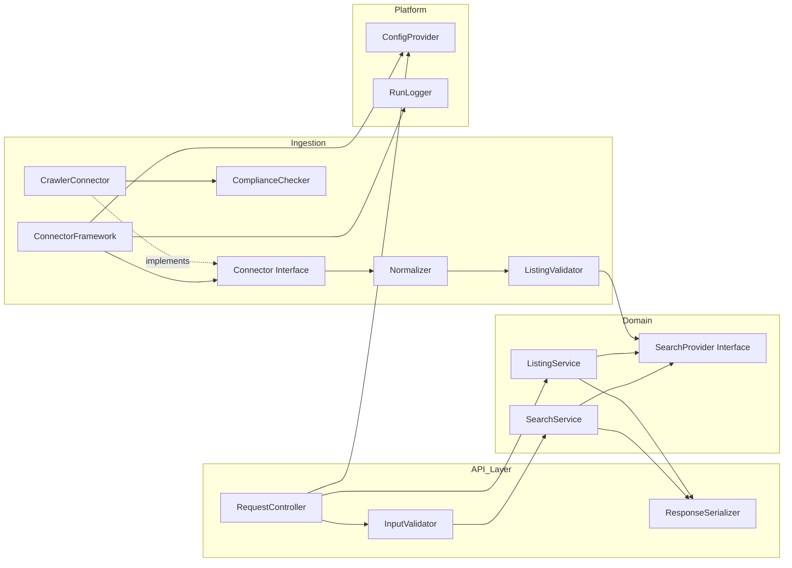

# Design Document

## Overview

Dieses Dokument beschreibt das technische Design der quelloffenen Immobilien-Plattform. Die Plattform besteht aus drei Schichten:

1. **Agent-first Backend** — eine über AWS API Gateway bereitgestellte, maschinenlesbar dokumentierte `Search_API`, die primär für AI-Agents und AI-Tools, sekundär für das Frontend ausgelegt ist.
2. **Datenbeschaffungsschicht** — ein modulares `Connector_Framework` mit einer einheitlichen Connector-Schnittstelle (DB, externe API, rechtskonformer Webcrawler), das heterogene Quellen in ein normalisiertes `Listing`-Datenmodell überführt.
3. **White-Label Frontend** — eine Angular-Single-Page-Application, deren Branding (Logo, Farben, Texte) zur Laufzeit aus einer externen `Theme_Config` geladen wird, ohne Code-Änderung.

Die gesamte Infrastruktur wird als Infrastructure-as-Code (AWS CDK) definiert und ist mit einem einzigen Befehl in einem leeren AWS-Konto provisionierbar. Alle umgebungs- und quellenspezifischen Werte stammen aus einer externen Konfigurationsquelle; keine Werte sind hartkodiert.

Leitprinzipien: **Agent-first**, **maximale Adaptierbarkeit (White-Labeling)**, **Pluggability ohne Kern-Code-Änderung**, **Compliance-by-default beim Crawling** und **schlanke, verständliche Open-Source-Architektur (YAGNI)**.

### Zuordnung Design → Requirements (Überblick)

| Design-Baustein | Adressierte Requirements |
| --- | --- |
| Search_API (Query/Get/Discovery) | 1, 2, 3, 9, 11 |
| Listing_Store & Datenmodell | 4 |
| Connector_Framework | 5 |
| Crawler_Connector & Compliance_Checker | 6, 11 |
| Frontend (Suche) | 7 |
| Frontend (Theming / White-Labeling) | 8 |
| Infrastructure-as-Code & Konfiguration | 9, 10, 11 |
| Dokumentation & Open Source | 3, 8, 10 |

## Architecture

### Technologie-Rationale

Die wesentlichen Technologieentscheidungen und ihre Begründung — bewusst schlank gehalten:

| Entscheidung | Wahl | Begründung | Verworfene Alternative |
| --- | --- | --- | --- |
| Compute Backend | **AWS Lambda** (Node.js/TypeScript) | Serverless, keine zu verwaltende Infra, skaliert auf null — passend für ein Open-Source-Projekt, das in beliebigen Konten reproduzierbar laufen soll. Erfüllt das IaC-"ein Befehl"-Ziel (Req 9.2) ohne Cluster-Betrieb. | ECS/Fargate (Dauerbetriebskosten, mehr Betriebslast). |
| API-Zugang | **AWS API Gateway (REST)** | Durch Requirement 9.1 vorgegeben. REST (statt HTTP-API) wegen nativer Request-Validierung gegen das OpenAPI-Schema und Modell-Validierung an der Kante (Req 1.5/1.6/3.5). | HTTP-API (günstiger, aber schwächere eingebaute Validierung). |
| Primärer Listing-Store | **Amazon DynamoDB** | Schlüsselbasierter Einzelabruf (Req 2.1 < 2 s), Upsert-Semantik (Req 4.4) und Serverless-Kostenmodell. Deterministische Paginierung über stabilen Sortierschlüssel. | RDS/Aurora (Betriebslast, Over-Engineering für den Kern-Use-Case). |
| Such-/Filterindex | **Amazon OpenSearch Serverless** (optional, konfigurierbar) | Mehrfach-Range-Filter mit UND-Verknüpfung und Paginierung (Req 1.1–1.4) werden effizient und ausdrucksstark unterstützt. Als austauschbarer `SearchProvider` abstrahiert; ein DynamoDB-basierter Provider dient als schlanker Default für kleine Datenmengen. | Reiner DynamoDB-Query (unflexibel bei mehreren Range-Filtern). |
| Frontend-Framework | **Angular** | Durch Vision bevorzugt. Begründung: integriertes, opinionated Framework (Router, Forms, DI, HttpClient) reduziert Architektur-Entscheidungen in einem Open-Source-Projekt; starke typisierte reaktive Formulare passen zur Filtervalidierung (Req 7.2); `APP_INITIALIZER` erlaubt sauberes Laden der `Theme_Config` vor App-Start (Req 8.1/8.2). Reaktive Formulare + DI erleichtern Mitwirkenden den Einstieg. | **React** — leichtgewichtiger und verbreiteter, aber benötigt mehr Zusatzentscheidungen (Routing, State, Forms) und damit mehr implizites Wissen für Contributor. React bleibt eine tragfähige Alternative und wird in der Doku als solche erwähnt. |
| Frontend-Hosting | **S3 + CloudFront** | Statische SPA, global gecacht, günstig, vollständig per IaC. Theme_Config als separate, nicht aggressiv gecachte Datei. | Amplify Hosting (mehr Magie, weniger transparent für Open Source). |
| Connector-Orchestrierung | **EventBridge Scheduler → Lambda/Step Functions** | Zeitgesteuerte Connector-Läufe (Req 11.1 Zeitplan-Intervalle). Step Functions kapselt Zeitlimit (Req 5.7) und Isolation zwischen Connectors. | Dauerläufer/Cron auf EC2 (Betriebslast). |
| Konfiguration | **SSM Parameter Store + Secrets Manager** | Externe Konfiguration, benannte Werte, Secrets getrennt (Req 9.3, 11.1). Start-Validierung prüft Pflichtwerte (Req 9.4, 11.2). | `.env`-Dateien im Image (nicht auditierbar, Secret-Risiko). |
| IaC | **AWS CDK (TypeScript)** | Gleiche Sprache wie Backend/Connectors → ein Sprachraum für Contributor, typsichere Infra, `cdk deploy` als "ein Befehl" (Req 9.2). Snapshot-/Assertion-Tests für Infra möglich. | **Terraform** — ebenfalls valide, cloud-agnostisch; verworfen, weil es einen zweiten Sprach-/Tooling-Raum (HCL) einführt und das Ziel "ein Sprachraum, niedrige Einstiegshürde" für ein kleines OSS-Projekt schlechter trifft. Terraform wird in der Doku als Alternative genannt. |

### Architektur-Übersicht

```mermaid
graph TB
    subgraph Clients
        AG[AI_Agent / AI_Tool]
        BR[Browser-Nutzer]
    end

    subgraph Frontend_Hosting[Frontend Hosting]
        CF[CloudFront]
        S3F[S3: Angular SPA + theme-config.json]
    end

    subgraph API[API-Schicht]
        APIGW[AWS API Gateway REST\nRequest-Validierung]
    end

    subgraph Compute[Backend Lambdas]
        LQ[SearchQuery Lambda]
        LG[GetListing Lambda]
        LD[Discovery Lambda\nOpenAPI-Schema]
    end

    subgraph Data[Datenhaltung]
        DDB[(DynamoDB\nListing_Store)]
        OS[(OpenSearch Serverless\nSuchindex - optional)]
    end

    subgraph Ingestion[Datenbeschaffung]
        SCH[EventBridge Scheduler]
        SF[Step Functions\nConnector_Lauf]
        CFW[Connector_Framework Lambda]
        CC[Compliance_Checker]
    end

    subgraph Config[Konfiguration]
        SSM[SSM Parameter Store]
        SEC[Secrets Manager]
    end

    subgraph ExtSources[Externe Quellen]
        RDB[(Relationale DB)]
        EXTAPI[Externe API]
        WEB[Webseiten / Zielseiten]
    end

    BR --> CF --> S3F
    BR -. theme-config.json .-> CF
    AG --> APIGW
    BR --> APIGW
    APIGW --> LQ
    APIGW --> LG
    APIGW --> LD
    LQ --> OS
    LQ --> DDB
    LG --> DDB
    OS -. indexiert .- DDB

    SCH --> SF --> CFW
    CFW --> RDB
    CFW --> EXTAPI
    CFW --> CC --> WEB
    CFW --> DDB
    CFW -. reindex .-> OS

    LQ -.liest.-> SSM
    CFW -.liest.-> SSM
    CFW -.liest.-> SEC
```

### Request-Pfade

- **Agent/Frontend-Suche:** Client → API Gateway (validiert Parameter gegen OpenAPI-Modell) → SearchQuery-Lambda → SearchProvider (OpenSearch oder DynamoDB) → normalisierte, paginierte Antwort.
- **Detailabruf:** Client → API Gateway → GetListing-Lambda → DynamoDB `GetItem` → vollständiges Listing.
- **Discovery:** Client → API Gateway → Discovery-Lambda → statisch gepflegtes, validiertes OpenAPI-Dokument.
- **Datenimport:** EventBridge Scheduler → Step Functions (pro aktivem Connector, mit Zeitlimit) → Connector_Framework-Lambda → Connector → Normalisierung/Validierung → DynamoDB-Upsert → (optional) OpenSearch-Reindex.

## Components and Interfaces

### Komponentenübersicht



### Backend-Schnittstellen

#### Search_API Endpunkte

| Methode | Pfad | Zweck | Requirements |
| --- | --- | --- | --- |
| `GET` | `/listings` | Suche mit Search_Filter, Paginierung | 1, 11.3 |
| `GET` | `/listings/{id}` | Einzel-Listing-Detail | 2 |
| `GET` | `/openapi.json` | Discovery: maschinenlesbares API_Schema | 3.1, 3.2 |

**`GET /listings` Query-Parameter** (alle optional, UND-verknüpft):

| Parameter | Typ | Bereich / Format | Requirement |
| --- | --- | --- | --- |
| `city` | string | exakte Übereinstimmung | 1.2 |
| `priceMin`, `priceMax` | integer | 0 … 999.999.999 | 1.2, 1.6 |
| `roomsMin`, `roomsMax` | integer | 1 … 99 | 1.2 |
| `areaMin`, `areaMax` | integer | 1 … 100.000 | 1.2, 1.6 |
| `propertyType` | enum | zulässige Listing_Typ-Werte | 1.2 |
| `pageSize` | integer | 1 … 50 (Default 50; 20 ohne Filter, Req 11.3) | 1.3 |
| `pageToken` | string | opaker Cursor der Vorseite | 1.3, 1.4 |

**SearchProvider-Schnittstelle** (Abstraktion über OpenSearch/DynamoDB, austauschbar via Konfiguration):

```typescript
interface SearchQuery {
  city?: string;
  price?: { min?: number; max?: number };
  rooms?: { min?: number; max?: number };
  area?: { min?: number; max?: number };
  propertyType?: PropertyType;
  pageSize: number;      // 1..50
  pageToken?: string;    // opaker Cursor
}

interface SearchResult {
  items: Listing[];      // höchstens pageSize Einträge
  nextPageToken?: string; // vorhanden gdw. weitere Seiten existieren
}

interface SearchProvider {
  search(query: SearchQuery): Promise<SearchResult>; // konjunktive Filterung, deterministische Ordnung
  getById(id: string): Promise<Listing | null>;
  upsert(listing: Listing): Promise<void>;           // vollständiger Ersatz bei existierender id
}
```

Deterministische Ordnung (Req 1.4) wird durch eine feste Sortierung `(price ASC, id ASC)` garantiert; `pageToken` kodiert die Sortierschlüssel des letzten Treffers (keine Offsets), sodass identische Parameter identische Seiten liefern.

#### Connector-Schnittstelle (Pluggability, Req 5.1)

```typescript
interface ConnectorContext {
  config: Record<string, unknown>; // validierte, quellenspezifische Konfiguration
  logger: RunLogger;
  emit(raw: RawRecord): Promise<void>; // übergibt Rohdatensatz an Normalizer→Validator→Store
}

interface Connector {
  readonly type: 'relational-db' | 'external-api' | 'web-crawler';
  initialize(ctx: ConnectorContext): Promise<void>;   // Pflichtoperation: Initialisieren
  run(ctx: ConnectorContext): Promise<void>;          // Pflichtoperation: Ausführen
  reportStatus(): ConnectorStatus;                     // Pflichtoperation: Status-Melden
}

interface ConnectorStatus {
  state: 'idle' | 'running' | 'succeeded' | 'failed';
  imported: number;
  updated: number;
  rejected: number;
}
```

**Registrierung ohne Kern-Code-Änderung:** Connectors werden über eine `ConnectorRegistry` per Konfiguration (Typ + Quellendatei/Modulname) eingebunden. Das Framework kennt nur das `Connector`-Interface; neue Connectors werden als eigenständige Module hinzugefügt und in der Registry-Konfiguration referenziert — der Kern bleibt unverändert (Req 5.1).

**Connector_Framework-Ablauf pro Lauf:** `initialize` → `run` (emittiert Rohsätze) → je Satz `Normalizer` → `ListingValidator` → bei Erfolg `upsert`, bei Fehler Abweisung + Protokoll (Req 5.5, 5.6, 4.2, 4.3) → nach Lauf Zähler `imported/updated/rejected` protokollieren (Req 5.8). Jeder Lauf läuft in einem Step-Functions-Task mit Zeitlimit (Default 300 s, Req 5.7); eine Überschreitung beendet nur den betroffenen Connector und protokolliert, andere laufen weiter.

#### Compliance_Checker & Crawler (Req 6, 11.6/11.7)

```typescript
interface ComplianceDecision {
  allowed: boolean;
  reason: string;          // immer gesetzt (Grund bei Ablehnung/Bestätigung)
  checkedAt: string;       // ISO-8601 mit Zeitzone
}

interface ComplianceChecker {
  // Prüft Erlaubnisliste, robots.txt (Timeout 10 s) und Pfad-Regeln VOR jedem Abruf
  check(targetUrl: string): Promise<ComplianceDecision>;
}
```

Der `CrawlerConnector` ruft eine Zielseite ausschließlich ab, wenn `check(...)` zuvor `allowed === true` zurückgegeben hat. Ablaufregeln:

- Zielseite nicht auf `Erlaubnisliste` → `allowed=false` ohne Netzzugriff (Req 6.4).
- `robots.txt`-Abruf > 10 s oder Fehler → kein Abruf, Protokoll mit Grund (Req 6.2).
- `robots.txt` verbietet Pfad → Pfad nicht abrufen (Req 6.3).
- Rate-Limit pro Zielseite (0,1–100 req/s): Mindestwartezeit = `1 / rate` Sekunden zwischen zwei Anfragen an dieselbe Zielseite (Req 6.5).
- Jeder Abruf wird mit URL, Compliance-Ergebnis (+Grund) und Zeitstempel (Datum/Uhrzeit/Zeitzone) protokolliert (Req 6.6).
- Kann Zulässigkeit nicht bestätigt werden → kein Abruf, Protokoll "unzulässig + Grund" (Req 6.7, 11.7).

#### ConfigProvider (Req 9.3/9.4, 11.1/11.2)

```typescript
interface ConfigProvider {
  // Lädt benannte Werte aus SSM/Secrets; wirft beim Start, wenn ein Pflichtwert fehlt/leer ist
  requireAll(names: string[]): Record<string, string>;
}
```

Beim Start (Lambda-Init bzw. Connector-Init) werden alle als erforderlich markierten Konfigurationswerte geladen; fehlt oder leert einer, bricht die Komponente mit einer maschinenlesbaren Fehlermeldung ab, die den Namen des fehlenden Werts nennt.

### Frontend-Komponenten (Angular)

```mermaid
sequenceDiagram
    participant U as Nutzer
    participant APP as App (APP_INITIALIZER)
    participant TC as ThemeConfigLoader
    participant S3 as S3/CloudFront (theme-config.json)
    participant SF as SearchForm
    participant API as Search_API

    APP->>TC: beforeAppStart()
    TC->>S3: GET theme-config.json
    S3-->>TC: Branding-Werte (oder Fehler)
    TC->>TC: validieren; je Wert gültig→übernehmen, sonst Default + log
    TC-->>APP: ThemeModel (immer vollständig)
    U->>SF: Filter setzen + Suche auslösen
    SF->>SF: reactive-form Validierung (min<=max etc.)
    SF->>API: GET /listings?...  (nur bei gültigen Werten)
    API-->>SF: Listings (<=50) | Fehler | leer
    SF->>U: Liste | Hinweis "keine Ergebnisse" | Fehlermeldung
```

| Komponente | Verantwortung | Requirements |
| --- | --- | --- |
| `ThemeConfigLoader` (`APP_INITIALIZER`) | lädt `theme-config.json` zur Laufzeit vor App-Start; validiert je Wert; Fallback auf dokumentierten Default; protokolliert ungültige Werte | 8.1–8.5 |
| `ThemeService` | stellt validiertes `ThemeModel` bereit (CSS-Custom-Properties, Logo-URL, Texte) | 8.1 |
| `SearchFormComponent` | reaktive Formulare mit Filtergrenzen, clientseitige Validierung, Werterhaltung bei Fehler | 7.1, 7.2, 7.7 |
| `ResultListComponent` | zeigt ≤50 Listings mit Ort/Preis/Zimmer/Fläche/Typ; "keine Ergebnisse"-Hinweis | 7.3, 7.4, 7.6 |
| `ListingDetailComponent` | zeigt vollständige Details | 7.5 |
| `ApiClient` | ruft Search_API; 10-s-Timeout; Fehlermeldung + Werterhalt | 7.7 |

**Theme-Laufzeitladung (White-Labeling):** Die SPA bündelt kein Branding. Eine separate `theme-config.json` liegt neben dem SPA-Build in S3 und wird von CloudFront mit kurzer bzw. `no-cache`-Policy ausgeliefert. Beim Laden (oder Neuladen innerhalb von 5 s, Req 8.2) wird sie ausgewertet; Farben werden als CSS-Custom-Properties (`--brand-primary` etc.) gesetzt. Dadurch ändert sich das Branding ohne Quellcode-Änderung und ohne Neu-Build.

## Data Models

### Listing (normalisiertes Kernmodell, Req 4.1)

```typescript
type PropertyType = 'apartment' | 'house' | 'land' | 'commercial' | 'other';

interface Listing {
  id: string;            // 1..128 Zeichen, eindeutig (Partition Key)
  city: string;          // 1..200 Zeichen
  price: number;         // 0.01 .. 999999999.99
  rooms: number;         // 0 .. 100
  area: number;          // 1 .. 100000 (m²)
  propertyType: PropertyType;
  description: string;   // 0 .. 5000 Zeichen
  // Herkunfts-/Audit-Felder (Req 4.5)
  source: string;        // Quellenbezeichner
  lastImportedAt: string;// ISO-8601 Zeitpunkt des letzten Imports
}
```

### DynamoDB-Tabellendesign (Listing_Store)

| Element | Wert |
| --- | --- |
| Tabelle | `Listings` |
| Partition Key | `id` (string) |
| Attribute | `city, price, rooms, area, propertyType, description, source, lastImportedAt` |
| Upsert | `PutItem` ersetzt den Datensatz vollständig (Req 4.4) |
| Einzelabruf | `GetItem` by `id` (Req 2.1) |

Bei aktivem OpenSearch-Provider wird dieselbe Struktur in einen Index gespiegelt; `price` und `id` bilden die deterministische Sortierung (`price ASC, id ASC`). Der `pageToken` kodiert `{lastPrice, lastId}` (opak, base64) — kein Offset, damit Wiederholungen stabil sind (Req 1.4).

### Fehler-Antwortmodell (einheitlich, Req 3.4)

```typescript
interface ApiError {
  code: string;          // eindeutiger maschinenlesbarer Fehlercode, z.B. "INVALID_FILTER"
  message: string;       // menschenlesbar
  field?: string;        // betroffenes Feld bei Validierungsfehlern (Req 1.5, 1.6, 3.5)
  missingId?: string;    // bei 404 der fehlende Bezeichner (Req 2.2)
}
```

### Theme_Config-Modell (Req 8.1, 8.6)

```json
{
  "logoUrl": "string (URL)",
  "colors": { "primary": "#RRGGBB", "secondary": "#RRGGBB" },
  "texts": { "appTitle": "string", "searchHeadline": "string" }
}
```

Jeder Wert ist optional; fehlende oder ungültige Werte werden durch dokumentierte Defaults ersetzt (Req 8.3–8.5). Zulässige Formate (z. B. Hex-Farben, URL) sind in der Theming-Dokumentation beschrieben (Req 8.6).

### Connector-Konfigurationsmodell (Req 5.3/5.4)

```json
{
  "id": "string",
  "type": "relational-db | external-api | web-crawler",
  "enabled": true,
  "settings": { "...quellenspezifisch...": "..." },
  "timeoutSeconds": 300,
  "crawler": {
    "allowList": ["https://erlaubt.example"],
    "ratePerSecond": 1.0
  }
}
```

## Correctness Properties

*A property is a characteristic or behavior that should hold true across all valid executions of a system — essentially, a formal statement about what the system should do. Properties serve as the bridge between human-readable specifications and machine-verifiable correctness guarantees.*

Diese Properties leiten sich aus der Prework-Analyse der Acceptance Criteria ab. Redundante Kriterien wurden konsolidiert (siehe Testing Strategy für die Zuordnung). Jede Property ist universell quantifiziert und auf die reine Logik der Plattform (Filterung, Paginierung, Validierung, Normalisierung, Upsert, Compliance-Gate, Theming) gerichtet.

### Property 1: Konjunktive Filterung

*For any* Menge gespeicherter Listings und *for any* Kombination gesetzter Search_Filter liefert die Suche genau jene Listings zurück, die **alle** gesetzten Filterkriterien gleichzeitig erfüllen — kein zurückgegebenes Listing verletzt einen Filter, und kein im Bestand passendes Listing fehlt.

**Validates: Requirements 1.1, 1.2**

### Property 2: Paginierungsgrenze und Folgeseiten-Token

*For any* Treffermenge und *for any* gültige `pageSize` enthält eine Ergebnisseite höchstens `pageSize` Listings (höchstens 50 mit Filter, höchstens 20 ohne Filter), und ein `nextPageToken` ist genau dann vorhanden, wenn weitere, noch nicht ausgelieferte Treffer existieren.

**Validates: Requirements 1.3, 11.3**

### Property 3: Deterministische, totale Paginierungsordnung

*For any* Suchanfrage liefert eine Wiederholung mit identischen Filter- und Paginierungsparametern dieselbe Listing-Reihenfolge; und das vollständige seitenweise Durchblättern einer Treffermenge ergibt jedes passende Listing genau einmal, ohne Duplikate oder Lücken (totale, stabile Ordnung über `(price, id)`).

**Validates: Requirements 1.4**

### Property 4: Filter-Eingabevalidierung lehnt ungültige Werte ab

*For any* Suchanfrage mit mindestens einem syntaktisch ungültigen Filterwert oder einem Range mit Minimalwert größer als Maximalwert (Preis oder Fläche) antwortet die Search_API mit Status 400 und benennt das betroffene Feld, ohne die Suche auszuführen.

**Validates: Requirements 1.5, 1.6, 3.5**

### Property 5: Antwort-Schema-Konformität

*For any* von der Search_API serialisiertes Listing stimmen Feldnamen und Datentypen der Antwort mit dem im API_Schema beschriebenen Listing-Datenmodell überein.

**Validates: Requirements 3.3**

### Property 6: Einheitliche Fehlerstruktur

*For any* fehlgeschlagene Anfrage enthält die Fehlerantwort einen nicht-leeren, eindeutigen, maschinenlesbaren Fehlercode und eine nicht-leere menschenlesbare Beschreibung.

**Validates: Requirements 3.4**

### Property 7: Listing-Validierung vor Speicherung

*For any* importiertes Listing wird es genau dann im Listing_Store akzeptiert, wenn alle Pflichtfelder vorhanden sind und jeder Feldwert innerhalb seines zulässigen Wertebereichs bzw. seiner Werteliste liegt.

**Validates: Requirements 4.1, 4.2**

### Property 8: Abweisung lässt den Datenbestand unverändert

*For any* ungültiges importiertes Listing bleibt der Listing_Store nach der Abweisung bitweise unverändert gegenüber dem Zustand davor, und das betroffene Feld wird protokolliert.

**Validates: Requirements 4.3, 5.6**

### Property 9: Upsert-Idempotenz und vollständige Aktualisierung

*For any* Listing gilt: wird es mit einer bereits vorhandenen `id` importiert, so entspricht der gespeicherte Datensatz anschließend vollständig den importierten Werten; ein erneuter Import desselben Listings ändert den Store nicht weiter (Idempotenz), und die Anzahl der Datensätze wächst durch wiederholten Import derselben `id` nicht.

**Validates: Requirements 4.4**

### Property 10: Herkunfts- und Audit-Felder werden gesetzt

*For any* erfolgreich gespeichertes Listing sind nach dem Import die Felder `source` (Datenquelle) und `lastImportedAt` (Zeitpunkt des letzten Imports) gesetzt.

**Validates: Requirements 4.5**

### Property 11: Normalisierung vor Speicherung

*For any* von einem Connector emittierten Rohdatensatz entspricht das im Listing_Store gespeicherte Objekt dem einheitlichen, normalisierten Listing-Datenmodell, unabhängig vom Quellformat.

**Validates: Requirements 5.5**

### Property 12: Ungültige Connector-Konfiguration wird abgelehnt

*For any* Connector-Aktivierung mit ungültiger Konfiguration lehnt das Connector_Framework die Ausführung ab (die `run`-Operation wird nicht aufgerufen) und protokolliert den Grund der Ablehnung.

**Validates: Requirements 5.4**

### Property 13: Lauf-Zähler-Buchhaltung

*For any* abgeschlossenen Connector_Lauf gilt: die Summe aus protokollierten importierten, aktualisierten und abgewiesenen Listings entspricht der Gesamtzahl der verarbeiteten Datensätze, und die Anzahl der aktualisierten entspricht der Anzahl der Datensätze mit bereits vorhandener `id`.

**Validates: Requirements 5.8**

### Property 14: robots.txt-Pfadverbot wird respektiert

*For any* Zielseite mit einer robots.txt, die einen Pfad untersagt, ruft der Crawler_Connector diesen Pfad nicht ab.

**Validates: Requirements 6.3**

### Property 15: Einhaltung der Abrufrate

*For any* pro Zielseite konfigurierte Abrufrate `r` (0,1 ≤ r ≤ 100) beträgt der zeitliche Abstand zwischen zwei aufeinanderfolgenden Anfragen an dieselbe Zielseite mindestens `1/r` Sekunden.

**Validates: Requirements 6.5**

### Property 16: Vollständigkeit des Crawl-Protokolls

*For any* Crawl_Lauf existiert je betrachteter Zielseite ein Protokolleintrag mit abgerufener Adresse, Compliance-Ergebnis (zulässig oder unzulässig mit Grund) und Zeitpunkt des Abrufs inklusive Datum, Uhrzeit und Zeitzone.

**Validates: Requirements 6.6**

### Property 17: Compliance-Gate (Default-deny)

*For any* Zielseite ruft der Crawler_Connector sie genau dann ab, wenn der Compliance_Checker für diese Zielseite zuvor die Zulässigkeit bestätigt hat (`allowed === true`). Fehlt die Bestätigung, steht die Seite nicht auf der Erlaubnisliste, schlägt der robots.txt-Abruf fehl oder ist die Zulässigkeit nicht bestätigbar, erfolgt kein Abruf und das Ergebnis wird als unzulässig mit Grund protokolliert.

**Validates: Requirements 6.1, 6.4, 6.7, 11.6, 11.7**

### Property 18: Vollständigkeit des Lauf-Protokolls und Herkunftszuordnung

*For any* Connector_Lauf oder Crawl_Lauf existiert ein Protokolleintrag mit Startzeitpunkt, Endzeitpunkt, Quellenbezeichner und Ergebnisstatus (Erfolg oder Fehler), und jedes in diesem Lauf importierte Listing ist eindeutig diesem Lauf bzw. seiner Quelle zuordenbar.

**Validates: Requirements 11.5**

### Property 19: Config-Start-Validierung

*For any* Startkonfiguration, in der ein als erforderlich markierter Konfigurationswert fehlt oder leer ist, bricht die betroffene Komponente den Start ab und gibt eine maschinenlesbare Fehlerbeschreibung zurück, die den Namen genau dieses fehlenden Werts nennt.

**Validates: Requirements 9.4, 11.2**

### Property 20: Frontend-Filtervalidierung erhält Eingaben

*For any* Suche, die der Nutzer mit ungültigen oder inkonsistenten Filterwerten auslöst, führt das Frontend keinen Aufruf der Search_API durch, benennt das betroffene Feld und erhält die eingegebenen Filterwerte unverändert.

**Validates: Requirements 7.2**

### Property 21: Frontend-Listing-Rendering ist vollständig

*For any* in der Ergebnisliste dargestelltes Listing enthält die gerenderte Darstellung Ort, Preis, Zimmeranzahl, Fläche und Immobilientyp.

**Validates: Requirements 7.4**

### Property 22: Theming-Resolve-Totalität

*For any* Theme_Config — auch mit fehlenden und/oder ungültigen Einträgen — ergibt die Auflösung ein vollständiges Theme-Modell: jeder Branding-Wert entspricht dem Eingabewert, falls dieser gültig ist, andernfalls dem dokumentierten Standardwert; für jeden ungültigen Wert wird ein Fehler protokolliert.

**Validates: Requirements 8.1, 8.3, 8.4, 8.5**

## Error Handling

### Prinzipien

- **Fail fast beim Start:** Fehlende Pflicht-Konfiguration bricht den Start mit benanntem Wert ab (Req 9.4/11.2, Property 19). Kein Degradieren mit halber Konfiguration.
- **Default-deny beim Crawling:** Ohne positive Compliance-Bestätigung kein Abruf (Req 11.6, Property 17).
- **Keine Teilzustände:** Bei Fehlern in der Verarbeitungskette wird nichts teilweise persistiert (Req 9.5).
- **Einheitliches Fehlerschema:** Jede API-Fehlerantwort nutzt `ApiError` mit `code` + `message` (Property 6).

### API-Schicht

| Situation | Status | Verhalten | Requirement |
| --- | --- | --- | --- |
| Ungültiger Filterwert / min>max | 400 | `ApiError{code:"INVALID_FILTER", field}`; Suche nicht ausgeführt | 1.5, 1.6, 3.5 |
| Ungültige/leere Listing-id | 400 | `ApiError{code:"INVALID_ID", field:"id"}` | 2.3 |
| Listing nicht gefunden | 404 | `ApiError{code:"NOT_FOUND", missingId}` | 2.2 |
| Keine Treffer | 200 | leere `items`-Liste | 1.7 |
| Downstream-Dienst nicht erreichbar | 503 | `ApiError{code:"DOWNSTREAM_UNAVAILABLE"}`; nichts persistiert | 9.5 |
| Downstream-Timeout (>10 s) | 503 | Aufruf abgebrochen, `ApiError{code:"DOWNSTREAM_TIMEOUT"}` | 9.6 |
| Detailabruf >2 s | Fehler | Timeout-Fehler signalisiert | 2.4, 11.4 |

API Gateway validiert eingehende Parameter bereits an der Kante gegen das OpenAPI-Modell (Typ/Bereich/Enum); die Lambda-Validierung ist die zweite, autoritative Schicht und Quelle der Feldangabe in `ApiError`.

### Datenbeschaffung

| Situation | Verhalten | Requirement |
| --- | --- | --- |
| Pflichtfeld fehlt / außerhalb Bereich | Listing abgewiesen, Store unverändert, Feld protokolliert | 4.3, 5.6 |
| Normalisierungsfehler | Datensatz abgewiesen + Grund protokolliert | 5.6 |
| Ungültige Connector-Konfig | Ausführung abgelehnt + Grund protokolliert | 5.4 |
| Connector-Zeitlimit (>300 s) | betroffenen Connector beenden, protokollieren, übrige fortsetzen | 5.7 |
| robots.txt-Timeout/Fehler (>10 s) | kein Abruf, Grund im Crawl-Protokoll | 6.2 |
| Zulässigkeit nicht bestätigbar | kein Abruf, "unzulässig + Grund" protokolliert | 6.7, 11.7 |

Isolation der Connector-Läufe erfolgt über getrennte Step-Functions-Ausführungen pro Connector, sodass ein Fehler oder Timeout eines Connectors die anderen nicht beeinflusst (Req 5.7).

### Frontend

| Situation | Verhalten | Requirement |
| --- | --- | --- |
| Ungültige Filtereingabe | clientseitige Validierung, Feld benannt, Werte erhalten, kein API-Call | 7.2 |
| API-Fehler oder Timeout (>10 s) | menschenlesbare Fehlermeldung, Filterwerte erhalten | 7.7 |
| Keine Treffer | "keine Ergebnisse"-Hinweis | 7.6 |
| Theme_Config fehlt/ungültig | Default-Werte verwenden, Fehler protokollieren | 8.3, 8.4, 8.5 |

## Testing Strategy

Es wird ein **dualer Testansatz** verfolgt: Property-based Tests validieren universelle Eigenschaften über viele generierte Eingaben; Unit-/Integration-/Smoke-Tests decken konkrete Beispiele, Infrastruktur und Artefakte ab.

### Property-based Testing

**Anwendbarkeit:** PBT ist für die Kernlogik dieses Features angemessen, da zentrale Bausteine reine, input-abhängige Funktionen sind: Filterung, Paginierung/Ordnung, Validierung, Normalisierung, Upsert-Semantik, das Compliance-Gate und die Theming-Auflösung. Für diese existieren echte "für alle Eingaben X gilt P(X)"-Aussagen.

**Bibliothek:** [`fast-check`](https://github.com/dubzzz/fast-check) für TypeScript (Backend-Logik, Connector/Compliance-Logik und Angular-Logik). PBT wird **nicht** selbst implementiert.

**Konfiguration:**
- Jeder Property-Test läuft mit **mindestens 100 Iterationen** (`fc.assert(..., { numRuns: 100 })`).
- Jede Property wird mit **genau einem** Property-Test implementiert.
- Jeder Test trägt einen Kommentar im Format: **Feature: real-estate-platform, Property {number}: {property_text}**.
- Externe Abhängigkeiten (Store, HTTP, Uhr) werden für PBT gemockt bzw. durch In-Memory-Fakes und eine simulierte Uhr ersetzt (u. a. für Property 15 Rate-Limit), damit 100+ Iterationen schnell und ohne AWS-Kosten laufen.

**Property → Test-Abdeckung:** Die 22 Correctness Properties werden 1:1 auf Property-Tests abgebildet (Properties 1–22). Konsolidierte Requirements (3.5→Prop 4, 11.2→Prop 19, 5.6→Prop 8, 6.1/6.4/6.7/11.7→Prop 17, 8.1/8.3/8.4→Prop 22) sind über die jeweilige Property abgedeckt.

### Unit- und Beispieltests

Für Kriterien, die nicht als universelle Property sinnvoll sind (konkrete Beispiele, Interaktionen):
- Leere Trefferliste → 200 + `[]` (Req 1.7).
- Discovery liefert gültiges OpenAPI-Dokument, das alle Endpunkte/Parameter/Enum-Bereiche und das Listing-Modell beschreibt (Req 3.1, 3.2) — Schema-Validierung.
- Connector-Registrierung: Dummy-Connector via Registry-Konfig → Framework ruft `initialize/run/reportStatus` (Req 5.1, 5.2, 5.3).
- Frontend: Suchformular rendert alle Filterfelder (Req 7.1); Ergebnisliste zeigt ≤50 (Req 7.3); Detailauswahl (Req 7.5); "keine Ergebnisse"-Hinweis (Req 7.6); Fehler/Timeout-Anzeige mit Werterhalt (Req 7.7).

### Integrationstests

Für Infrastruktur-/Latenz-/Downstream-Verhalten (input-unabhängig, 1–3 Beispiele):
- Detailabruf < 2 s / Timeout-Verhalten (Req 2.1, 2.4, 11.4).
- API-Antwort über API Gateway < 5 s (Req 9.1).
- Downstream nicht erreichbar → 503, nichts persistiert (Req 9.5); Downstream-Timeout → 503 (Req 9.6).
- Connector-Zeitlimit beendet nur betroffenen Connector (Req 5.7).
- Theme_Config-Änderung wird nach Neuladen < 5 s übernommen (Req 8.2).
- robots.txt-Timeout/Fehler → kein Abruf (Req 6.2).

### Smoke-Tests und Artefaktprüfungen

- `cdk synth` erfolgreich; `cdk deploy` in leerem Konto ohne manuelle Schritte (Req 9.2).
- Statische Prüfung: keine hartkodierten Endpunkte/Secrets, alle Werte extern (Req 11.1).
- Doku-Existenz/Vollständigkeit: Installations-, Erweiterungs-, Theming-, API- und Connector-Doku je einzeln; OSI-anerkannte Lizenzdatei; Request/Response-Beispiel je Endpunkt (Req 3.6, 8.6, 10.1–10.5).
- Infra-Assertion-/Snapshot-Tests der CDK-Stacks (API Gateway-Validierung aktiv, Scheduler, Store, Hosting).
