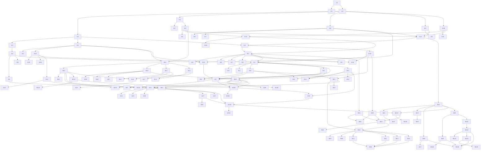

# Implementation Plan: Real Estate Platform

## Overview

Der Plan setzt das Design inkrementell um. Nach Monorepo-Gerüst und CI folgt sofort ein **Walking Skeleton**: minimales Listing-Schema, eine `GET /listings`-Lambda hinter API Gateway REST, eine DynamoDB-Tabelle, ein Seed-Skript und ein per `cdk deploy` bereitstellbarer Stack. Danach wird die Fachlogik schichtweise in die Breite ausgebaut. Die Reihenfolge ist: `shared` (Schema, Money, Cursor, Taxonomie, Locale-Matching), dann `core` (SearchService, ListingService, SearchProvider, AccessGuard), `api`, `ingestion`, Crawler, `mcp`, `admin`, `frontend`, OpenSearch-Provider mit Indexer, Observability/Lasttest und zuletzt die Dokumentation. Die Infrastruktur (CDK) **wächst pro Feature mit**: Jeder Abschnitt hat einen eigenen Infra-Sub-Task statt eines großen IaC-Blocks am Ende.

Sprache: **TypeScript (strict)** für alle Pakete (`shared`, `core`, `api`, `mcp`, `admin`, `ingestion`, `frontend` (Angular), `infra` (AWS CDK)). Schemas basieren auf **Zod v4** in `@open-estate/shared`, Tests auf **Jest + fast-check**. Jede der 39 Correctness Properties ist genau ein optionaler PBT-Sub-Task (`*`) direkt bei der implementierenden Logik. Jeder Property-Test läuft mit `fc.assert(..., { numRuns: 100 })` und trägt den Tag-Kommentar `Feature: real-estate-platform, Property N: ...`.

Angebote: Ein Listing kann **nur zum Kauf (`SALE`), nur zur Miete (`RENT`) oder gleichzeitig zum Kauf und zur Miete** angeboten werden (`offers[]` mit 1–2 Einträgen, je Art höchstens einer; Req 12.1, 12.14). Seed-Daten, Generatoren, Suche, Ergebnisliste und Detailansicht decken alle drei Varianten ausdrücklich ab.

## Tasks

- [x] 1. Monorepo-Gerüst
  - [x] 1.1 Monorepo mit Paketen und Tooling anlegen
    - npm-Workspaces `packages/shared`, `core`, `api`, `mcp`, `admin`, `ingestion`, `frontend`, `infra` mit Abhängigkeitsrichtung gemäß Design (`shared` ohne AWS-Abhängigkeit)
    - Gemeinsame `tsconfig.base.json` (`strict: true`), ESLint, Prettier, Jest-Konfiguration mit fast-check, Ordner `packages/shared/test/arbitraries`
    - OSI-anerkannte Lizenzdatei (`LICENSE`, z. B. Apache-2.0) im Repository-Wurzelverzeichnis
    - npm-Skripte `lint`, `test`, `build`, `synth`
    - _Requirements: 9.2, 10.4_

- [x] 2. Continuous Integration
  - [x] 2.1 GitHub-Actions-Workflow anlegen
    - `.github/workflows/ci.yml`: Node-LTS, `npm ci`, `lint`, `test`, `build`, `cdk synth` für Push und Pull Request
    - _Requirements: 9.2_

- [x] 3. Walking Skeleton (dünner End-to-End-Durchstich)
  - [x] 3.1 Minimales Listing-Schema und Fehlermodell in `shared` anlegen
    - Zod-Schema mit `id`, `title`, `offers` (1–2, `SALE`|`RENT`), `address.city`, `postalCode`, `listingType`; `ApiError`/`ErrorResponse`-Typen und Grundgerüst des `ErrorCode`-Katalogs
    - _Requirements: 3.3, 3.4, 12.1_

  - [x] 3.2 Minimalen SearchProvider in `core` anlegen
    - `SearchProvider`-Interface; In-Memory-Implementierung und einfacher DynamoDB-Provider (Scan, `id ASC`, `pageSize`-Begrenzung)
    - _Requirements: 1.5, 1.6_

  - [x] 3.3 Lambda-Handler `GET /listings` in `api` anlegen
    - Liest `pageSize` (Default 20), ruft den Provider auf und liefert `200 {items, nextPageToken?}` bzw. `200 {items: []}`
    - _Requirements: 1.6, 1.12, 9.1_

  - [x] 3.4 CDK-Grundstacks in `infra` anlegen
    - `DataStack` (Tabelle `Listings`, PK `id`), `ApiStack` (API Gateway REST, `NodejsFunction` für `GET /listings`); CDK-App mit Umgebungsparameter, Ausgabe der API-URL; deploybar per `cdk deploy`
    - _Requirements: 9.1, 9.2_

  - [x] 3.5 Seed-Skript mit Beispiel-Listings anlegen
    - `infra/scripts/seed.ts`: schreibt Beispiel-Listings in `Listings`, darunter je mindestens ein Listing nur `SALE`, nur `RENT` und `SALE` + `RENT`; Tabellenname aus Stack-Output bzw. Umgebung (nicht hartkodiert)
    - _Requirements: 12.1, 11.1_

  - [x]* 3.6 Skeleton-Tests schreiben
    - CDK-Assertions (Tabelle, REST-API, Lambda-Integration); Handler-Test gegen In-Memory-Provider (Seitengröße, leere Liste → 200)
    - _Requirements: 1.6, 1.12, 9.2_

- [x] 4. Checkpoint - Walking Skeleton
  - Ensure all tests pass, ask the user if questions arise.

- [x] 5. `shared`: Schema und reine Domänenlogik
  - [x] 5.1 Geldbeträge implementieren (`toMinor`, `formatDecimal`, `Money`-Schema)
    - String-basiertes Parsing (nie `parseFloat * 100`), Hundertstel als Integer, Bereich 0,01–999.999.999,99, höchstens zwei Nachkommastellen; Flächen-Parsing analog (1–100.000)
    - _Requirements: 4.3, 4.5, 12.2, 12.3_

  - [x]* 5.2 Property-Test für Geldbetrags- und Dezimal-Round-Trip schreiben
    - **Property 10: Geldbetrags- und Dezimal-Round-Trip**
    - **Validates: Requirements 4.3, 4.5, 12.2, 12.3**

  - [x] 5.3 Vollständiges Listing-Schema und Serialisierung implementieren
    - `LISTING_BOUNDS`; `SaleOffer`/`RentOffer` (`strictObject`, `warmRent ≥ coldRent`, eine Währung je Angebot); `offers` 1–2 mit `uniqueOfferTypes` (nur Kauf, nur Miete oder beides); Zimmer 0–99,5 in 0,5-Schritten; Adresse; Geo-Vorprüfung `lat` xor `lon`; `translations` ≤ 20 mit eindeutigen Locales inkl. Originalsprache; `media` ≤ 50, `tours` ≤ 10; `contact` mit `pii(...)`-Metadaten; Herkunftsfelder `source`, `lastImportedAt`, `lastRunId`
    - `serialize`/`parse` zwischen interner Darstellung (Minor Units) und API-Darstellung (`LocalizedListing` mit Dezimal-Strings, `deliveredLocale`, `originalLocale`, `group`)
    - Generatoren in `test/arbitraries` aus `LISTING_BOUNDS` (inkl. Listings mit `SALE` + `RENT`)
    - _Requirements: 2.1, 3.3, 3.8, 4.1, 4.2, 4.4, 4.5, 4.6, 4.7, 12.1, 12.3, 14.1, 14.2, 16.1, 16.2_

  - [x]* 5.4 Property-Test für Listing-Serialisierungs-Round-Trip schreiben
    - **Property 9: Listing-Serialisierungs-Round-Trip und Schema-Konformität**
    - **Validates: Requirements 2.1, 3.3, 5.5**

  - [x] 5.5 Taxonomie-Schema, `validateTaxonomy` und Default-Taxonomie implementieren
    - Verschachteltes und flaches Format; sammelt alle Verstöße (`DUPLICATE_CODE`, `INVALID_CODE_LENGTH`, `UNKNOWN_GROUP`) mit Code; Default-`taxonomy.json` (Wohnung, Haus, Grundstück, Gewerbe mit den geforderten Typen)
    - _Requirements: 15.1, 15.2, 15.4_

  - [x]* 5.6 Property-Test für Taxonomie-Validierung schreiben
    - **Property 24: Taxonomie-Validierung**
    - **Validates: Requirements 15.1, 15.4**

  - [x]* 5.7 Unit-Test für die Default-Taxonomie schreiben
    - Enthält alle geforderten Gruppen und Typen, jede Gruppe mit mindestens einem Typ
    - _Requirements: 15.2_

  - [x] 5.8 Cursor implementieren (`encodeCursor`/`decodeCursor`, `queryHash`)
    - base64url-JSON `{v:1, lastId, queryHash}`; `queryHash` = SHA-256 der normalisierten Filter + `pageSize`; Fehler `INVALID_PAGE_TOKEN`
    - _Requirements: 1.7, 1.8_

  - [x]* 5.9 Property-Test für Cursor-Round-Trip und Anfragebindung schreiben
    - **Property 6: Cursor-Round-Trip und Bindung an die Anfrage**
    - **Validates: Requirements 1.7, 1.8**

  - [x] 5.10 BCP-47-Validierung und `parseAcceptLanguage` implementieren
    - `lang`-Prüfung (nicht leer, ≤ 35 Zeichen, `Intl.getCanonicalLocales`); Header-Parsing ohne Fehler, verwirft ungültige Einträge, `*` und `q=0`, stabile Sortierung nach q
    - _Requirements: 14.6, 14.9_

  - [x]* 5.11 Property-Test für Accept-Language-Parsing schreiben
    - **Property 27: Accept-Language-Parsing**
    - **Validates: Requirements 14.6**

  - [x] 5.12 Sprachauswahl implementieren (`resolvePreferences`, `selectLocalizedVersion`)
    - `lang` übersteuert den Header; je Präferenz zuerst exakt (case-insensitive), dann primärer Subtag (Originalsprache bevorzugt, sonst lexikografisch kleinste), sonst Originalsprache; Titel und Beschreibung aus derselben Fassung; Codes bleiben sprachneutral
    - _Requirements: 3.8, 14.3, 14.4, 14.5, 14.7, 14.8, 14.10_

  - [x]* 5.13 Property-Test für die Sprachauswahl der API schreiben
    - **Property 26: Sprachauswahl der API**
    - **Validates: Requirements 3.8, 14.3, 14.4, 14.5, 14.7, 14.8, 14.10, 19.4**

  - [x] 5.14 `buildSchemas`, `SearchQuery`-Schema, `parseSearchQuery` und `toApiErrors` implementieren
    - Factory aus Taxonomie + Locales (dynamische Enums); Parameter gemäß Design-Tabelle (`offerType`, Preis/Zimmer/Fläche min/max, `currency`, `city`, `postalCode`, `group` XOR `types` (1–50), `hasTour`, `lang`, `pageSize` 1–50 Default 20, `pageToken`); String-Coercion für API und typisierte Werte für MCP; sammelt alle Fehler (`INVALID_PARAMETER`, `INVALID_RANGE`, `INVALID_PAGE_SIZE`, `INVALID_OFFER_TYPE`, `OFFER_TYPE_REQUIRED`, `CONFLICTING_FILTERS`, `UNKNOWN_TAXONOMY_CODE`, `INVALID_FILTER_COUNT`, `INVALID_LOCALE`); vollständiger `ErrorCode`-Katalog
    - _Requirements: 1.2, 1.9, 1.10, 1.11, 3.4, 3.5, 3.7, 4.7, 12.8, 12.12, 14.9, 15.7, 15.8, 15.10, 19.7_

- [x] 6. `core`: Konfiguration, Suche und Zugangsschutz
  - [x] 6.1 ConfigProvider implementieren (`requireAll`, `loadJson`)
    - SSM, privater S3-Config-Bucket, Secrets Manager; Laden beim Init; `CONFIG_MISSING`/`CONFIG_INVALID` mit Namen; keine hartkodierten Endpunkte oder Secrets
    - _Requirements: 9.3, 9.4, 11.1, 11.2_

  - [x]* 6.2 Property-Test für die Start-Validierung der Konfiguration schreiben
    - **Property 23: Start-Validierung der Konfiguration**
    - **Validates: Requirements 9.4, 11.2**

  - [x] 6.3 Flaches Suchdokument und In-Memory-Referenzprovider implementieren
    - `toSearchDocument`: `cityNorm` (NFC + lowercase), `saleAmountMinor`/`saleCurrency`, `rentAmountMinor`/`rentCurrency` (Listings mit beiden Angeboten füllen beide Feldpaare), `roomsHalf`, `areaMinor`, `tourHosts`
    - In-Memory-Provider erweitern: alle primitiven Bedingungen der `ResolvedQuery`, Ordnung `id ASC`, Lookahead `pageSize + 1`, Cursor
    - _Requirements: 1.1, 1.2, 1.3, 1.4, 1.5, 1.7, 1.8, 12.6, 12.7, 12.9, 16.9_

  - [x] 6.4 SearchService und ListingService implementieren
    - Übersetzt `group` → Typ-Codes der geladenen Taxonomie, `hasTour` → aktuelle Tour-Hosts, Preis → `amountMinor`, fehlende `currency` → Standardwährung; wendet `selectLocalizedVersion` je Listing an; `ListingService.get` wirft `NOT_FOUND` mit `details.id`
    - _Requirements: 1.1, 1.12, 2.1, 2.2, 12.6, 12.7, 12.9, 14.3, 15.5, 15.6, 15.11, 16.9_

  - [x]* 6.5 Property-Test für konjunktive Filterung schreiben
    - **Property 1: Konjunktive Filterung entspricht dem Referenzmodell**
    - **Validates: Requirements 1.1, 1.2, 1.3, 1.4, 1.12, 16.9**

  - [x]* 6.6 Property-Test für Angebotsart- und Preisfilter schreiben
    - Generator enthält Listings nur `SALE`, nur `RENT` und `SALE` + `RENT`; ein Listing mit beiden Angeboten erscheint bei passender Suche nach `SALE` und nach `RENT`
    - **Property 2: Angebotsart- und Preisfilter wirken je Angebot und Währung**
    - **Validates: Requirements 12.6, 12.7, 12.9**

  - [x]* 6.7 Property-Test für den Gruppenfilter schreiben
    - **Property 3: Gruppenfilter ≡ Vereinigung ihrer Typen**
    - **Validates: Requirements 15.5, 15.6, 15.11**

  - [x]* 6.8 Property-Test für Seitengröße und Folgeseiten-Verweis schreiben
    - **Property 4: Seitengröße und Folgeseiten-Verweis**
    - **Validates: Requirements 1.5, 1.6, 1.7**

  - [x]* 6.9 Property-Test für deterministische, totale Ordnung schreiben
    - **Property 5: Deterministische, totale Ordnung**
    - **Validates: Requirements 1.8, 19.3**

  - [x] 6.10 DynamoDB-SearchProvider vollständig implementieren
    - Ersetzt den Skeleton-Provider: GSI `byId` (PK `L`, SK `id`), `FilterExpression` über flache Felder, seitenweises Weiterlesen bis `pageSize + 1`, `getById`; Schreibhilfe für Listing + flache Suchfelder; Request-Deadline 4,5 s, Downstream-Fehler → `SERVICE_UNAVAILABLE`
    - _Requirements: 1.1, 1.5, 1.7, 1.8, 2.1, 9.5, 9.6_

  - [x]* 6.11 Integrationstest DynamoDB-Provider gegen Referenzmodell schreiben
    - DynamoDB Local, wenige Durchläufe mit denselben Generatoren wie Property 1/5
    - _Requirements: 1.1, 1.8_

  - [x] 6.12 AccessGuard implementieren
    - Reihenfolge Zugangsmodus → Key-Prüfung → Rate-Limit; Client-ID `ip:` bzw. `key:`; `Authorization: Bearer`, Speicherung nur als SHA-256; `API_KEY_MISSING`/`API_KEY_INVALID`; fixes Fenster mit bedingtem `UpdateItem` (`ADD count 1`, `count < N`), TTL; `RATE_LIMITED` mit `retryAfterSeconds = max(1, ceil(windowEnd − now))`; Key-Limit übersteuert das globale Limit; 60-s-Cache für Limits und Zugangsmodus; injizierbare Uhr und Zähler-Fake
    - _Requirements: 17.1, 17.2, 17.3, 17.4, 17.5, 17.6, 17.7, 17.9_

  - [x]* 6.13 Property-Test für das Rate-Limit schreiben
    - **Property 36: Rate-Limit begrenzt zugelassene Anfragen**
    - **Validates: Requirements 17.1, 17.2, 17.3, 17.6**

  - [x]* 6.14 Property-Test für die API-Key-Prüfung schreiben
    - **Property 37: API-Key-Prüfung**
    - **Validates: Requirements 17.4, 17.5, 17.7**

  - [x] 6.15 Infrastruktur für `core` erweitern
    - `DataStack`: GSI `byId`, Tabellen `ApiKeys` (GSI `byHash`) und `RateLimitCounters` (TTL); SSM-Parameter (Standardwährung, Zugangsmodus, Rate-Limit, Config-Bucket, Search-Provider); privater Config-Bucket mit Default-`taxonomy.json`; Konfigurations- und Taxonomie-Validierung bei `cdk synth`
    - _Requirements: 9.2, 9.3, 11.1, 15.1, 15.4, 17.1_

- [x] 7. Checkpoint - Domänenkern validieren
  - Ensure all tests pass, ask the user if questions arise.

- [x] 8. `api`: Search_API
  - [x] 8.1 `GET /listings` vollständig implementieren
    - AccessGuard → `parseSearchQuery` → SearchService → Serialisierung; `lang`/`Accept-Language`; Statuscodes 200/400/401/429 (`Retry-After`)/503; Init lädt Taxonomie, Locales und Tour-Erlaubnisliste (bei Init-Fehler werden keine Anfragen verarbeitet)
    - _Requirements: 1.1, 1.9, 1.10, 1.11, 1.12, 3.3, 3.5, 9.1, 9.5, 9.6, 12.6, 12.8, 12.12, 14.3, 14.6, 14.8, 14.9, 15.4, 15.7, 15.8, 15.10, 17.2, 17.5_

  - [x]* 8.2 Property-Test für die Ablehnung ungültiger Suchparameter schreiben
    - Spy-Provider prüft, dass bei Ablehnung kein Provider-Aufruf erfolgt
    - **Property 7: Ungültige Suchparameter werden ohne Ausführung abgelehnt**
    - **Validates: Requirements 1.9, 1.10, 1.11, 3.5, 12.8, 12.12, 14.9, 15.7, 15.8, 15.10**

  - [x]* 8.3 Property-Test für die einheitliche Fehlerstruktur schreiben
    - **Property 8: Einheitliche Fehlerstruktur**
    - **Validates: Requirements 3.4, 2.2**

  - [x] 8.4 `GET /listings/{id}` implementieren
    - `INVALID_ID` (400), `NOT_FOUND` (404, `details.id`), vollständiger Datensatz inkl. aller Angebote (Kauf und/oder Miete), Sprachauswahl
    - _Requirements: 2.1, 2.2, 2.3, 14.3, 14.7_

  - [x] 8.5 `GET /openapi.json` und `GET /meta` implementieren
    - OpenAPI aus Zod (`zod-openapi`), einmal beim Init berechnet: alle Endpunkte, Parameter mit Typ, Pflicht/optional, Grenzen, Enums (Taxonomie, Angebotsarten, aktivierte Locales), Listing-Modell; `/meta` mit Taxonomie (Gruppe → Typ-Codes), Locales, Standardwährung, Tour-Hosts, Feldgrenzen
    - _Requirements: 3.1, 3.2, 3.7, 15.3, 15.9, 16.6_

  - [x]* 8.6 Unit-Tests für die API-Handler schreiben
    - OpenAPI-Dokument besteht OpenAPI-Validator (3.1, 3.2); leere Trefferliste → 200 + `[]`; Downstream-Fehler/Deadline → 503 ohne Persistenz; `/meta`-Inhalt; Detail für Listing mit `SALE` + `RENT` liefert beide Angebote
    - _Requirements: 1.12, 2.1, 3.1, 3.2, 9.5, 9.6, 15.9_

  - [x] 8.7 Infrastruktur für `api` erweitern
    - Routen `/listings`, `/listings/{id}`, `/openapi.json`, `/meta`; Gateway Responses auf `ErrorResponse`-Format; AWS WAF WebACL mit statischer IP-Rate-Rule; Lambda-Berechtigungen für Tabellen, SSM und Config-Bucket
    - _Requirements: 3.4, 9.1, 9.3_

  - [x]* 8.8 CDK-Assertion-Tests für den API-Stack schreiben
    - Routen, Gateway Responses, WAF-Anbindung, keine Gateway-Request-Validierung
    - _Requirements: 3.4, 9.1, 9.2_

- [x] 9. Checkpoint - Search_API validieren
  - Ensure all tests pass, ask the user if questions arise.

- [x] 10. `ingestion`: Connector_Framework und Import-Pipeline
  - [x] 10.1 Connector-Schnittstelle, ConnectorContext, RunLogger und Registry implementieren
    - `Connector` (`type`, `initialize`, `run`, `reportStatus`), `ConnectorContext.emit`; `connectors.json`-Schema (Typ, Modul, Zeitplan, `timeoutSeconds` Default 300, `settings`, `secretRef`); Registry lädt Module per Konfiguration; wertfreier strukturierter RunLogger
    - _Requirements: 5.1, 5.2, 11.5_

  - [x] 10.2 ConnectorFramework-Ablaufsteuerung implementieren
    - Validiert die Connector-Konfiguration vor `initialize` (bei Fehler weder `initialize` noch `run`, Grund protokolliert); Run-Log `{runId, source, startedAt, endedAt, status, imported, updated, rejected}`
    - _Requirements: 5.3, 5.4, 5.8, 11.5_

  - [x]* 10.3 Property-Test für ungültige Connector-Konfiguration schreiben
    - **Property 17: Ungültige Connector-Konfiguration wird abgelehnt**
    - **Validates: Requirements 5.4**

  - [x] 10.4 ImportPipeline-Schritte 1–6 implementieren
    - Mapping ins Schema (unbekannte Felder verwerfen); Löschsperren-Prüfung (Grund „Löschsperre“); PII-Filter gemäß `pii-allowlist.json` (fehlend/leer ⇒ alle PII-Felder entfernen, Log ohne Wert); Validierung mit allen Feldfehlern inkl. Angebotsregeln; Medien/Touren bereinigen (https-URL, Tour-Erlaubnisliste, `providerCode`, Kürzung 50/10, Protokoll); Anreicherung `source`, `lastImportedAt`, `lastRunId`
    - _Requirements: 4.8, 4.9, 4.10, 4.12, 5.5, 5.6, 12.4, 12.5, 12.11, 12.14, 16.1, 16.2, 16.4, 16.5, 16.8, 16.11, 18.1, 18.2, 18.3, 18.7_

  - [x]* 10.5 Property-Test für die Import-Validierung schreiben
    - **Property 11: Import-Validierung akzeptiert genau gültige Listings**
    - **Validates: Requirements 4.1, 4.2, 4.4, 4.5, 4.6, 4.8, 4.9, 4.10, 14.1, 14.2**

  - [x]* 10.6 Property-Test für die Angebots-Konsistenz schreiben
    - Gültige Kandidaten umfassen nur `SALE`, nur `RENT` und `SALE` + `RENT`
    - **Property 12: Angebots-Konsistenz**
    - **Validates: Requirements 12.1, 12.3, 12.4, 12.5, 12.11, 12.14**

  - [x]* 10.7 Property-Test für die Medien-/Tour-Bereinigung schreiben
    - **Property 18: Medien-/Tour-Bereinigung beim Import**
    - **Validates: Requirements 16.1, 16.2, 16.4, 16.5, 16.8, 16.11**

  - [x] 10.8 Atomaren Upsert (ListingWriter) implementieren
    - `TransactWriteItems` = `Put(Listings)` inkl. flacher Suchfelder + `ConditionCheck(DeletionBlocklist, attribute_not_exists)`; vollständige Ersetzung inkl. Medien/Touren; Ermittlung `imported`/`updated`; In-Memory-Fake mit Blocklist für Tests
    - _Requirements: 4.11, 5.8, 16.3, 18.7_

  - [x]* 10.9 Property-Test für unveränderten Bestand bei Abweisung schreiben
    - **Property 13: Abweisung lässt den Bestand unverändert**
    - **Validates: Requirements 4.9, 5.6, 12.4, 12.5, 12.11**

  - [x]* 10.10 Property-Test für Upsert-Ersetzung und Idempotenz schreiben
    - **Property 14: Upsert ersetzt vollständig und ist idempotent**
    - **Validates: Requirements 4.11, 16.3**

  - [x]* 10.11 Property-Test für Herkunft und Lauf-Protokoll schreiben
    - **Property 15: Herkunft, Lauf-Zuordnung und Lauf-Protokoll**
    - **Validates: Requirements 4.12, 11.5**

  - [x]* 10.12 Property-Test für die Lauf-Zähler schreiben
    - **Property 16: Lauf-Zähler**
    - **Validates: Requirements 5.8**

  - [x] 10.13 Referenz-Connectors für relationale Datenbank und externe REST-API implementieren
    - `relational-db` (Zugangsdaten über `secretRef`, konfigurierbare Abfrage und Feld-Mapping), `external-api` (Endpunkt, Paginierung, Mapping aus `settings`); Registrierung nur über `connectors.json`
    - _Requirements: 5.1, 5.2, 5.3, 11.1_

  - [x]* 10.14 Unit-Tests für die Connector-Registrierung und die Referenz-Connectors schreiben
    - Dummy-Connector je Quellentyp ohne Kern-Änderung; gemockte Datenquellen; Import eines Listings mit `SALE` + `RENT`
    - _Requirements: 5.1, 5.2, 5.3_

  - [x] 10.15 Ingestion-Infrastruktur ergänzen
    - `IngestionStack`: EventBridge Scheduler aus `connectors.json`, je Connector eine Step-Functions-Ausführung mit `TimeoutSeconds`, Connector-Lambda; Tabelle `DeletionBlocklist`; GSI `bySource` auf `Listings`; Secrets-Zugriff; Upload von `pii-allowlist.json` und `tour-providers.json` in den Config-Bucket
    - _Requirements: 5.7, 9.2, 11.1, 16.8_

  - [x]* 10.16 Tests für die Ingestion-Infrastruktur schreiben
    - CDK-Assertions (Scheduler, State Machine mit Timeout, Tabellen); Timeout eines Connectors beendet nur diesen
    - _Requirements: 5.7, 9.2_

- [x] 11. Crawler_Connector und Compliance_Checker
  - [x] 11.1 ComplianceChecker implementieren
    - Default-deny in fester Reihenfolge: Erlaubnisliste (kein Netzzugriff), nicht-leere `legalBasis`, robots.txt (Timeout 10 s, Cache je Origin und Lauf, Nicht-2xx ⇒ unzulässig), Pfadverbot (`robots-parser`); `ComplianceDecision{allowed, reason, checkedAt}`; injizierbares `fetch`; Schema für `crawler-allowlist.json`
    - _Requirements: 6.1, 6.2, 6.3, 6.4, 6.7, 6.8, 6.9, 11.7_

  - [x]* 11.2 Property-Test für das Compliance-Gate schreiben
    - **Property 20: Compliance-Gate (Default-deny)**
    - **Validates: Requirements 6.1, 6.2, 6.3, 6.4, 6.7, 6.8, 6.9, 11.6, 11.7**

  - [x] 11.3 RateLimiter je Origin implementieren
    - Mindestabstand `1/r` s, `r ∈ [0,1; 100]`, injizierbare Uhr
    - _Requirements: 6.5_

  - [x]* 11.4 Property-Test für die Abrufrate schreiben
    - **Property 21: Einhaltung der Abrufrate**
    - **Validates: Requirements 6.5**

  - [x] 11.5 CrawlerConnector implementieren und registrieren
    - Abruf nur bei `allowed === true`; Crawl-Protokoll je URL (Ergebnis, Grund, ISO-8601-Zeitstempel mit Offset, Quelle); Rohdaten über `ctx.emit` in dieselbe ImportPipeline; Typ `web-crawler`
    - _Requirements: 6.6, 6.7, 11.5, 11.6, 11.7_

  - [x]* 11.6 Property-Test für das Crawl-Protokoll schreiben
    - **Property 22: Vollständiges Crawl-Protokoll**
    - **Validates: Requirements 6.6**

  - [x]* 11.7 Unit-Test für robots.txt-Timeout und Fehler schreiben
    - Simulierte Verzögerung > 10 s bzw. Netzwerkfehler → kein Abruf, Grund im Protokoll
    - _Requirements: 6.2_

- [x] 12. Checkpoint - Datenbeschaffung validieren
  - Ensure all tests pass, ask the user if questions arise.

- [x] 13. `mcp`: MCP_Server
  - [x] 13.1 MCP-Handler `POST /mcp` implementieren
    - MCP-TypeScript-SDK, `StreamableHTTPServerTransport` stateless mit `enableJsonResponse`, pro Request neu instanziiert; Tools `search_listings`, `get_listing`, `list_property_types` (nur lesend) mit Eingabeschemas aus `buildSchemas`; `structuredContent` mit identischer Serialisierung und Paginierung; Fehler als `isError: true` mit `ApiError[]`; unbekanntes Tool → JSON-RPC-Fehler `UNKNOWN_TOOL`; AccessGuard mit gemeinsamen Zählern (401/429); Deadline 10 s → `SERVICE_UNAVAILABLE` ohne Teilergebnis
    - _Requirements: 17.3, 17.7, 19.1, 19.2, 19.3, 19.4, 19.5, 19.6, 19.7, 19.8, 19.9, 19.10_

  - [x]* 13.2 Property-Test für MCP/API-Äquivalenz schreiben
    - **Property 39: MCP/API-Äquivalenz**
    - **Validates: Requirements 19.3, 19.4, 19.6, 19.8**

  - [x]* 13.3 Property-Test für die Verfügbarkeit der Taxonomie schreiben
    - Prüft API_Schema, `/meta` und `list_property_types` gegen dieselbe generierte Taxonomie
    - **Property 25: Taxonomie ist überall vollständig verfügbar**
    - **Validates: Requirements 3.7, 15.3, 15.9, 19.5**

  - [x]* 13.4 Unit-Tests für den MCP_Server schreiben
    - `tools/list` liefert genau drei Tools, Schemas stimmen mit OpenAPI-Parametern überein (Typen, Pflicht, Defaults, Grenzen); unbekanntes Tool; Deadline-Abbruch
    - _Requirements: 19.1, 19.2, 19.9, 19.10_

  - [x] 13.5 Infrastruktur für `mcp` ergänzen
    - Route `POST /mcp` mit MCP-Lambda am selben API Gateway, Berechtigungen analog zur API-Lambda
    - _Requirements: 9.1, 19.7_

- [x] 14. `admin`: Zugangsverwaltung und DSGVO-Löschprozess
  - [x] 14.1 Admin-Lambda mit API-Key-, Rate-Limit- und Zugangsmodus-Verwaltung implementieren
    - Routing `/admin/*`; Identität aus IAM-`userArn`; `POST`/`DELETE /admin/api-keys[/{keyId}]` (Klartext nur einmal, Speicherung als Hash), `PUT .../rate-limit`, `PUT /admin/rate-limit`, `PUT /admin/access-mode`; Validierung mit Schema, `INVALID_RATE_LIMIT` mit ungültigem Wert, bisherige Konfiguration bleibt bei Fehler erhalten; Audit `access-config`
    - _Requirements: 17.4, 17.6, 17.8, 17.9_

  - [x]* 14.2 Property-Test für die Validierung von Rate-Limit-Änderungen schreiben
    - **Property 38: Validierung von Rate-Limit-Änderungen**
    - **Validates: Requirements 17.8**

  - [x] 14.3 Löschprozess implementieren
    - `POST /admin/deletions` (`{listingId}` oder `{source}`; ohne Treffer 404 `DELETION_TARGET_NOT_FOUND` ohne Änderung), `GET /admin/deletions/{requestId}`, `DELETE /admin/deletion-blocklist/{listingId}`; `DeletionRequests` `OPEN`; Lösch-Workflow je Listing: zuerst Löschsperre, dann `DeleteItem`; Abschluss `EXECUTED` + Audit `{requestedAt, executedAt, requestedBy, criterion, removedCount}` ohne PII
    - _Requirements: 18.4, 18.5, 18.6, 18.8, 18.9_

  - [x]* 14.4 Property-Test für die Löschung der Zielmenge schreiben
    - **Property 34: Löschung entfernt genau die Zielmenge**
    - **Validates: Requirements 18.4, 18.9**

  - [x]* 14.5 Property-Test für die dauerhafte Löschsperre schreiben
    - Kombiniert Lösch-Workflow, ImportPipeline/ListingWriter und Search-/ListingService über In-Memory-Fakes, inkl. nebenläufiger Löschung und Import
    - **Property 35: Löschsperre ist dauerhaft**
    - **Validates: Requirements 18.5, 18.6, 18.7**

  - [x]* 14.6 Property-Test für PII-Filter und wertfreies Logging schreiben
    - Erfasst alle Log- und Audit-Einträge aus ImportPipeline (10.4) und Lösch-Workflow (14.3)
    - **Property 33: PII-Filter und wertfreies Logging**
    - **Validates: Requirements 18.1, 18.2, 18.3, 18.8**

  - [x] 14.7 Überfälligkeits-Prüfung mit SNS-Benachrichtigung implementieren
    - Stündlicher Check über GSI `byStatus`: `OPEN` und älter als 24 h → SNS-Nachricht mit Attribut `adminArn` und Anzahl verbleibender Listings; Anfrage bleibt `OPEN`; injizierbare Uhr
    - _Requirements: 18.10_

  - [x]* 14.8 Unit-Tests für Benachrichtigung und Konfigurationsübernahme schreiben
    - 24-h-Benachrichtigung mit simulierter Uhr (18.10); Rate-Limit- und Zugangsmodus-Änderung wirkt nach Ablauf des 60-s-Caches (17.9)
    - _Requirements: 17.9, 18.10_

  - [x] 14.9 Admin-CLI `open-estate-admin` implementieren
    - SigV4-signierte Aufrufe aller `/admin/*`-Endpunkte; Befehl `reload` erhöht `CONFIG_VERSION` und erzwingt so Kaltstarts für Taxonomie- und Erlaubnislisten-Änderungen
    - _Requirements: 15.3, 16.8, 17.8, 18.4_

  - [x] 14.10 Infrastruktur für `admin` ergänzen
    - `/admin/*` mit `AWS_IAM`-Autorisierung, Gateway Response 403 → `ApiError{code:"FORBIDDEN"}`; Tabellen `DeletionRequests` (GSI `byStatus`) und `AuditLog`; Lösch-Workflow (Step Functions); stündlicher Scheduler; SNS-Topic; Administrator-IAM-Policy
    - _Requirements: 18.4, 18.10, 18.11_

  - [x]* 14.11 CDK-Assertion-Tests für den Admin-Stack schreiben
    - IAM-Autorisierung auf `/admin/*`, 403-Gateway-Response, Tabellen, SNS, Scheduler
    - _Requirements: 18.11_

- [x] 15. Checkpoint - Agent- und Admin-Schnittstellen validieren
  - Ensure all tests pass, ask the user if questions arise.

- [x] 16. `frontend`: Angular White-Label- und mehrsprachige SPA
  - [x] 16.1 Angular-App, Transloco und AppInitializer anlegen
    - Angular-Workspace in `packages/frontend`; Transloco mit HTTP-Loader (`i18n/{locale}.json`); `APP_INITIALIZER` lädt parallel `theme-config.json`, `i18n-config.json` und `/meta`; fehlt die Datei der Standardsprache oder ist sie ungültig → Fehlerseite mit Locale-Namen statt App-Start
    - _Requirements: 8.1, 13.1, 13.3, 13.9_

  - [x] 16.2 ThemeService (`resolveTheme`) implementieren
    - Je Wert: gültiger Wert der aktiven Locale → Standardsprache → dokumentierter Default; Protokoll je ungültigem Wert; CSS-Custom-Properties, Logo, Texte
    - _Requirements: 8.1, 8.3, 8.4, 8.5, 8.7_

  - [x]* 16.3 Property-Test für die Theme-Auflösung schreiben
    - **Property 30: Theme-Auflösung ist total**
    - **Validates: Requirements 8.1, 8.3, 8.4, 8.5, 8.7**

  - [x] 16.4 LocaleService (`resolveLocale`) und Sprachauswahl implementieren
    - Verfügbar = aktiviert und Datei lesbar (sonst ausgeblendet + Log); gespeicherte Wahl → erste passende Browser-Sprache (exakt oder Hauptsprache) → Standardsprache; Speicherung in `localStorage`; Sprachwechsel ohne Reload mit Formularerhalt
    - _Requirements: 13.4, 13.5, 13.6, 13.11, 13.12_

  - [x]* 16.5 Property-Test für die Frontend-Locale-Bestimmung schreiben
    - **Property 28: Frontend-Locale-Bestimmung und Sprachauswahl-Liste**
    - **Validates: Requirements 13.4, 13.6, 13.11, 13.12**

  - [x] 16.6 Transloco-Fallback und `missingHandler` implementieren
    - `fallbackLang` = Standardsprache; sonst Schlüssel bzw. Code anzeigen und einmal `{locale, key}` protokollieren; Bezeichnungen für Angebotsart, Gruppe und Typ über `offerType.*`, `taxonomy.group.*`, `taxonomy.type.*`
    - _Requirements: 13.1, 13.7, 13.8_

  - [x]* 16.7 Property-Test für die Text-Fallback-Kette schreiben
    - **Property 29: Text-Fallback-Kette**
    - **Validates: Requirements 13.1, 13.7, 13.8**

  - [x] 16.8 ApiClient implementieren
    - Sendet `lang` = aktive Locale bei jedem Aufruf; 10-s-Timeout; strukturierte Fehlerrückgabe
    - _Requirements: 7.7, 13.10_

  - [x] 16.9 SearchFormComponent implementieren
    - Reaktives Formular mit Validatoren aus `shared` (`LISTING_BOUNDS`, Zimmer-Schritt 0,5); `offerType` Pflichtauswahl `SALE`|`RENT` mit Default `SALE`; Preis, Zimmer, Fläche, Ort, PLZ, Gruppe **oder** Typen aus `/meta`, „hat 3D-Tour“; bei Fehler kein API-Aufruf, Feld benennen, Eingaben erhalten
    - _Requirements: 4.7, 7.1, 7.2, 12.10_

  - [x]* 16.10 Property-Test für die Frontend-Filtervalidierung schreiben
    - **Property 31: Frontend-Filtervalidierung entspricht dem Schema und erhält Eingaben**
    - **Validates: Requirements 4.7, 7.2**

  - [x] 16.11 ResultListComponent implementieren
    - Seitengröße 20 mit Folgeseiten; je Listing Titel, gefilterte Angebotsart, Ort, Preis + Währung des Angebots der gefilterten Angebotsart (bei Listings mit `SALE` + `RENT` das passende Angebot), Zimmer, Fläche, lokalisierter Typ; Hinweis „keine Ergebnisse“; Fehlermeldung mit Werterhalt
    - _Requirements: 7.3, 7.4, 7.6, 7.7_

  - [x] 16.12 ListingDetailComponent und MediaGalleryComponent implementieren
    - Alle Felder; alle Angebote (bei Kauf und Miete beide) mit Angebotsart, Preis und Währung; bei `RENT` Kaltmiete sowie Nebenkosten und Warmmiete nur, wenn gespeichert; Bilder in gespeicherter Reihenfolge, `(error)` → Platzhalter
    - _Requirements: 7.5, 12.13, 16.10, 16.12_

  - [x]* 16.13 Property-Test für das vollständige Listing-Rendering schreiben
    - Generator umfasst Listings nur `SALE`, nur `RENT` und `SALE` + `RENT`
    - **Property 32: Vollständiges Listing-Rendering**
    - **Validates: Requirements 7.4, 12.13**

  - [x] 16.14 TourEmbedComponent implementieren
    - Einbettung nur, wenn der Host (case-insensitive exakt) in `/meta.tourProviders` liegt; `iframe` mit `sandbox` und `referrerpolicy="no-referrer"`, `DomSanitizer` erst nach Prüfung; sonst ausblenden + Log `{listingId, host}`
    - _Requirements: 16.6, 16.7_

  - [x]* 16.15 Property-Test für die Tour-Einbettung schreiben
    - **Property 19: Tour-Einbettung nur für aktuell erlaubte Hosts**
    - **Validates: Requirements 16.6, 16.7**

  - [x]* 16.16 Unit-Tests für die Frontend-Komponenten schreiben
    - Alle Filterfelder, `offerType` Default `SALE` (7.1, 12.10); Seitengröße 20 (7.3); Detailauswahl (7.5); „keine Ergebnisse“ (7.6); Fehler/Timeout mit Werterhalt (7.7); Sprachwechsel < 1 s ohne Reload mit Formularerhalt (13.5); `lang` in API-Aufrufen (13.10); Medien-Reihenfolge und Platzhalter (16.10, 16.12); Startabbruch bei defekter Standardsprachen-Datei (13.9); Template-Lint für sichtbaren Text ohne Transloco-Schlüssel (13.2)
    - _Requirements: 7.1, 7.3, 7.5, 7.6, 7.7, 12.10, 13.2, 13.5, 13.9, 13.10, 16.10, 16.12_

  - [x] 16.17 Frontend-Infrastruktur ergänzen
    - `FrontendStack`: S3 + CloudFront; `theme-config.json`, `i18n-config.json`, `i18n/*.json` mit `no-cache`; Response-Headers-Policy mit CSP (`frame-src` aus `tour-providers.json`, `img-src https:`, `default-src 'self'`); Spiegelung von `i18n-config.json` in den Config-Bucket; Validierung der Standardsprachen-Datei bei `cdk synth`
    - _Requirements: 8.2, 13.3, 13.9, 16.6, 16.8_

  - [x]* 16.18 CDK-Assertion-Tests für den Frontend-Stack schreiben
    - Cache-Policies, CSP-Header aus Tour-Erlaubnisliste, Bucket-Deployment
    - _Requirements: 8.2, 16.6_

- [x] 17. Checkpoint - Frontend validieren
  - Ensure all tests pass, ask the user if questions arise.

- [x] 18. OpenSearch-Provider und Indexer
  - [x] 18.1 OpenSearch-SearchProvider implementieren
    - `bool.filter` mit `term`/`range`/`terms` über das flache Suchdokument, `sort: [{id: asc}]`, `search_after`, `hasTour` per `terms` auf aktuelle Hosts; Auswahl über SSM `search-provider`
    - _Requirements: 1.1, 1.5, 1.7, 1.8, 11.3, 16.9_

  - [x] 18.2 Indexer-Lambda für DynamoDB Streams implementieren
    - Spiegelt Upserts und Löschungen aus `Listings` nach OpenSearch
    - _Requirements: 4.11, 18.4, 18.5_

  - [x]* 18.3 Konformitätstest OpenSearch-Provider und Indexer schreiben
    - OpenSearch-Testcontainer, wenige Durchläufe gegen das Referenzmodell aus Property 1/5; Upsert und Löschung werden gespiegelt
    - _Requirements: 1.1, 1.8, 18.5_

  - [x] 18.4 OpenSearch-Infrastruktur ergänzen
    - Optionaler `SearchStack` (OpenSearch Serverless, Indexer mit Stream-Trigger), aktivierbar per Konfiguration; Streams auf `Listings`
    - _Requirements: 9.2, 11.3_

  - [x]* 18.5 CDK-Assertion-Tests für den Search-Stack schreiben
    - Stream-Trigger, Collection und Zugriffsrichtlinien nur bei aktivierter Konfiguration
    - _Requirements: 9.2_

- [x] 19. Observability und Performance
  - [x] 19.1 Logging und Latenz-Metriken in API- und MCP-Handlern implementieren
    - Powertools Logger mit Redaction der PII-Felder, Metrics (EMF) `RequestLatency` mit Dimensionen `interface` und `endpoint`; Downstream-Deadline-Budget 4,5 s zentral
    - _Requirements: 9.1, 9.6, 11.4, 18.2_

  - [x] 19.2 Alarm und Dashboard-Metrik in CDK ergänzen
    - CloudWatch-Alarm `p95(RequestLatency) > 2000 ms` je Endpunkt
    - _Requirements: 2.4, 11.3, 11.4_

  - [x]* 19.3 Unit-Test für die Metrik-Emission schreiben
    - Jeder Such- und Detailaufruf über API und MCP erzeugt `RequestLatency` mit korrekten Dimensionen
    - _Requirements: 11.4_

  - [x] 19.4 Lasttest-Skript und Datengenerator implementieren
    - Generator für 100.000 Listings (inkl. `SALE`, `RENT`, `SALE` + `RENT`) aus den shared-Arbitraries; k6-Skript 50 req/s über 10 min getrennt für Suche (Seitengröße 20) und Detail mit Schwelle p95 ≤ 2 s
    - _Requirements: 2.4, 11.3_

  - [x]* 19.5 Integrationstests gegen eine deployte Testumgebung schreiben
    - Antwort ≤ 5 s (9.1); Downstream nicht erreichbar → 503 ohne Persistenz (9.5, 9.6); Theme-Änderung nach Reload ≤ 5 s (8.2); neue Locale ohne Rebuild (13.3); `/admin/*` ohne Berechtigung → 403 (18.11); Metrik abfragbar (11.4)
    - _Requirements: 8.2, 9.1, 9.5, 9.6, 11.4, 13.3, 18.11_

  - [x]* 19.6 Statische Prüfung auf hartkodierte Konfiguration schreiben
    - Scan auf Endpunkte, Secrets und Tabellennamen im Quellcode
    - _Requirements: 11.1_

- [x] 20. Dokumentation
  - [x] 20.1 Installations- und Fehlerbehebungsdokumentation schreiben
    - Voraussetzungen, nummerierte reproduzierbare Schritte (`cdk deploy`, Seed), Behebungsschritte je dokumentiertem Fehlerfall
    - _Requirements: 9.2, 10.1, 10.2_

  - [x] 20.2 API- und MCP-Dokumentation schreiben
    - Je Endpunkt ein vollständiges Request- und Response-Beispiel (inkl. Listing mit `SALE` + `RENT`); Anbindung eines AI_Agent an den MCP_Server mit Konfigurationsbeispiel
    - _Requirements: 3.6, 10.5, 10.6_

  - [x] 20.3 Connector-Erweiterungsdokumentation schreiben
    - Schnittstelle, Pflichtoperationen, Registrierung über `connectors.json`, vollständiges Beispiel
    - _Requirements: 10.3, 10.5_

  - [x] 20.4 Theming-, Übersetzungs-, Taxonomie- und Tour-Anbieter-Dokumentation schreiben
    - Alle Theme-Werte mit Formaten und Defaults; neue Locale hinzufügen; Taxonomie erweitern; Tour-Anbieter ergänzen — je mit Konfigurationsbeispiel
    - _Requirements: 8.6, 10.5, 10.6_

  - [x]* 20.5 Artefaktprüfungen für Dokumentation und Lizenz schreiben
    - Existenz der einzelnen Dokumente, Request/Response-Beispiel je Endpunkt, OSI-Lizenzdatei vorhanden
    - _Requirements: 3.6, 8.6, 10.1, 10.3, 10.4, 10.5, 10.6_

- [x] 21. Finaler Checkpoint - Alle Tests bestehen
  - Ensure all tests pass, ask the user if questions arise.

## Notes

- Mit `*` markierte Sub-Tasks sind optional (Property-, Unit-, Integrations-, CDK-Assertion- und Artefakttests) und können für ein schnelleres MVP übersprungen werden.
- Alle 39 Correctness Properties sind genau einmal abgebildet und liegen direkt bei der implementierenden Logik. Property 33 und 35 liegen im Admin-Abschnitt, weil sie Import und Löschung gemeinsam prüfen.
- Der Walking Skeleton (Task 3) wird in Task 5/6 nicht verworfen, sondern ausgebaut: Das minimale Schema wird zum vollständigen Schema, der Skeleton-Provider zum vollständigen DynamoDB-Provider.
- Die CDK-Infrastruktur wächst pro Abschnitt (3.4 → 6.15 → 8.7 → 10.15 → 13.5 → 14.10 → 16.17 → 18.4 → 19.2). Diese Tasks laufen bewusst nacheinander, weil sie dieselbe CDK-App ändern.
- Kauf, Miete sowie Kauf und Miete gleichzeitig werden durchgängig abgedeckt: Seed (3.5), Schema (5.3), Suchfelder (6.3), Property 2/12/32, Detail-API (8.6), Ergebnisliste und Detailansicht (16.11, 16.12).

## Task Dependency Graph



```json
{
  "waves": [
    { "id": 0, "tasks": ["1.1"] },
    { "id": 1, "tasks": ["2.1", "3.1"] },
    { "id": 2, "tasks": ["3.2", "5.1", "5.5", "5.8", "5.10"] },
    { "id": 3, "tasks": ["3.3", "5.2", "5.3", "5.6", "5.7", "5.9", "5.11", "6.1"] },
    { "id": 4, "tasks": ["3.4", "5.4", "5.12", "5.14", "6.2", "6.12", "10.1"] },
    { "id": 5, "tasks": ["3.5", "3.6", "5.13", "6.3", "6.13", "6.14", "6.15", "10.2", "10.4", "11.1", "11.3", "14.1", "16.1"] },
    { "id": 6, "tasks": ["6.4", "6.10", "10.3", "10.5", "10.6", "10.7", "10.13", "11.2", "11.4", "11.5", "11.7", "14.2", "16.2", "16.4", "16.6", "16.8"] },
    { "id": 7, "tasks": ["6.5", "6.6", "6.7", "6.8", "6.9", "6.11", "8.1", "10.8", "10.14", "11.6", "16.3", "16.5", "16.7", "16.9", "16.11", "18.1", "18.2"] },
    { "id": 8, "tasks": ["8.2", "8.3", "8.4", "8.5", "10.9", "10.10", "10.11", "10.12", "13.1", "14.3", "16.10", "16.12", "18.3"] },
    { "id": 9, "tasks": ["8.6", "8.7", "13.2", "13.3", "13.4", "14.4", "14.5", "14.6", "14.7", "14.9", "16.13", "16.14", "19.1"] },
    { "id": 10, "tasks": ["8.8", "10.15", "14.8", "16.15", "16.16", "19.3", "19.4"] },
    { "id": 11, "tasks": ["10.16", "13.5"] },
    { "id": 12, "tasks": ["14.10"] },
    { "id": 13, "tasks": ["14.11", "16.17"] },
    { "id": 14, "tasks": ["16.18", "18.4"] },
    { "id": 15, "tasks": ["18.5", "19.2"] },
    { "id": 16, "tasks": ["19.5", "19.6", "20.1", "20.2", "20.3", "20.4"] },
    { "id": 17, "tasks": ["20.5"] }
  ]
}
```
