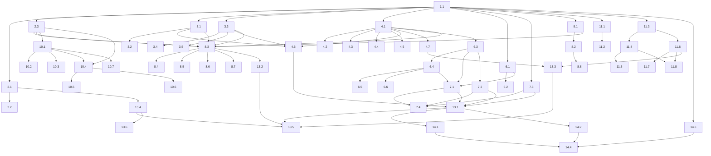

# Implementation Plan: Real Estate Platform

## Overview

Dieser Plan setzt die im Design beschriebene Architektur inkrementell um: zuerst das gemeinsame Datenmodell und die Plattform-Bausteine (ConfigProvider, RunLogger), dann die austauschbare SearchProvider-/Store-Schicht, darauf die Backend-Lambdas hinter API Gateway (CDK), anschließend das Connector_Framework mit Normalizer/Validator/Registry, danach Crawler_Connector und Compliance_Checker, dann das Angular White-Label-Frontend, und zuletzt die IaC-Verdrahtung samt Scheduler/Step Functions sowie die Open-Source-Dokumentation und Lizenz.

Sprache: **TypeScript** (Backend-Lambdas, Connectors, AWS CDK) und **Angular/TypeScript** (Frontend), gemäß Design. Property-Based Tests werden mit **fast-check** (min. 100 Iterationen, `fc.assert(..., { numRuns: 100 })`) implementiert, je genau ein Test pro Property mit Tag-Kommentar im Format `Feature: real-estate-platform, Property N: ...`. Externe Abhängigkeiten (Store, HTTP, Uhr) werden in PBT durch In-Memory-Fakes und eine simulierte Uhr ersetzt.

Alle Correctness Properties (1–22) aus dem Design sind als optionale PBT-Sub-Tasks (`*`) nahe der jeweiligen Implementierung platziert.

## Tasks

- [ ] 1. Projektgerüst und gemeinsame Typen anlegen
  - Monorepo-Struktur anlegen: `packages/shared`, `packages/backend`, `packages/ingestion`, `packages/frontend`, `infra` (CDK)
  - Gemeinsames Paket mit TypeScript strict, ESLint, Jest/fast-check, Angular-Workspace initialisieren
  - `PropertyType`-Union und `Listing`-Interface (Felder/Wertebereiche) im `shared`-Paket definieren
  - `ApiError`-Interface (`code`, `message`, `field?`, `missingId?`) definieren
  - `SearchQuery`/`SearchResult`/`SearchProvider`-Interfaces definieren
  - _Requirements: 4.1, 3.3, 3.4_

- [ ] 2. Plattform-Bausteine: Konfiguration und Protokollierung
  - [ ] 2.1 ConfigProvider implementieren (`requireAll`, SSM/Secrets-Lader mit Start-Validierung)
    - Lädt benannte Werte; bricht bei fehlendem/leerem Pflichtwert mit maschinenlesbarem Fehler ab, der den Namen des fehlenden Werts nennt
    - Keine hartkodierten Endpunkte/Secrets; alle Werte extern
    - _Requirements: 9.3, 9.4, 11.1, 11.2_

  - [ ]* 2.2 Property-Test für Config-Start-Validierung schreiben
    - **Property 19: Config-Start-Validierung**
    - **Validates: Requirements 9.4, 11.2**

  - [ ] 2.3 RunLogger implementieren (Lauf-Protokoll + Zähler + Crawl-Protokoll)
    - Strukturierte Einträge für Start-/Endzeitpunkt, Quellenbezeichner, Ergebnisstatus; Zähler `imported/updated/rejected`; Crawl-Einträge mit URL, Compliance-Ergebnis+Grund, Zeitstempel (Datum/Uhrzeit/Zeitzone)
    - _Requirements: 11.5, 5.8, 6.6_

- [ ] 3. Listing-Validierung und Normalisierung (Kernlogik)
  - [ ] 3.1 ListingValidator implementieren
    - Prüft Vorhandensein aller Pflichtfelder und Einhaltung jedes Wertebereichs/jeder Werteliste; liefert bei Fehler das betroffene Feld
    - _Requirements: 4.1, 4.2_

  - [ ]* 3.2 Property-Test für Listing-Validierung schreiben
    - **Property 7: Listing-Validierung vor Speicherung**
    - **Validates: Requirements 4.1, 4.2**

  - [ ] 3.3 Normalizer implementieren (Rohdatensatz → normalisiertes Listing)
    - Überführt heterogene Rohsätze unabhängig vom Quellformat in das einheitliche Listing-Modell; setzt `source` und `lastImportedAt`
    - _Requirements: 5.5, 4.5_

  - [ ]* 3.4 Property-Test für Normalisierung schreiben
    - **Property 11: Normalisierung vor Speicherung**
    - **Validates: Requirements 5.5**

  - [ ]* 3.5 Property-Test für Herkunfts-/Audit-Felder schreiben
    - **Property 10: Herkunfts- und Audit-Felder werden gesetzt**
    - **Validates: Requirements 4.5**

- [ ] 4. SearchProvider-Schicht und Listing_Store (DynamoDB-Default + Suchlogik)
  - [ ] 4.1 In-Memory-SearchProvider-Referenzimplementierung schreiben
    - Konjunktive Filterung, deterministische Ordnung `(price ASC, id ASC)`, opaker `pageToken` (base64 `{lastPrice,lastId}`), `pageSize`-Begrenzung, `getById`, `upsert` als vollständiger Ersatz
    - Dient als Default-Provider für kleine Datenmengen und als Fake für PBT
    - _Requirements: 1.1, 1.2, 1.3, 1.4, 11.3, 4.4_

  - [ ]* 4.2 Property-Test für konjunktive Filterung schreiben
    - **Property 1: Konjunktive Filterung**
    - **Validates: Requirements 1.1, 1.2**

  - [ ]* 4.3 Property-Test für Paginierungsgrenze und Folgeseiten-Token schreiben
    - **Property 2: Paginierungsgrenze und Folgeseiten-Token**
    - **Validates: Requirements 1.3, 11.3**

  - [ ]* 4.4 Property-Test für deterministische, totale Paginierungsordnung schreiben
    - **Property 3: Deterministische, totale Paginierungsordnung**
    - **Validates: Requirements 1.4**

  - [ ]* 4.5 Property-Test für Upsert-Idempotenz und vollständige Aktualisierung schreiben
    - **Property 9: Upsert-Idempotenz und vollständige Aktualisierung**
    - **Validates: Requirements 4.4**

  - [ ] 4.6 DynamoDB-SearchProvider implementieren (`Listings`-Tabelle)
    - `GetItem` by `id`, `PutItem` als vollständiger Ersatz, Query mit deterministischer Sortierung und Cursor-Paginierung über `pageToken`
    - _Requirements: 2.1, 4.4, 1.3, 1.4_

  - [ ] 4.7 Optionalen OpenSearch-SearchProvider implementieren (konfigurierbar)
    - Mehrfach-Range-Filter mit UND-Verknüpfung, identische `(price, id)`-Ordnung und Cursor-Paginierung; via Konfiguration gegen den DynamoDB-Default austauschbar
    - _Requirements: 1.1, 1.2, 1.3, 1.4_

- [ ] 5. Checkpoint - Kernlogik validieren
  - Ensure all tests pass, ask the user if questions arise.

- [ ] 6. Domänen-Services und Eingabevalidierung
  - [ ] 6.1 InputValidator für Such- und Detailanfragen implementieren
    - Validiert Filter-Syntax, Wertebereiche/Enums und `min<=max` (Preis/Fläche); validiert Listing-id (leer/ungültig); liefert `ApiError` mit betroffenem Feld, ohne die Suche auszuführen
    - _Requirements: 1.5, 1.6, 3.5, 2.3_

  - [ ]* 6.2 Property-Test für Filter-Eingabevalidierung schreiben
    - **Property 4: Filter-Eingabevalidierung lehnt ungültige Werte ab**
    - **Validates: Requirements 1.5, 1.6, 3.5**

  - [ ] 6.3 SearchService und ListingService implementieren
    - SearchService delegiert an SearchProvider (konjunktiv, paginiert); ListingService liefert vollständiges Listing oder 404 mit `missingId`
    - _Requirements: 1.1, 1.7, 2.1, 2.2_

  - [ ] 6.4 ResponseSerializer implementieren (schema-konforme Serialisierung + einheitliches Fehlerschema)
    - Antwortfelder/-typen stimmen mit dem API_Schema-Listing-Modell überein; jede Fehlerantwort nutzt `ApiError` mit nicht-leerem `code` + `message`
    - _Requirements: 3.3, 3.4_

  - [ ]* 6.5 Property-Test für Antwort-Schema-Konformität schreiben
    - **Property 5: Antwort-Schema-Konformität**
    - **Validates: Requirements 3.3**

  - [ ]* 6.6 Property-Test für einheitliche Fehlerstruktur schreiben
    - **Property 6: Einheitliche Fehlerstruktur**
    - **Validates: Requirements 3.4**

- [ ] 7. Backend-Lambdas und API-Controller
  - [ ] 7.1 RequestController und SearchQuery-Lambda (`GET /listings`) implementieren
    - Verdrahtet InputValidator → SearchService → ResponseSerializer; 400 bei ungültigem Filter, 200 + `[]` bei keinen Treffern, 503 bei Downstream-Fehler/Timeout (>10 s)
    - _Requirements: 1.1, 1.5, 1.6, 1.7, 11.3, 9.5, 9.6_

  - [ ] 7.2 GetListing-Lambda (`GET /listings/{id}`) implementieren
    - 400 bei leerer/ungültiger id, 404 mit `missingId`, Timeout-Fehler wenn >2 s
    - _Requirements: 2.1, 2.2, 2.3, 2.4, 11.4_

  - [ ] 7.3 Discovery-Lambda (`GET /openapi.json`) implementieren
    - Liefert validiertes OpenAPI-Dokument, das alle Endpunkte, Parameter (Datentyp, Pflicht/optional, Wertebereiche/Enums) und das Listing-Modell beschreibt
    - _Requirements: 3.1, 3.2_

  - [ ]* 7.4 Unit-/Schema-Tests für die Lambdas schreiben
    - Leere Trefferliste → 200 + `[]` (Req 1.7); OpenAPI-Dokument gegen Schema validieren (Req 3.1, 3.2); 404-/400-Fehlerfälle
    - _Requirements: 1.7, 2.2, 2.3, 3.1, 3.2_

- [ ] 8. Connector_Framework und Registry
  - [ ] 8.1 Connector-Schnittstelle und ConnectorContext definieren
    - `type`, `initialize`, `run`, `reportStatus`; `ConnectorStatus` mit `state/imported/updated/rejected`; `emit(raw)` reicht an Normalizer→Validator→Store
    - _Requirements: 5.1_

  - [ ] 8.2 ConnectorRegistry (Registrierung per Konfiguration, ohne Kern-Änderung) implementieren
    - Bindet Connectors über Typ + Modulname aus der Konfiguration ein; Kern kennt nur das Connector-Interface
    - _Requirements: 5.1, 5.2_

  - [ ] 8.3 ConnectorFramework-Ablaufsteuerung implementieren
    - Validiert Connector-Konfiguration; führt `initialize`→`run` aus; je Rohsatz Normalizer→ListingValidator→Upsert bzw. Abweisung+Protokoll; protokolliert `imported/updated/rejected`; lehnt ungültige Konfiguration ab (ruft `run` nicht auf)
    - _Requirements: 5.3, 5.4, 5.5, 5.6, 5.8, 4.3_

  - [ ]* 8.4 Property-Test für ungültige Connector-Konfiguration schreiben
    - **Property 12: Ungültige Connector-Konfiguration wird abgelehnt**
    - **Validates: Requirements 5.4**

  - [ ]* 8.5 Property-Test für Abweisung ohne Datenbestandsänderung schreiben
    - **Property 8: Abweisung lässt den Datenbestand unverändert**
    - **Validates: Requirements 4.3, 5.6**

  - [ ]* 8.6 Property-Test für Lauf-Zähler-Buchhaltung schreiben
    - **Property 13: Lauf-Zähler-Buchhaltung**
    - **Validates: Requirements 5.8**

  - [ ]* 8.7 Property-Test für Vollständigkeit des Lauf-Protokolls und Herkunftszuordnung schreiben
    - **Property 18: Vollständigkeit des Lauf-Protokolls und Herkunftszuordnung**
    - **Validates: Requirements 11.5**

  - [ ]* 8.8 Unit-Test für Connector-Registrierung schreiben
    - Dummy-Connector via Registry-Konfiguration → Framework ruft `initialize/run/reportStatus`
    - _Requirements: 5.1, 5.2, 5.3_

- [ ] 9. Checkpoint - Ingestion-Kern validieren
  - Ensure all tests pass, ask the user if questions arise.

- [ ] 10. Compliance_Checker und Crawler_Connector
  - [ ] 10.1 ComplianceChecker implementieren (Erlaubnisliste, robots.txt, Pfadregeln)
    - Prüft VOR jedem Abruf: Erlaubnisliste (sonst kein Netzzugriff), robots.txt (Timeout 10 s), Pfadverbote; liefert `ComplianceDecision{allowed, reason, checkedAt}`; Default-deny wenn nicht bestätigbar
    - _Requirements: 6.1, 6.2, 6.3, 6.4, 6.7, 11.6, 11.7_

  - [ ]* 10.2 Property-Test für robots.txt-Pfadverbot schreiben
    - **Property 14: robots.txt-Pfadverbot wird respektiert**
    - **Validates: Requirements 6.3**

  - [ ]* 10.3 Property-Test für Compliance-Gate (Default-deny) schreiben
    - **Property 17: Compliance-Gate (Default-deny)**
    - **Validates: Requirements 6.1, 6.4, 6.7, 11.6, 11.7**

  - [ ] 10.4 CrawlerConnector implementieren (Compliance-Gate + Rate-Limiting + Protokoll)
    - Abruf nur bei `allowed === true`; Mindestwartezeit `1/rate` s pro Zielseite (0,1–100 req/s, simulierte Uhr für Tests); protokolliert je Zielseite URL, Compliance-Ergebnis+Grund, Zeitstempel
    - _Requirements: 6.5, 6.6, 11.6_

  - [ ]* 10.5 Property-Test für Einhaltung der Abrufrate schreiben
    - **Property 15: Einhaltung der Abrufrate**
    - **Validates: Requirements 6.5**

  - [ ]* 10.6 Property-Test für Vollständigkeit des Crawl-Protokolls schreiben
    - **Property 16: Vollständigkeit des Crawl-Protokolls**
    - **Validates: Requirements 6.6**

  - [ ]* 10.7 Unit-Test für robots.txt-Timeout/Fehler schreiben
    - robots.txt-Abruf >10 s oder Fehler → kein Abruf, Grund im Crawl-Protokoll
    - _Requirements: 6.2_

- [ ] 11. Angular White-Label-Frontend
  - [ ] 11.1 ThemeConfigLoader (`APP_INITIALIZER`) und ThemeService implementieren
    - Lädt `theme-config.json` vor App-Start; validiert je Wert; gültig→übernehmen, sonst dokumentierter Default + Fehlerprotokoll; setzt CSS-Custom-Properties; liefert immer vollständiges ThemeModel
    - _Requirements: 8.1, 8.3, 8.4, 8.5_

  - [ ]* 11.2 Property-Test für Theming-Resolve-Totalität schreiben
    - **Property 22: Theming-Resolve-Totalität**
    - **Validates: Requirements 8.1, 8.3, 8.4, 8.5**

  - [ ] 11.3 ApiClient implementieren
    - Ruft Search_API; 10-s-Timeout; liefert Fehler/Erfolg strukturiert zurück
    - _Requirements: 7.3, 7.7_

  - [ ] 11.4 SearchFormComponent implementieren (reaktive Formulare, clientseitige Validierung)
    - Filterfelder mit Grenzen (Preis 0–100.000.000, Zimmer 1–50, Fläche 1–100.000, Typ, Ort); bei ungültig/inkonsistent: kein API-Call, Feld benennen, Eingaben erhalten
    - _Requirements: 7.1, 7.2, 7.7_

  - [ ]* 11.5 Property-Test für Frontend-Filtervalidierung schreiben
    - **Property 20: Frontend-Filtervalidierung erhält Eingaben**
    - **Validates: Requirements 7.2**

  - [ ] 11.6 ResultListComponent und ListingDetailComponent implementieren
    - Ergebnisliste: ≤50 Listings mit Ort/Preis/Zimmer/Fläche/Typ; "keine Ergebnisse"-Hinweis; Detailansicht mit vollständigen Feldern
    - _Requirements: 7.3, 7.4, 7.5, 7.6_

  - [ ]* 11.7 Property-Test für vollständiges Listing-Rendering schreiben
    - **Property 21: Frontend-Listing-Rendering ist vollständig**
    - **Validates: Requirements 7.4**

  - [ ]* 11.8 Unit-Tests für Frontend-Komponenten schreiben
    - Suchformular rendert alle Filterfelder (7.1); Ergebnisliste ≤50 (7.3); Detailauswahl (7.5); "keine Ergebnisse" (7.6); Fehler/Timeout-Anzeige mit Werterhalt (7.7)
    - _Requirements: 7.1, 7.3, 7.5, 7.6, 7.7_

- [ ] 12. Checkpoint - Anwendungsschichten validieren
  - Ensure all tests pass, ask the user if questions arise.

- [ ] 13. Infrastruktur-als-Code (AWS CDK) und Verdrahtung
  - [ ] 13.1 Daten- und API-Stacks definieren (DynamoDB, API Gateway REST, Lambdas)
    - `Listings`-Tabelle; API Gateway mit Request-/Modell-Validierung gegen OpenAPI an der Kante; SearchQuery/GetListing/Discovery-Lambdas integrieren; Antwort <5 s
    - _Requirements: 9.1, 9.2, 1.5, 1.6, 3.5_

  - [ ] 13.2 Ingestion-Stack definieren (EventBridge Scheduler, Step Functions, Connector-Lambda)
    - Zeitgesteuerte Läufe aus Konfiguration; pro Connector getrennte Step-Functions-Ausführung mit Zeitlimit (Default 300 s), sodass ein Timeout nur den betroffenen Connector beendet
    - _Requirements: 5.7, 11.1_

  - [ ] 13.3 Frontend-Hosting-Stack und optionalen OpenSearch-Stack definieren
    - S3 + CloudFront für SPA; `theme-config.json` separat mit `no-cache`-Policy; OpenSearch-Provider per Konfiguration aktivierbar
    - _Requirements: 8.2, 1.1_

  - [ ] 13.4 Konfigurations-Verdrahtung (SSM/Secrets) und Downstream-Timeouts integrieren
    - Alle Werte extern via ConfigProvider; Downstream-Timeout 10 s → 503; keine Teilpersistenz bei Fehlern
    - _Requirements: 9.3, 9.5, 9.6, 11.1_

  - [ ]* 13.5 CDK-Snapshot-/Assertion- und Integrationstests schreiben
    - `cdk synth` erfolgreich; API-Gateway-Validierung aktiv, Scheduler/Store/Hosting vorhanden; Downstream nicht erreichbar → 503 ohne Persistenz; Detailabruf <2 s / Timeout; API <5 s; Connector-Zeitlimit isoliert; Theme-Reload <5 s
    - _Requirements: 9.1, 9.2, 9.5, 9.6, 2.1, 2.4, 11.4, 5.7, 8.2_

  - [ ]* 13.6 Statische Prüfung auf externe Konfiguration schreiben
    - Keine hartkodierten Endpunkte/Secrets; alle Werte extern bezogen
    - _Requirements: 11.1_

- [ ] 14. Open-Source-Dokumentation und Lizenz
  - [ ] 14.1 Installations- und Fehlerbehebungsdokumentation schreiben
    - Voraussetzungen + reproduzierbare, nummerierte Deploy-Schritte (ein Befehl, keine Konsolenschritte); Behebungsschritte für dokumentierte Fehlerfälle
    - _Requirements: 10.1, 10.2, 9.2_

  - [ ] 14.2 API-, Connector-Erweiterungs- und Theming-Dokumentation schreiben
    - API-Doku mit je einem vollständigen Request-/Response-Beispiel pro Endpunkt; Connector-Doku (Schnittstelle, Pflichtoperationen, Registrierung, Beispiel); Theming-Doku (konfigurierbare Werte + zulässige Formate)
    - _Requirements: 3.6, 10.3, 10.5, 8.6_

  - [ ] 14.3 OSI-anerkannte Lizenzdatei hinzufügen
    - Eigenständige Lizenzdatei (OSI-anerkannt) im Repository-Wurzelverzeichnis
    - _Requirements: 10.4_

  - [ ]* 14.4 Artefaktprüfungen für Dokumentation und Lizenz schreiben
    - Existenz/Vollständigkeit von Installations-, Erweiterungs-, Theming-, API- und Connector-Doku je einzeln; OSI-Lizenzdatei vorhanden; Request/Response-Beispiel je Endpunkt
    - _Requirements: 3.6, 8.6, 10.1, 10.3, 10.4, 10.5_

- [ ] 15. Finaler Checkpoint - Alle Tests bestehen
  - Ensure all tests pass, ask the user if questions arise.

## Notes

- Mit `*` markierte Sub-Tasks sind optional (Property-, Unit-, Integrations-, Snapshot- und Artefakttests) und können für ein schnelleres MVP übersprungen werden.
- Jede Aufgabe referenziert konkrete (Unter-)Requirements zur Nachverfolgbarkeit.
- Die 22 Correctness Properties sind 1:1 als Property-Tests mit **fast-check** (min. 100 Iterationen) abgebildet und nahe der jeweiligen Implementierung platziert, damit Fehler früh erkannt werden.
- Jeder Property-Test trägt den Tag-Kommentar `Feature: real-estate-platform, Property N: ...` und nutzt In-Memory-Fakes sowie eine simulierte Uhr (u. a. Property 15), damit Iterationen schnell und ohne AWS-Kosten laufen.
- Checkpoints sichern inkrementelle Validierung an natürlichen Schichtgrenzen ab.

## Task Dependency Graph



```json
{
  "waves": [
    { "id": 0, "tasks": ["1.1"] },
    { "id": 1, "tasks": ["2.1", "2.3", "3.1", "3.3", "4.1", "8.1", "11.1", "11.3", "14.3"] },
    { "id": 2, "tasks": ["2.2", "3.2", "3.4", "3.5", "4.2", "4.3", "4.4", "4.5", "4.7", "6.1", "6.3", "8.2", "10.1", "11.2", "11.4", "11.6"] },
    { "id": 3, "tasks": ["4.6", "6.2", "6.4", "8.3", "10.2", "10.3", "10.4", "10.7", "11.5", "11.7", "11.8"] },
    { "id": 4, "tasks": ["6.5", "6.6", "7.1", "7.2", "7.3", "8.4", "8.5", "8.6", "8.7", "8.8", "10.5", "10.6", "13.3"] },
    { "id": 5, "tasks": ["7.4", "13.1", "13.2"] },
    { "id": 6, "tasks": ["13.4", "14.1", "14.2"] },
    { "id": 7, "tasks": ["13.5", "13.6", "14.4"] }
  ]
}
```
