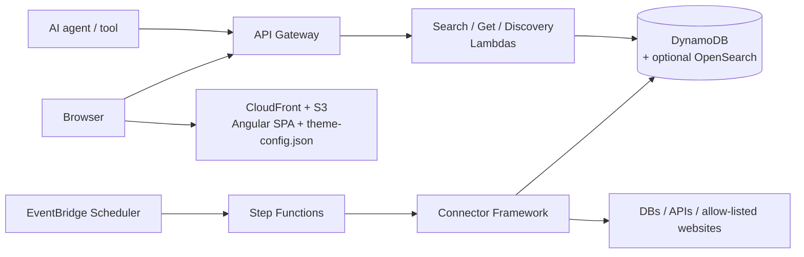

# OpenEstate

**An open-source, agent-first real estate search platform for AWS.**

OpenEstate gives you two things out of the box:

- **A search API built for AI agents** — structured filters, deterministic pagination, machine-readable errors and a self-describing OpenAPI schema, so LLM agents and tools can find properties without scraping HTML.
- **A white-label web frontend** — an Angular app whose logo, colors and texts come from a runtime config file. Rebrand it without touching code or rebuilding.

Listings come from **pluggable connectors**: existing databases, external APIs, or a **compliance-first web crawler** that only fetches pages that are allow-listed and permitted by `robots.txt`.

> **Status:** 🚧 Early stage — specification complete, implementation in progress. See the [Roadmap](ROADMAP.md).

## Why

Real estate data is scattered across portals, agency websites and legacy databases. Humans can click through them; AI agents can't do that reliably. OpenEstate normalizes listings into one data model and exposes them through an API designed to be consumed by machines first and humans second.

## Features

| Area | What you get |
| --- | --- |
| Agent-first API | `GET /listings` with conjunctive filters (city, price, rooms, area, type), cursor pagination, `GET /listings/{id}`, `GET /openapi.json` discovery |
| Consistent errors | Every error has a stable machine-readable `code`, a human-readable `message` and the offending `field` |
| Pluggable connectors | One small interface (`initialize` / `run` / `reportStatus`); add a source without changing core code |
| Legal crawling | Allow-list, `robots.txt` enforcement, per-site rate limits, full audit log — default-deny |
| White-labeling | Logo, colors and UI texts from `theme-config.json`; invalid values fall back to documented defaults |
| AWS-native | API Gateway, Lambda, DynamoDB (OpenSearch optional), S3 + CloudFront, EventBridge Scheduler, Step Functions |
| Infrastructure as Code | AWS CDK (TypeScript); one command to deploy into an empty account |

## Architecture



The full design (data model, interfaces, correctness properties) lives in [`.kiro/specs/real-estate-platform/`](.kiro/specs/real-estate-platform/).

## Tech stack

- **Language:** TypeScript everywhere (backend, connectors, infrastructure, frontend)
- **Frontend:** Angular (React would work too — the API is framework-agnostic)
- **Infrastructure:** AWS CDK
- **Testing:** Jest + [fast-check](https://github.com/dubzzz/fast-check) for property-based tests

## Repository layout

```
packages/
  shared/      # Listing model, schemas, API types, error codes
  core/        # Search and listing services, search providers, access guard
  api/         # Search API Lambdas (search, detail, discovery)
  mcp/         # MCP server for AI agents
  admin/       # Admin API and CLI
  ingestion/   # Connector framework, crawler, compliance checker
  frontend/    # Angular white-label app
  infra/       # AWS CDK app, seed data
  loadtest/    # Load tests
  devserver/   # DEV ONLY: local demo server (in-memory, local login), not deployed
docs/          # Installation, API, MCP, connector and configuration guides
```

## Documentation

See the [documentation index](docs/README.md): installation and troubleshooting, Search API, MCP
server, connectors, theming, translations, taxonomy and 3D tour providers.

## Getting started

Requires Node.js 22.22.3+ (Angular 22), an AWS account and a bootstrapped CDK environment. Full steps, configuration overrides and troubleshooting: [docs/installation.md](docs/installation.md).

```bash
npm ci
npm run build   # the FrontendStack uploads packages/frontend/dist/browser
npx cdk bootstrap aws://<account>/<region>   # once per account and region
npm run deploy --workspace @open-estate/infra -- -c env=dev
npm run seed --workspace @open-estate/infra -- --env dev   # sample listings
```

No AWS account at hand? `npm run dev` starts an in-memory local demo with sample data and a local
login (DEV ONLY): [docs/local-demo.md](docs/local-demo.md).

## Legal notice on crawling

The crawler connector is a tool, not a permission. It enforces `robots.txt`, allow-lists and rate limits, but **you** are responsible for making sure you are allowed to collect and republish data from a source (terms of service, copyright, database rights, GDPR and other applicable law). When in doubt, ask the site owner or use an official API.

## Contributing

Contributions are welcome — especially new connectors. Read [CONTRIBUTING.md](CONTRIBUTING.md) and our [Code of Conduct](CODE_OF_CONDUCT.md). Security issues: see [SECURITY.md](SECURITY.md).

## License

[Apache License 2.0](LICENSE) — © 2026 The OpenEstate Authors.
