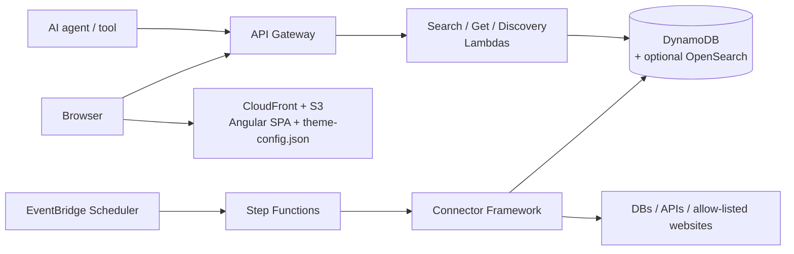

# OpenEstate

**An open-source, agent-first real estate search platform for AWS.**

OpenEstate gives you two things out of the box:

- **A search API built for AI agents** — structured filters, deterministic pagination, machine-readable errors and a self-describing OpenAPI schema, so LLM agents and tools can find properties without scraping HTML.
- **A white-label web frontend** — an Angular app whose logo, colors and texts come from a runtime config file. Rebrand it without touching code or rebuilding.

Listings come from **pluggable connectors**: existing databases, external APIs, or a **compliance-first web crawler** that only fetches pages that are allow-listed and permitted by `robots.txt`.

> **Status:** 🚧 Early stage — specification complete, implementation in progress. See the [Roadmap](ROADMAP.md).

## Why

Real estate data is scattered across portals, agency websites and legacy databases. Humans can click through them; AI agents can't do that reliably. OpenEstate normalizes listings into one data model and exposes them through an API designed to be consumed by machines first and humans second.

## Features

| Area | What you get |
| --- | --- |
| Agent-first API | `GET /listings` with conjunctive filters (city, price, rooms, area, type), cursor pagination, `GET /listings/{id}`, `GET /openapi.json` discovery |
| Consistent errors | Every error has a stable machine-readable `code`, a human-readable `message` and the offending `field` |
| Pluggable connectors | One small interface (`initialize` / `run` / `reportStatus`); add a source without changing core code |
| Legal crawling | Allow-list, `robots.txt` enforcement, per-site rate limits, full audit log — default-deny |
| White-labeling | Logo, colors and UI texts from `theme-config.json`; invalid values fall back to documented defaults |
| AWS-native | API Gateway, Lambda, DynamoDB (OpenSearch optional), S3 + CloudFront, EventBridge Scheduler, Step Functions |
| Infrastructure as Code | AWS CDK (TypeScript); one command to deploy into an empty account |

## Architecture



The full design (data model, interfaces, correctness properties) lives in [`.kiro/specs/real-estate-platform/`](.kiro/specs/real-estate-platform/).

## Tech stack

- **Language:** TypeScript everywhere (backend, connectors, infrastructure, frontend)
- **Frontend:** Angular (React would work too — the API is framework-agnostic)
- **Infrastructure:** AWS CDK
- **Testing:** Jest + [fast-check](https://github.com/dubzzz/fast-check) for property-based tests

## Repository layout

```
packages/
  shared/      # Listing model, schemas, API types, error codes
  core/        # Search and listing services, search providers, access guard
  api/         # Search API Lambdas (search, detail, discovery)
  mcp/         # MCP server for AI agents
  admin/       # Admin API and CLI
  ingestion/   # Connector framework, crawler, compliance checker
  frontend/    # Angular white-label app
  infra/       # AWS CDK app, seed data
  loadtest/    # Load tests
  devserver/   # DEV ONLY: local demo server (in-memory, local login), not deployed
docs/          # Installation, API, MCP, connector and configuration guides
```

## Documentation

See the [documentation index](docs/README.md): installation and troubleshooting, Search API, MCP
server, connectors, theming, translations, taxonomy and 3D tour providers.

## Run everything with one command

```bash
git clone https://github.com/CuriousExile/open-estate.git && cd open-estate
./run-everything.sh
```

That's all. It installs dependencies, lints, type-checks, builds, runs every test, synthesizes all
CDK stacks and smoke-tests the local demo (Search API, MCP server, Management API, login), then
prints `PASS` / `FAIL` / `SKIP` per step and `RESULT: OK` or `RESULT: FAILED`. The exit code is 0
only if no step failed. Logs are in `logs/run-everything/<step>.log`, the summary is in
`logs/run-everything/summary.md`.

- **No AWS needed.** Only the e2e tests against a deployed stack need AWS; they are reported as
  `SKIP`.
- **No Node.js setup needed.** If Node.js is missing or older than required, the script downloads
  the version pinned in `.nvmrc` (checksum-verified) into `.tools/` and uses it for this run. Nothing
  is installed system-wide.
- **Docker is optional.** With Docker running, the DynamoDB Local / OpenSearch integration tests run
  too; without it they are `SKIP`. Use `--no-docker` to skip them anyway.
- `./run-everything.sh --quick` runs only install, lint and the quick tests (about a minute).
- Needs bash, curl and tar: macOS or Linux. On Windows use WSL.

## Getting started without AWS

You don't need an AWS account, AWS credentials or Docker to build, test or run OpenEstate.
AWS is only needed to deploy it. Requires Node.js 22.22.3+ or 24.15+ (`nvm use` picks up
`.nvmrc`; `./run-everything.sh` fetches it for you).

```bash
npm ci
npm run build   # TypeScript packages + Angular SPA
npm test        # quick test tier, offline (see "Testing" below)
npm run dev     # local demo: SPA, Search API, MCP server, Management API, in memory
```

`npm run dev` serves the SPA at <http://127.0.0.1:4200> and the APIs at `http://127.0.0.1:4310`
(`/api/listings`, `/mcp`, `/management`), with demo data and a password-less local login (DEV
ONLY, never expose it): [docs/local-demo.md](docs/local-demo.md). On Node 20 only the backend runs:
`npm run dev:server`.

| Works offline                                   | Needs AWS                                  |
| ----------------------------------------------- | ------------------------------------------ |
| Build, lint, unit and property tests            | `npm run deploy`, `npm run seed`           |
| `npm run synth` (synthesizes every CDK stack)   | `npm run test:e2e` (a deployed stack)      |
| Local demo (`npm run dev`, `npm run dev:server`) | Cognito login, CloudWatch, real S3 media  |
| `npm run test:integration` (needs Docker)       |                                            |

## Deploying to AWS

Requires an AWS account and a bootstrapped CDK environment. Full steps, configuration overrides and
troubleshooting: [docs/installation.md](docs/installation.md).

```bash
npm ci
npm run build   # the FrontendStack uploads packages/frontend/dist/browser
npx cdk bootstrap aws://<account>/<region>   # once per account and region
npm run deploy --workspace @open-estate/infra -- -c env=dev
npm run seed --workspace @open-estate/infra -- --env dev   # sample listings
```

## Testing

Tests are split into two tiers and into functional areas, so you don't have to run the full
suite for every small change.

| Command                       | What runs                                                         | When                    |
| ----------------------------- | ----------------------------------------------------------------- | ----------------------- |
| `npm test`                    | Quick tier: every area except `infra`, property tests capped at 10 runs | After each change |
| `npm run test:<area>`         | One area (quick tier)                                             | While working in it     |
| `npm test -- <path or name>`  | Single files, e.g. `npm test -- search-service`                   | Tight loop              |
| `npm run test:full`           | Everything, property tests at full run counts (CI runs this)      | Before a commit / PR    |
| `npm run verify`              | Lint, build, test typecheck, full tests, synth                    | Final check             |

Areas: `shared`, `search` (search and read model, Search API, MCP), `management` (agencies,
listing versions, Management and Admin API), `ingestion` (connectors, crawler, import pipeline),
`platform` (config, observability, dev server, load test), `frontend`, `infra` (CDK stacks,
full tier only). The quick tier also skips a few slow suites that a faster check already covers,
listed with their reason in `FULL_ONLY` in [`jest.config.js`](jest.config.js).
`OPEN_ESTATE_TEST_TIER=full` switches any command to the full tier, for example
`OPEN_ESTATE_TEST_TIER=full npm run test:search`. Details:
[CONTRIBUTING.md](CONTRIBUTING.md#tests).

## Legal notice on crawling

The crawler connector is a tool, not a permission. It enforces `robots.txt`, allow-lists and rate limits, but **you** are responsible for making sure you are allowed to collect and republish data from a source (terms of service, copyright, database rights, GDPR and other applicable law). When in doubt, ask the site owner or use an official API.

## Contributing

Contributions are welcome — especially new connectors. Read [CONTRIBUTING.md](CONTRIBUTING.md) and our [Code of Conduct](CODE_OF_CONDUCT.md). Security issues: see [SECURITY.md](SECURITY.md).

## License

[Apache License 2.0](LICENSE) — © 2026 The OpenEstate Authors.
