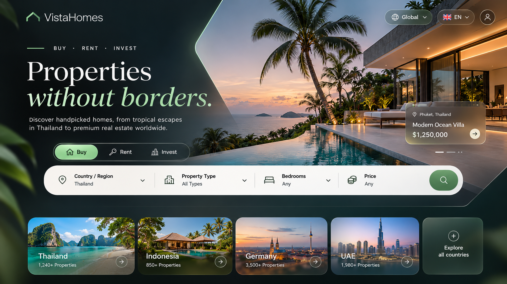

# Visual design reference

`visual-reference.png` defines the look and feel of the Angular frontend. It is a style reference, not a feature mockup: which elements exist is decided by the [specification](../../.kiro/specs/real-estate-platform/), not by this image. "VistaHomes" is a placeholder brand.

## Style direction

- **Mood:** premium, calm, image-led. Large hero photography, generous whitespace, few but strong accents.
- **Colors:** deep forest green / near-black background, soft mint-green accent for highlights and primary actions, white and off-white for text and surfaces.
- **Typography:** large serif display headline with an italic accent line; clean sans-serif for UI text; small, widely letter-spaced uppercase labels.
- **Surfaces:** frosted-glass cards with subtle borders and blur over imagery; strong corner radius; pill-shaped controls.
- **Search:** one wide, light, pill-shaped search bar with labelled segments (icon, label, current value) and a round primary search button.
- **Controls:** segmented pill toggles with a filled active state; outlined pill dropdowns (e.g. language switcher) on dark backgrounds.
- **Cards:** image tiles with dark gradient overlay, title and meta text bottom-left, round arrow button bottom-right.

These map to the white-label defaults in `theme-config.json` (colors, logo, texts). Anything a deployer should be able to change belongs in the theme config, not in component styles.
